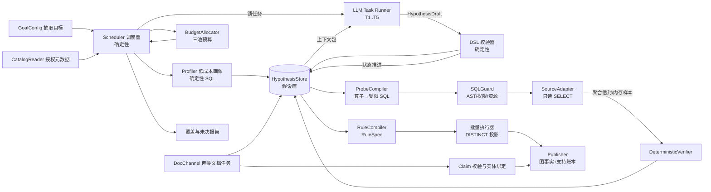
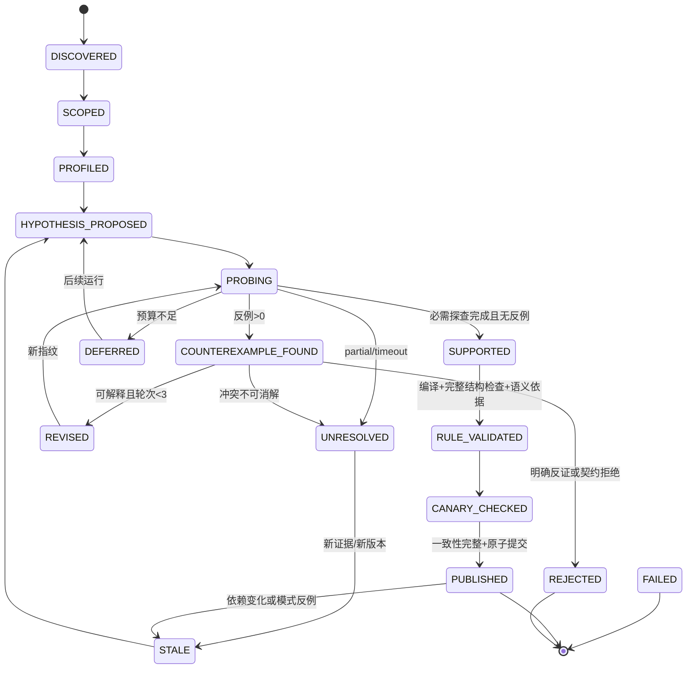
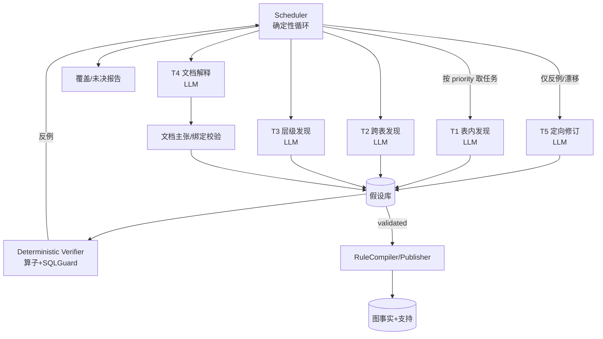

# 轻量知识图谱：结构发现工作流详细设计

版本：v1.0，2026-10-17。本文是 [SDD](SDD.md) 中发现工作流的实施基线，细化假设契约、算子、状态机、预算、层级算法与验收。文中的代码、SQL 和夹具目录是待实现设计；本轮没有连接客户数据库或调用抽取模型，不能把文档检查视为运行验收。

对应需求：US-07、US-08、US-09、US-10、US-11、US-12、US-15、US-16、US-18。对应设计：SDD §6（工作流）、§7（列组与身份）、§8（层级）、§9（规则与算子）、§10（文档）。与 SDD 冲突时，以 SDD 的数据保留边界、安全策略与输出契约优先，本文只做细化。

路径约定：`route2/...`、`xiaomeng/...` 是复用审计中的旧项目路径；`lightgraph/...` 是待实现模块和测试目录。旧代码定位仅用于迁移参考，实际迁移前需核对版本，不能作为新系统已实现的证明。规范优先级：SDD 的安全、身份、图事实和发布契约优先；本文维护发现任务、算子细节和错误码；US 维护验收编号，实施计划维护执行顺序。

## 0. 交付项与章节映射

| 交付项 | 章节 | 关键产物 |
| --- | --- | --- |
| (a) 假设 DSL | §3 | `Hypothesis` JSON Schema、六种载荷、证据等级、状态 |
| (b) 探查算子目录 | §4 | 11 个算子 + 信封 + SQL 模板 + 成本 |
| (c) 发现状态机 | §5 | 状态表、转移守卫、持久化契约、mermaid |
| (d) 预算分配器 | §6 | 三池预算、优先级公式、停止/延期规则 |
| (e) LLM 任务契约 | §7 | 输入包/输出 schema/修订循环/3 个中文 prompt |
| (f) RuleSpec 与执行 | §8 | YAML、编译模板、批量、去重、可解释 |
| (g) 宽表层级算法 | §9 | 六阶段算法、伪代码、用户样例走查、冲突分类 |
| (h) 分工与最小工作流 | §10 | 确定性边界、调用次数、调度伪代码 |
| (i) 夹具与验收 | §11 | 18 张表（t01–t18）、装置、反例矩阵、指标阈值 |
| (j) 复用/改造映射 | §12 | path:line 清单、必改点 |
| 附录 | §13–§15 | 错误码、阈值、实施顺序 |

通用约定：

- SQL 全部是**模板**，方言无关。`:name` 是驱动绑定参数；`<ident>` 是目录签发的标识符（编译器引用，不接受模型文本）；`<scope>` 是预编译的作用域条件。方言差异由 `CapabilityManifest` 决定算子是否可编译（SDD §4.1）。
- 源库返回的原始行、样本、DISTINCT 结果、逐行投影、值哈希列表与模型请求/响应，只能停留在受控内存。存储边界按 SDD §3：经过白名单校验的聚合计数、规则、元数据、派生说明及受控图结果才可持久化；候选必须显式标candidate/unresolved且不能进入accepted视图；改名为 evidence、cache 或 checkpoint 不能改变这条边界。
- 输入可以是 Gauss 元数据与按需实例数据，也可以是用户上传的 Excel，且都支持数据说明和分析知识两类 Markdown。Excel 原始上传文件按客户输入政策管理，解析结果遵守相同内存边界，不产生第二份落盘数据副本。
- 本文“全范围验证”指声明的一致性范围内完成了某一结构检查；它不代表全库覆盖，也不自动证明业务含义。
- 成本单位 CU（Cost Unit）见 §6.1；LLM 调用按"call + token 预留"两维计。
- 术语链：`目标(goal) → 假设(hypothesis) → 探查(probe) → 验证(validation) → 规则(rule) → 图事实(graph fact) → 支持账本(support)`。

## 1. 总览

### 1.1 五条设计原则

1. **假设先行，探查有界。** 每个 LLM 调用必须绑定一个假设或一个明确的未决问题；不允许"先看看数据"式探索。探查算子由程序编译，LLM 只能选算子名和受限参数（SDD §4.2）。
2. **规则化执行，逐行不走模型。** 模型只产出结构假设；取值变化由 RuleSpec 批量执行。千万事实行与 LLM 调用数解耦。
3. **确定性优先。** 能用一条确定性规则判定的结论，不交给模型；模型输出永远不能直接变成图事实，必须过验证器。
4. **预算守恒、分池预留。** 启动新假设前先预留必做验证的最低成本（§6.4）；预算耗尽时输出覆盖缺口与延期队列。DB、LLM、时间/内存分别限额，比例只是试点调度参数。
5. **不以猜测消解冲突。** 同码异义、环、编码映射缺失和 schema 矛盾影响的部分进入 `unresolved`。多父本身不一定错误：已确认允许 DAG 的分类体系可保留全部合法父边；未知体系不挑父。

### 1.2 组件与调用关系



职责边界（与 SDD §6.2 一致，这里落到进程角色）：

| 角色 | 实现性质 | 可以 | 禁止 |
| --- | --- | --- | --- |
| Scheduler | 程序 | 选下一个任务、分配预算、终止 | 读源行、改规则语义 |
| Profiler / Verifier | 程序 | 执行注册算子、比较计数、记录结构覆盖和规则守卫 | 用统计通过替代业务语义证据 |
| LLM Task Runner | 模型 | 提假设、写 rationale、请求探查、引用证据 | 发 SQL、发布事实、编造编码映射 |
| RuleCompiler / Publisher | 程序 | 编译 RuleSpec、去重、写图与支持 | 绕过验证记录发布 |

### 1.3 一次发现运行的边界

输入：`ExtractionGoal`（SDD §5.1）、授权对象范围、知识文档 ID 列表、预算上限、可选用户提示（已确认映射，作为 `created_by=user` 的假设进入，仍需验证）。
输出：已验证 RuleSpec、仅抽样支持的候选假设、图事实变更、未决与冲突报告、覆盖统计。仅抽样候选不得通过 RuleCompiler 自动发布数据事实。**不输出**源行、样本文件、含样本的请求/响应或本地数据副本。
终止态：`COMPLETED`（目标必做检查均完成，无未覆盖项）、`COMPLETED_WITH_GAPS`（已运行完可执行任务，仍有语义未决/不支持范围）、`PARTIAL`（因资源、超时或来源中断而未完成）、`FAILED`（配置、安全或不可恢复错误）。退出状态与结构覆盖、语义接受结果分别报告，不能只用一个“成功”布尔值代替。

## 2. 核心对象与持久化边界

### 2.1 对象关系

```text
Goal ──scopes──> TableRef ──has──> ColumnProfile（聚合）
                     │
                     └──candidates──> Hypothesis ──probes──> ProbeResult（聚合+内存样本）
                                          │                        │
                                          ├──revisions──> Hypothesis(revision+1)
                                          ├──validation──> ValidationRecord
                                          └──compiles──> RuleSpec ──runs──> RunBatch
                                                                       └──produces──> GraphFact + Support
```

### 2.2 持久化白名单

所有写入经 SDD 的 `Store/PersistencePolicy` 校验，表中的“允许”指经过按字段校验的派生对象，不是允许保存同名的完整工具返回。

| 对象 | 允许持久化 | 仅内存 / 禁止持久化 |
| --- | --- | --- |
| `ColumnProfile` | 计数、比例、长度范围、格式分类计数、统计是否估计 | top-k 具体值、原始频次行、业务数值分位点 |
| `Hypothesis` | 结构化列/规则引用、状态、依赖、经检查的不含源值解释 | 样本原句、模型自由输出、由样本生成的枚举或例外值列表 |
| `ProbeResult` | 算子、无值模板形状指纹、计数、覆盖、成本、状态码 | 返回行、反例值、实际绑定参数、值哈希列表 |
| `ValidationRecord` | 检查项、计数、覆盖和一致性证明引用、语义依据引用 | 原始证据行、任意 `strata` 值、样本文件或其路径 |
| `RuleSpec` | 经过验证的映射/谓词、少量语义判别常量及依据、预算、失效条件 | 原始值域、样本/异常值清单；未验模型输出 |
| `RunBatch` | 逻辑分区 token、完成状态、计数、发布版本 | 起止业务键、最后一行值、键范围哈希、逐行哈希列表 |
| `GraphFact/Support` | 通过输出和保留契约的目标实体/属性/边/主张及支持；candidate/unresolved与accepted分开 | 整行JSON、未选中字段、以“来源支持”为名保留原始行 |
| LLM 审计 | 任务 ID、无值包结构指纹、契约/模型版本、调用和 token 计数、校验码 | prompt、response、原文 delta、含业务值的请求/输出 hash |

数据说明仅保存经过校验的结构结论、规则适用范围与冲突分类；不得把观察样本改写进“说明”绕过禁存。源值可以成为图属性的前提，是它属于目标投影、通过属性校验并有独立支持。属性撤回、授权投影与图发布统一遵循 SDD §11–12。

运行结果可存客户指定的数据库或文件介质，逻辑内容如下；路径只是输出布局，不要求保存所有对象原文：

```text
runs/<run_id>/
  goal.yaml                # 目标与授权配置引用
  profiles.jsonl           # 白名单聚合计数
  hypotheses.jsonl         # 安全结构提案、状态和依赖
  probes.jsonl             # 无值探查审计
  validations.yaml         # 覆盖/一致性/检查结论
  rules.yaml               # 已验证规则
  graph_changes.jsonl      # 已接受图事实的发布 delta
  report.md                # 覆盖、未决、冲突分类、预算账
  budget.json              # 分池实际消耗与预留
```

`report.md` 固定报告：授权对象、已读元数据、已画像列组、全范围/分区结构验证、仅抽样假设、语义证据、未决与恢复提示、冲突计数、预算、数据保留自检。正式发布待提交区只容纳已验图事实；受控候选单独标状态保存，未验原始候选行不进入任何持久化暂存区。

## 3. (a) 假设 DSL

### 3.1 通用信封 JSON Schema（draft-07 子集）

```json
{
  "$schema": "http://json-schema.org/draft-07/schema#",
  "$id": "lightgraph/hypothesis/1.0",
  "type": "object",
  "additionalProperties": false,
  "required": ["hypothesis_id", "kind", "target", "claim", "status", "evidence_level",
               "created_by", "revision", "budget"],
  "properties": {
    "hypothesis_id": {"type": "string", "pattern": "^h_[0-9a-f]{16,32}$"},
    "kind": {"enum": ["column_group", "entity_key", "wide_hierarchy",
                      "reference", "discriminator", "exclusion"]},
    "target": {
      "type": "object", "additionalProperties": false,
      "required": ["source_id", "schema", "table", "columns"],
      "properties": {
        "source_id": {"type": "string"},
        "schema": {"type": "string"},
        "table": {"type": "string"},
        "partition": {"type": "string"},
        "columns": {"type": "array", "items": {"type": "string"}, "maxItems": 64}
      }
    },
    "claim": {"type": "object", "description": "须同时通过 kind 对应的封闭载荷 schema；不得只使用本信封作准入"},
    "status": {"enum": ["proposed", "probing", "supported", "counterexample",
                        "revised", "validated", "unresolved", "rejected",
                        "deferred", "stale"]},
    "evidence_level": {"enum": ["L0_declared", "L1_observed", "L2_sampled",
                                "L3_full_verified", "L4_published"]},
    "created_by": {"enum": ["llm", "rule", "user", "import"]},
    "confidence_band": {"enum": ["low", "medium", "high"]},
    "revision": {"type": "integer", "minimum": 1, "maximum": 3},
    "revision_of": {"type": ["string", "null"]},
    "rationale": {"type": "string", "maxLength": 1200},
    "scope": {
      "type": "object", "additionalProperties": false,
      "properties": {
        "namespace_columns": {"type": "array", "items": {"type": "string"}},
        "predicate_ref": {"type": "string"},
        "taxonomy": {"type": "string"},
        "version": {"type": "string"}
      }
    },
    "support": {"type": "array", "maxItems": 32, "items": {"$ref": "#/definitions/evidence_ref"}},
    "counterexamples": {"type": "array", "maxItems": 32, "items": {"$ref": "#/definitions/counterexample"}},
    "open_questions": {"type": "array", "items": {"type": "string"}, "maxItems": 12},
    "requested_probes": {"type": "array", "items": {"type": "string"}, "maxItems": 6},
    "budget": {
      "type": "object", "additionalProperties": false,
      "required": ["probe_calls_used", "db_cu_used", "llm_calls_used"],
      "properties": {
        "probe_calls_used": {"type": "integer", "minimum": 0},
        "db_cu_used": {"type": "number", "minimum": 0},
        "llm_calls_used": {"type": "integer", "minimum": 0},
        "llm_tokens_used": {"type": "integer", "minimum": 0}
      }
    },
    "priority_inputs": {
      "type": "object", "additionalProperties": false,
      "properties": {
        "goal_gain": {"type": "number", "minimum": 0, "maximum": 1},
        "info_gain": {"type": "number", "minimum": 0, "maximum": 1},
        "coverage_gain": {"type": "number", "minimum": 0, "maximum": 1},
        "risk": {"enum": ["low", "medium", "high"]}
      }
    },
    "created_at": {"type": "string"},
    "task_id": {"type": ["string", "null"]},
    "fingerprint": {"type": "string"}
  },
  "definitions": {
    "evidence_ref": {
      "type": "object", "additionalProperties": false,
      "required": ["kind"],
      "oneOf": [{"required": ["probe_id", "operator"]}, {"required": ["document_ref"]}, {"required": ["user_confirmation_ref"]}],
      "properties": {
        "probe_id": {"type": "string"},
        "operator": {"type": "string"},
        "kind": {"enum": ["declared", "observed", "checked", "document", "user"]},
        "counts": {"type": "object", "additionalProperties": {"type": "integer", "minimum": 0}},
        "artifact_ref": {"type": "string"},
        "user_confirmation_ref": {"type": "string"},
        "document_ref": {"type": "object", "additionalProperties": false, "required": ["document_id", "revision", "locator"], "properties": {"document_id": {"type": "string"}, "revision": {"type": "string"}, "locator": {"type": "string"}}}
      }
    },
    "counterexample": {
      "type": "object", "additionalProperties": false,
      "required": ["probe_id", "code", "count"],
      "properties": {
        "probe_id": {"type": "string"},
        "code": {"enum": ["fd_violation", "multi_valued_attribute", "null_key",
                          "same_code_diff_label", "same_label_diff_code",
                          "fill_mismatch", "multiple_parent", "cycle", "self_loop",
                          "gap_in_path", "code_series_mismatch", "label_conflict",
                          "reference_ambiguous", "reference_missing", "cross_level_same_code",
                          "same_label_diff_definition", "level_group_ambiguous", "level_count_conflict",
                          "code_format_conflict",
                          "schema_value_conflict", "document_conflict"]},
        "count": {"type": "integer", "minimum": 0},
        "strata_counts": {"type": "object", "additionalProperties": {"type": "integer", "minimum": 0}}
      }
    }
  }
}
```

信封 schema 只描述程序保存的共同字段，不是可独立使用的完整准入器。实现必须把它与 `kind` 对应的封闭载荷校验组合：六类载荷只允许 §3.5 列出的字段，所有嵌套对象 `additionalProperties=false`，禁止自由 `filter/SQL/expression`。`status/evidence_level/revision/budget` 只由程序填入，模型提交 §7.3 的 `ProposalBatch`，不能提交或提升这些状态。样例中的 YAML 载荷是结构示意；程序补齐共同字段后才形成完整 `Hypothesis`。

`scope.predicate_ref` 指向 SDD §9.3.1 已登记的受限谓词树；不存在的引用拒绝。模型看到的临时取值引用只能在当前内存上下文解引用；需要持久化为规则常量时，可以来自授权文档/配置，也可以是已经验证语义、带验证依据并通过保留白名单的少量判别常量。它属于规则输出，不能复制原始值域、样本或反例列表；自动发现不依赖人工预写映射。

### 3.2 通用字段语义

| 字段 | 语义 | 谁写 | 校验 |
| --- | --- | --- | --- |
| `hypothesis_id` | 稳定 ID = `h_` + hash(fingerprint) 前 24 位 | 程序 | 不可复用给不同指纹 |
| `kind` | 六类之一，决定 claim schema 与可用算子 | LLM/规则 | 枚举 |
| `target` | 来源+表+列白名单；列必须来自授权目录 | LLM | 越权列直接拒绝该提案 |
| `claim` | 结构化断言（§3.5）；禁止自然语言代替 | LLM | 各 kind 的 schema |
| `status` | 生命周期；只由状态机写（§5） | 程序 | 转移合法性表 |
| `evidence_level` | 当前最强证据等级（§3.3） | 程序 | 只能随 probe 结果上调，修订可降级 |
| `created_by` | 来源类型；`user` 提示仍需数据验证 | 调度器 | — |
| `confidence_band` | 模型自评，仅用于排序提示，**不作为接受门槛** | LLM | low/medium/high |
| `revision` | 1..3；设计最多 2 次修订（revision ≤3）；试点配置 1 次（revision ≤2）；超限 → `unresolved` | 程序 | 试点 1 次修订 |
| `support` | 证据引用；`probe_id` 必须真实存在 | LLM 提议、程序写入 | 悬空引用整条拒绝 |
| `counterexamples` | 反例分类与计数；**不存值** | 程序 | examples 只在内存 |
| `open_questions` | 待查问题，进入下一轮任务或未决报告 | LLM | ≤12 条 |
| `budget` | 该假设已消耗的预算 | 程序 | 超限则 `deferred` |
| `fingerprint` | hash(kind, 授权目录 ID, 安全 claim 结构, 规则/文档依赖) | 程序 | 只对可持久化结构去重，不哈希源样本或参数值 |

### 3.3 证据等级

| 等级 | 定义 | 谁能置位 | 允许的状态 |
| --- | --- | --- | --- |
| `L0_declared` | 来自列名/注释/文档/用户提示，未看数据 | 程序 | proposed |
| `L1_observed` | 至少一次聚合画像（计数/分布），无核验 | 程序 | probing/supported(弱) |
| `L2_sampled` | 分层样本支持，未做全范围/分区核验 | 程序 | supported |
| `L3_full_verified` | 声明一致性范围上的结构核验完整通过 | 程序 | validated；业务含义另查 semantic_evidence |
| `L4_published` | 已发布图事实且有支持账本；是发布记录，不比 L3 增加语义真实性 | 程序 | PUBLISHED（规则/发布外部状态） |

规则：`L3` 必须记录 `scan_scope`、逻辑分区 token、一致性证明、扫描量及其 measured/estimated/unknown 状态。仅抽样不得升级 L3；完整 5 项字典也可达到 L3，不设置“至少 30 项”前置门槛。结构等级、业务语义依据与发布状态分别存储；FD 成立不能证明该列是指标或两表是同一业务对象。

### 3.4 状态

`proposed → probing → supported | counterexample → revised → probing … → validated → published`；旁路：`unresolved`、`rejected`、`deferred`、`stale`。完整转移与守卫见 §5。

### 3.5 六种载荷

#### 3.5.1 `column_group`：一实体的编码/标签/别名/展示属性

```json
{
  "hypothesis_id": "h_7a1c05d2e8b44f10",
  "kind": "column_group",
  "target": {"source_id": "gauss_1", "schema": "finance", "table": "report_item_l2",
             "columns": ["tenant_id", "report_item_l2_code", "report_item_l2_sort_column",
                         "report_item_l2_cn_name", "report_item_l2_en_name"]},
  "claim": {
    "group_id": "report_item_l2_identity",
    "entity_kind_hint": "ReportItem",
    "members": [
      {"column": "tenant_id", "role": "namespace", "in_identity": true},
      {"column": "report_item_l2_code", "role": "identity_code", "in_identity": true},
      {"column": "report_item_l2_cn_name", "role": "label", "in_identity": false,
       "multi_value": false, "normalization": "keep_original"},
      {"column": "report_item_l2_en_name", "role": "alias", "in_identity": false,
       "multi_value": true, "normalization": "keep_original"},
      {"column": "report_item_l2_sort_column", "role": "display_order",
       "in_identity": false, "exclude_from_projection": true}
    ],
    "expected_entity_count_band": [10, 5000],
    "join_candidate": true,
    "notes": "展示排序列不属于本次目标投影，不建节点也不保存为属性"
  },
  "status": "proposed",
  "evidence_level": "L0_declared",
  "created_by": "llm",
  "revision": 1,
  "revision_of": null,
  "rationale": "四列共享 report_item_l2 前缀；code 为标识，cn/en 为标签与别名，sort 为数值展示列。需检验 tenant+code→cn_name 的函数依赖。",
  "scope": {"namespace_columns": ["tenant_id"], "taxonomy": "report_item_l2"},
  "support": [],
  "counterexamples": [],
  "open_questions": ["sort_column 是否对同一 code 稳定（若是则仅为展示顺序）"],
  "requested_probes": ["profile_column_group", "check_fd"],
  "budget": {"probe_calls_used": 0, "db_cu_used": 0, "llm_calls_used": 0},
  "priority_inputs": {"goal_gain": 0.9, "info_gain": 0.8, "coverage_gain": 0.7}
}
```

角色枚举统一为：`identity_code | namespace | label | alias | semantic_attribute | display_order | level_position | fact_value | relation_endpoint | discriminator | audit | unknown`。同一列在不同规则中可有不同角色；`in_identity` 显式，避免"删掉数值列再 DISTINCT"式误判（SDD §7.4）。

#### 3.5.2 `entity_key`：实体身份与单值/多值属性

```yaml
hypothesis_id: h_2b93c07a1f5d4e88
kind: entity_key
target: {source_id: gauss_1, schema: finance, table: report_item_l2,
         columns: [tenant_id, report_item_l2_code, report_item_l2_cn_name, report_item_l2_en_name, report_item_l2_sort_column]}
claim:
  group_id: report_item_l2_identity
  entity_kind_hint: ReportItem
  key_columns: [tenant_id, report_item_l2_code]
  level_policy: not_applicable           # 单列组不是层级
  attributes:
    single_valued: [report_item_l2_cn_name]
    multi_valued: [report_item_l2_en_name]
    display_only: [report_item_l2_sort_column]
  normalization: identity                 # 保留前导零、大小写；不做隐式 trim
  uniqueness_target: one_semantic_binding_per_namespace_key # 原始事实行可以重复
  expected_conflict_codes: [same_code_diff_label]
status: proposed
evidence_level: L0_declared
created_by: llm
revision: 1
rationale: 编码是业务标识；中英文名可为标签与别名；排序列不参与身份。
```

#### 3.5.3 `wide_hierarchy`：宽表 L1..Ln 层级

```yaml
hypothesis_id: h_9f40aa12c7d3b5e1
kind: wide_hierarchy
target: {source_id: gauss_1, schema: finance, table: report_tree_wide,
         columns: [l1_code, l1_cn_name, l1_en_name, l1_sort, l2_code, l2_cn_name, l2_en_name, l2_sort, l3_code, l3_cn_name, l4_code, l4_cn_name, l5_code, l5_cn_name]}
claim:
  group_id: report_tree_levels
  levels:
    - {position: 1, key: l1_code, label: l1_cn_name, alias: l1_en_name, display_order: l1_sort}
    - {position: 2, key: l2_code, label: l2_cn_name, alias: l2_en_name, display_order: l2_sort}
    - {position: 3, key: l3_code, label: l3_cn_name}
    - {position: 4, key: l4_code, label: l4_cn_name}
    - {position: 5, key: l5_code, label: l5_cn_name}
  repeat_policy: collapse_consecutive_equal_identity
  gap_policy: unresolved                 # 或缺层时 nearest_non_empty_ancestor（需证据）
  multiple_parent_policy: report_as_dag_candidate
  cycle_policy: reject_affected_edges
  code_relation: unknown                 # strict_prefix | set_inclusion | unknown
  ordering_evidence: [metadata_level_order, applicable_document_ref] # 待核验的依据引用，统计另存 ProbeResult
status: proposed
evidence_level: L0_declared
created_by: llm
revision: 1
rationale: 五组 lN_code/lN_cn_name 同构；尾层存在重复填充迹象。需先验证层级方向与填充模式，再生成边。
```

#### 3.5.4 `reference`：跨表引用（含复合作用域）

```yaml
hypothesis_id: h_4d77e0b9a2c16f30
kind: reference
target: {source_id: gauss_1, schema: finance, table: fact_expense, columns: [tenant_id, report_item_l2_code]}
claim:
  source_columns: [tenant_id, report_item_l2_code]
  target_entity: h_2b93c07a1f5d4e88        # 只允许引用已识别的列组/实体键
  target_columns: [tenant_id, report_item_l2_code] # 由 target_entity 的授权列组核对
  direction: source_to_target
  cardinality_hint: n_to_1
  condition_ref: null                    # 已登记谓词树 ID，不接受自由 SQL
  polymorphic_by: null
  require_full_coverage: false
  normalization: identity
status: proposed
evidence_level: L0_declared
created_by: llm
```

#### 3.5.5 `discriminator`：多态引用/分区语义

```yaml
hypothesis_id: h_5e18c4a7b9f02d61
kind: discriminator
target: {source_id: gauss_1, schema: finance, table: fact_expense, columns: [ref_kind, ref_code]}
claim:
  discriminating_column: ref_kind
  partitions:
    - {selector_ref: selector_report_item, applies_to_entity: h_2b93c07a1f5d4e88, source_value_column: ref_code}
    - {selector_ref: selector_metric, applies_to_entity: h_1c0f7d33aa84b2e9, source_value_column: ref_code}
  unpartitioned_rule_policy: reject       # 禁止把多态条件拆成不相关单列条件
  unknown_partition_policy: unresolved
status: proposed
evidence_level: L0_declared
created_by: llm
```

#### 3.5.6 `exclusion`：不进入语义投影的列及原因

```yaml
hypothesis_id: h_6a2d9e17c3b04f52
kind: exclusion
target: {source_id: gauss_1, schema: finance, table: report_item_l2,
         columns: [report_item_l2_sort_column, created_at, updated_by]}
claim:
  exclusions:
    - {column: report_item_l2_sort_column, reason: display_order, affects: [identity, projection]}
    - {column: created_at, reason: audit_metadata, affects: [identity, projection]}
    - {column: updated_by, reason: audit_metadata, affects: [identity, projection]}
  not_excluded: [report_item_l2_en_name]   # 别名要保留
  evidence_requirement: check_fd_or_display_order_probe
status: proposed
evidence_level: L0_declared
created_by: llm
```

排除是"从语义投影移除"，不是"删除列"：元数据图仍完整展示该列（SDD §11.2）。任何排除都要有原因与验证引用，报告可审计。

### 3.5.7 封闭载荷的判别规则

以下与§3.1信封共同构成准入契约；实现必须生成按kind判别的联合schema，不能只检查claim是object。每类只能使用自己的字段，所有嵌套对象封闭：

| kind | 必填字段 | 其他允许字段 / 限制 |
| --- | --- | --- |
| column_group | group_id, entity_kind_hint, members | expected_entity_count_band、join_candidate、notes；members 1～64，每项column/role/in_identity必填，multi_value/normalization/exclude_from_projection可选 |
| entity_key | group_id, key_columns, entity_kind_hint, attributes, normalization | level_policy、uniqueness_target、expected_conflict_codes；key_columns 1～16且无重复；attributes仅single_valued/multi_valued/display_only |
| wide_hierarchy | group_id, levels, repeat_policy, gap_policy, multiple_parent_policy, cycle_policy | code_relation、ordering_evidence；levels 2～16，每层position/key必填，label/alias/display_order可选；position不重复；策略值仅§3.5.3及已注册扩展 |
| reference | source_columns, target_entity, target_columns, direction, normalization | cardinality_hint、condition_ref、polymorphic_by、require_full_coverage；两端复合键长度一致，target_entity须授权 |
| discriminator | discriminating_column, partitions, unpartitioned_rule_policy, unknown_partition_policy | partitions 1～64；每项selector_ref/applies_to_entity/source_value_column必填；未知判别值不得默认为已知分区 |
| exclusion | exclusions, evidence_requirement | not_excluded；每项column/reason/affects必填，affects仅identity/projection；列不能同时排除与保留 |

策略值来源是SDD规则契约与注册表；未知枚举拒绝，不允许任意字符串降级为自然语言执行。notes/rationale/open_questions为受限解释文本，经无源值持久化检查后才保存；即使满足字数限制，也不能把样本写进去。T4的DocumentClaim不是结构Hypothesis，走SDD的主张契约。

### 3.6 程序校验器（`validate_hypothesis`）

按顺序执行，任一失败返回错误码（§13）与可读说明：

1. schema 校验（章节 3.1）；`additionalProperties=false`，类型严格。
2. `target` 的 source/schema/table **必须**在授权目录；`columns` 必须在表内（大小写按目录声明，不做猜测）。
3. claim 的源列必须属于 `target.columns`；跨表目标列必须属于 `target_entity` 指向的独立授权列组，不能误套源列白名单。层级每层 key/label/alias 均按已声明目录 ID 校验。
4. 按 kind 检查角色：实体列组至少一个 identity_code；排除/引用假设不要求重复声明 identity_code。display_order 不得 in_identity=true；别名可多值；参与身份的列不得被排除。
5. 证据引用可解析：`support[].probe_id` 存在于本运行；`document_ref` 指向已授权文档且 revision 匹配。
6. 指纹去重：同 `fingerprint` 已存在则合并（保留较早证据，追加 support），不新建修订。
7. 敏感列拦截：命中敏感形态（密钥/邮箱/电话）的列不得进入 LLM 输入包（沿用 `column_role_inference.py:40` 的 `_SENSITIVE_VALUE` 思路）。
8. 预算：`revision ≤ 3`（设计）/`≤ 2`（试点）、`llm_calls_used` 未超本任务配额。

设计要点：校验器只拒绝**该提案**，不整批失败；被拒项写入 `rejected[]` 供报告，不进入下一轮 prompt 的上下文（避免污染）。

### 3.7 指纹与去重

```python
def hypothesis_fingerprint(h):
    safe_claim = persistence_policy.validate_rule_structure(h.claim)
    shape = canonical_json({"kind": h.kind, "target_ids": h.target.catalog_ids,
                            "claim": safe_claim, "dependencies": h.dependency_ids})
    return digest(["hypothesis/1.0", shape])
```

同一安全结构指纹复用同一假设并追加合法证据；只有结构或依赖发生变化才创建 revision+1，并链接 revision_of。程序状态、计数、rationale 不进入指纹。含数据库返回值的请求只可在同一内存生命周期内比较，不写入持久化指纹。跨运行复用已验规则与安全结论，重新取需要的数据；不存在“凭请求哈希恢复旧响应”的路径。

## 4. (b) 探查算子目录

### 4.0 通用约定

所有算子使用同一内存信封。持久化对象由专门投影器生成，不能对整个对象调用 `asdict()/json.dump()`。

```python
ProbeRequest = {probe_id, hypothesis_id, operator, args, reservation_id}
ProbeResult = {probe_id, operator, status, safe_aggregates,
               ephemeral_batch, scan_scope, consistency_ref,
               scanned_rows, scanned_rows_kind, cost, elapsed_ms, warnings}
ProbeAudit = {probe_id, operator, template_shape_hash, safe_aggregates,
              scan_scope_token, consistency_ref, status, cost, elapsed_ms}
```

- `args` 按算子使用封闭 schema：授权目录 ID、已登记枚举、整数界限与受限选择器引用。需要字面值时，只能从当前内存值引用、已授权规则常量或已验图属性取得，经类型校验后绑定；它们不是 SQL 片段，也不进入审计指纹。格式探查采用注册的 `format_id`，不接受模型自由正则。
- 样本批次 ≤32 行、单值 ≤200 字节、总量 ≤24KB；一般流式批次 ≤5,000 行且 ≤65,536 字节，先达到者触发分批。任务总内存另设硬限额，不得 spill。超过单批限制的单行不拆成可误用身份，返回超限状态。
- 聚合计数、比例、长度/格式分类经白名单投影后可持久化。分位值、top-k 值、逐行频次都仍是源返回值，只能在内存。`LIMIT` 不证明低扫描成本；`scanned_rows` 必须标明 measured/estimated/unknown，未知不可记为 0。
- 同一运行、同一真实一致性读内可在内存复用探查结果；持久化只复用已验规则/结构结论/安全计数。无来源变更标记或快照保证时，不能因为 schema/行数相同就复用上次探查结果。持久化审计 `template_shape_hash` 不包含绑定参数或样本，不承担结果缓存键作用。
- `D` 为相同一致性读与参数下结果稳定，`D*` 还依赖采样策略与 seed；这些标记不保证不同运行之间的数据不变。模型只能选择探查算子，执行/发布算子仅供程序调用。

### 4.1 算子总览

| # | 算子 | 输入 | 生成 SQL 的形状 | 成本估算 | 返回（仅聚合/分层样本） | 确定性 | LLM 可选 |
| --- | --- | --- | --- | --- | --- | --- | --- |
| 1 | `profile_column` | 表、列、扫描范围 | 单表 `COUNT/COUNT DISTINCT/MIN/MAX` + `GROUP BY … LIMIT k` | 全扫描 1 次；返回 ≤ k+1 行 | 行数、空值、空串、distinct、长度范围、top-k 计数 | D | 是 |
| 2 | `profile_column_group` | 列组、作用域列 | 联合 `GROUP BY` 计数 + `HAVING COUNT(*)>1` | 全扫描 1 次；group 基数影响临时空间 | 不同元组数、重复组数、最大重复、null 元组计数 | D | 是 |
| 3 | `check_fd` | 决定列 X、属性列 Y、作用域 | 派生表 `GROUP BY X HAVING COUNT(DISTINCT Y)>1` 计数 | 全扫描 1 次（可能 2 次：正反计数） | 反例组数、受影响 X 数、多值 Y 分布计数 | D | 是 |
| 4 | `check_value_domain` | 列、允许集合/正则/类型 | `GROUP BY col` + 违规 `FILTER` 计数 | 全扫描 1 次 | 基数、违规计数、违规形态计数、最频繁值计数 | D | 是 |
| 5 | `sample_strata` | 列组、分层策略、每层 k | `ORDER BY <稳定键> LIMIT` 游标分页（或键区间） | 按页计；每页 ≤ 200 行 | 分层样本（内存）、每层覆盖计数 | D* | 是 |
| 6 | `check_reference` | 源列、目标键、作用域条件、判别列 | 源 LEFT JOIN 目标去重键，统计匹配/缺失/多义 | 全扫描源 + 目标键聚合 | 可引用数、未匹配、歧义、空键、按判别列分区计数 | D | 是 |
| 7 | `distinct_projection` | 身份列+属性列+粒度、上限 | `COUNT(DISTINCT 元组)` + 截断 `GROUP BY` 取前 cap+1 | 全扫描；大基数有临时空间风险 | 元组数、截断标志、前 cap 计数、属性冲突计数 | D | 是 |
| 8 | `path_probe` | 层级槽位列、作用域 | 空值模式 `GROUP BY`、重复率、完整路径 distinct 计数 | 全扫描 1–2 次 | 空值模式计数、逐层重复率、路径数、节点候选计数 | D | 是 |
| 9 | `level_probe` | 候选层级列/排序列 | 逐层 `GROUP BY` 的 distinct/范围 + 同码跨层重复 + 排序单调性 | 全扫描 1–2 次 | 每层基数、跨层同码计数、排序重复/密度、level 判别分数 | D | 是 |
| 10 | `unpivot_probe` | 层槽位白名单、上限 | 固定深度 `UNION ALL`（每层一个 SELECT） | CU = 层数 × 基础扫描（可用单次 CTE 合并） | 节点候选计数、跨层同码计数、边候选计数、截断标志 | D | 是 |
| 11 | `compare_attribute_role` | 两个列组、角色对 | 两个 `DISTINCT` 集合的 `INTERSECT` 计数 + 条件分布 | 2 次扫描 | 值交集、角色对齐计数、单位/口径冲突计数 | D | 是 |

补充（可选能力）：`estimate_plan`（EXPLAIN，不返回行，用于成本校准；能力不支持时退回表画像行数）、`check_code_series`（两套编码集合的差集计数，用于 §9.6 编码冲突；可由 `distinct_projection` + 程序集合运算实现，不单列算子）。

### 4.2 SQL 模板与输出契约

以下是 SQL **形状示例**，不是可直接发送的通用 Gauss SQL。编译器依据实际产品/版本能力生成类型正确的 `FILTER/CASE`、元组 DISTINCT、正则/长度和参数形式；数值列不得直接套文本空串/长度模板。所有查询完成组装后再过同一安全闸门。标识符来自目录，字面值用驱动绑定；严格配置下不执行未登记能力。

**(1) `profile_column`**

```sql
-- A. 列形态（一次扫描拿到所有计数）
SELECT COUNT(*)                                            AS rows,
       COUNT(<col>)                                        AS non_null,
       COUNT(*) FILTER (WHERE <col> = '')                   AS empty_str,
       COUNT(*) FILTER (WHERE <col> IS NOT NULL AND <col> <> '') AS usable,
       COUNT(DISTINCT <col>)                               AS distinct_exact,
       MIN(LENGTH(<col>))                                  AS min_len,
       MAX(LENGTH(<col>))                                  AS max_len,
       COUNT(*) FILTER (WHERE <col> ~ :format_regex)        AS format_matches
FROM <table> WHERE <scope>;

-- B. 取值频次（返回值仅内存；持久化投影只留计数，回 ≤ :k 行）
SELECT <col> AS value, COUNT(*) AS freq
FROM <table> WHERE <scope> AND <col> IS NOT NULL AND <col> <> ''
GROUP BY <col> ORDER BY freq DESC, value ASC LIMIT :k;
```

内存返回：`{rows, non_null, empty_str, distinct_exact, null_ratio, len_range, format_counts, top_values:[{value,freq}], estimated:false}`；存储只接收移除 top_values 值后的白名单计数。
高基数字段（`distinct_exact > 4096`）时 B 改为近似/高频候选 + 稳定样本；`distinct_exact` 仍可用于键唯一性判断，不能用近似值证明唯一。

**(2) `profile_column_group`**

```sql
-- 联合粒度去重与重复组（保持元组，不逐列相乘）
SELECT COUNT(*)                                     AS rows,
       COUNT(DISTINCT (<k1>, <k2>, ...))            AS distinct_tuples,
       COUNT(*) FILTER (WHERE <k1> IS NULL OR ...)  AS null_key_rows
FROM <table> WHERE <scope>;

SELECT <k1>, <k2>, ..., COUNT(*) AS freq
FROM <table> WHERE <scope>
GROUP BY <k1>, <k2>, ...
HAVING COUNT(*) > 1
ORDER BY freq DESC LIMIT :k;
```

返回重复组数、最大重复、null 键行数、每作用域的元组基数。用于验证"实体规则投影"的粒度（SDD §7.4），**不能**用单列 DISTINCT 相乘代替。

**(3) `check_fd`（函数依赖核验）**

```sql
-- X -> Y 的反例：每个 X 下 Y 的多值个数分布
SELECT COUNT(*)                     AS x_groups,
       COUNT(*) FILTER (WHERE c > 1) AS violating_groups,
       SUM(CASE WHEN c > 1 THEN c - 1 ELSE 0 END) AS excess_values,
       MAX(c)                       AS max_values_per_x
FROM (SELECT <X...>, COUNT(DISTINCT <Y>) AS c
      FROM <table> WHERE <scope> AND <X...> IS NOT NULL
      GROUP BY <X...>) g;

-- 少量反例 X（内存信封，≤ :k 行）
SELECT <X...>, COUNT(DISTINCT <Y>) AS c, MIN(<Y>) AS y_min, MAX(<Y>) AS y_max
FROM <table> WHERE <scope> AND <X...> IS NOT NULL
GROUP BY <X...> HAVING COUNT(DISTINCT <Y>) > 1
ORDER BY c DESC, <X...> LIMIT :k;
```

多值属性策略必须声明：single_valued（有效非空值冲突）、multi_valued（记录多值基数）或 versioned（需独立版本证据）。`COUNT(DISTINCT Y)` 忽略 NULL，因此还必须分别统计 null_key_rows、null_attribute_rows、all_null_groups、mixed_null_groups；全空属性不能报告“FD 成立且名称已确认”。复合 X 逐列执行 NULL 检查，不把示意 `<X...> IS NOT NULL` 原样发送。`excess_values` 应使用 `SUM(CASE WHEN c>1 THEN c-1 ELSE 0 END)`，避免全空组产生负数。最小/最大字面值仅在内存。

**(4) `check_value_domain`**

```sql
SELECT COUNT(*)                                          AS rows,
       COUNT(DISTINCT <col>)                             AS distinct_exact,
       COUNT(*) FILTER (WHERE <col> NOT IN (SELECT v FROM (VALUES (:v1),(:v2)) t(v))) AS out_of_domain,
       COUNT(*) FILTER (WHERE <col> IS NULL)              AS nulls
FROM <table> WHERE <scope>;
```

用于判别列（`ref_kind`）、层级命名空间列、单位列、编码形态（`^[0-9]{4}$` 等）。正则/类型判断只用于**候选通道**，不直接确认业务含义。绑定值列表长度 ≤64，与 SDD 谓词上限一致；超限时使用已授权字典关系进行源侧比较或延期，不能导出全部集合在本地组装。

**(5) `sample_strata`**

```sql
-- 稳定排序 + 键集分页（每页 ≤ 200 行；不在服务端随机，避免重排依赖）
SELECT <cols...> FROM <table>
WHERE <scope> AND (<stable_key...>) > (:last_key...)
ORDER BY <stable_key...> LIMIT :page;

-- 分层条件示例：空值层、尾层重复层、冲突层、普通层
SELECT <cols...> FROM <table>
WHERE <scope> AND <col_l4> = <col_l5>          -- 填充层
ORDER BY <stable_key...> LIMIT :k;
```

分层定义（对应 SDD §5.2）：`普通 16 / 高频代表 8 / 稀有与异常 4 / 冲突与反例 4`，合计 ≤ 32 行/表/轮；不同层同一行只占一个名额。每层记录选择方法与局限，不能把稳定排序前 N 行称为代表性随机样本。可用授权键区间/分层页位置覆盖首中尾；没有低成本可重复抽样能力时明确 coverage_gap。键集分页最后键只在内存，崩溃后重新执行未完成逻辑分区。返回按层计数 + 样本（内存）。

**(6) `check_reference`**

```sql
WITH target_bindings AS (
  SELECT DISTINCT <scope_key...>, <target_local_key...>, <semantic_discriminator...>
  FROM <target_table> WHERE <target_scope> AND <all_key_columns_non_null>
), target_keys AS (
  SELECT <scope_key...>, <target_local_key...>, COUNT(*) AS semantic_bindings
  FROM target_bindings GROUP BY <scope_key...>, <target_local_key...>
), source_refs AS (
  SELECT DISTINCT <scope_key...>, <source_reference...>
  FROM <source_table> WHERE <source_scope>
)
SELECT COUNT(*) AS source_ref_tuples,
       SUM(CASE WHEN <source_key_missing> THEN 1 ELSE 0 END) AS null_refs,
       SUM(CASE WHEN NOT <source_key_missing> AND t.semantic_bindings IS NULL THEN 1 ELSE 0 END) AS unmatched,
       SUM(CASE WHEN t.semantic_bindings > 1 THEN 1 ELSE 0 END) AS ambiguous,
       SUM(CASE WHEN t.semantic_bindings = 1 THEN 1 ELSE 0 END) AS unique_matches
FROM source_refs s
LEFT JOIN target_keys t ON <complete_scope_and_reference_key_equalities>;
```

`semantic_discriminator` 来自已确认实体定义/版本规则，不能任选原始行 PK，也不能把多值别名计为多个实体。同一事实重复一万行，只对应一个目标绑定；只有同一作用域局部键映射到不同语义对象才是歧义。原始行覆盖率与 DISTINCT 引用元组覆盖率分别报告。复合作用域整体比较，多态引用按判别分区检查；NULL、空串与不可解析值各自计数，禁止隐式 TRIM。条件内覆盖可以很高，即使该条件只占整表 2%。值重合本身仍只支持 `value_overlap`，业务含义按 SDD 关系注册表另验。

**(7) `distinct_projection`**

```sql
-- 截断保护：先数总数，超过 cap 时只返回截断标志与抽样分区
SELECT COUNT(*) AS distinct_tuples FROM (
  SELECT DISTINCT <identity_cols...>, <attribute_cols...>
  FROM <table> WHERE <scope>) d;

SELECT <identity_cols...>, <attribute_cols...>, COUNT(*) AS freq
FROM <table> WHERE <scope>
GROUP BY <identity_cols...>, <attribute_cols...>
ORDER BY <identity_cols...>, <attribute_cols...> LIMIT :cap_plus_one;
```

`cap` 是一次声明分区的总投影元组上限，试点初值 20,000；它不同于每批 5,000 行/65,536 字节上限。计数与取数必须属于相同一致性读；不能确认时只报告观察覆盖。超过 cap 标记 projection_truncated，按已授权逻辑分区重跑；不能截断发布并撤回旧事实。实体、属性和关系端点分别做联合 DISTINCT，别名多值单独投影。

**(8) `path_probe`**

```sql
-- A. 空值/填充模式：每位是否为空、相邻位是否相同
SELECT (CASE WHEN <l1> IS NULL THEN '0' ELSE '1' END) ||
       (CASE WHEN <l2> IS NULL THEN '0' ELSE '1' END) || ... AS presence_pattern,
       COUNT(*) AS rows
FROM <table> WHERE <scope> GROUP BY presence_pattern ORDER BY rows DESC;

-- B. 逐层重复率（尾层填充证据）
SELECT COUNT(*)                                              AS rows,
       COUNT(*) FILTER (WHERE <l2> = <l1>)                    AS repeat_2,
       COUNT(*) FILTER (WHERE <l3> = <l2>)                    AS repeat_3,
       COUNT(*) FILTER (WHERE <l4> = <l3>)                    AS repeat_4,
       COUNT(*) FILTER (WHERE <l5> = <l4>)                    AS repeat_5,
       COUNT(*) FILTER (WHERE <l4> = <l5>)                    AS repeat_tail
FROM <table> WHERE <scope> AND <l1> IS NOT NULL AND <l2> IS NOT NULL;

-- C. 完整路径去重（路径即宽表一行；用于估算节点/边规模）
SELECT COUNT(*) AS distinct_paths FROM (
  SELECT DISTINCT <l1>,<l2>,<l3>,<l4>,<l5> FROM <table> WHERE <scope>) p;
```

注意：B 的等值比较只对"码"成立才有意义；码与名同时比较时需成组（`(l4_code,l4_name) = (l5_code,l5_name)`）。该比较只产生候选重复统计；只有身份解析与填充规则已验证时，才可压缩。相同编码/名称不能单独证明跨层身份相同。

**(9) `level_probe`**

```sql
-- A. 每层基数与层级方向证据：子层取值是否只出现在一个父值之下
SELECT COUNT(*)                                        AS child_values,
       COUNT(*) FILTER (WHERE parents = 1)              AS single_parent,
       COUNT(*) FILTER (WHERE parents > 1)              AS multi_parent
FROM (SELECT <l2> AS v, COUNT(DISTINCT <l1>) AS parents
      FROM <table> WHERE <scope> AND <l2> IS NOT NULL
      GROUP BY <l2>) x;

-- B. 排序列判别：同一层内 sort 是"展示顺序"还是"层级位置"
SELECT <l3> AS node, COUNT(DISTINCT <sort3>) AS sorts,
       MIN(<sort3>) AS lo, MAX(<sort3>) AS hi
FROM <table> WHERE <scope> AND <l3> IS NOT NULL
GROUP BY <l3>;

-- C. 跨层同码：同码是否同时出现在不同层
SELECT code, COUNT(DISTINCT level_position) AS levels
FROM (SELECT <l1> AS code, 1 AS level_position FROM <table> WHERE <scope> AND <l1> IS NOT NULL
      UNION ALL SELECT <l2>, 2 FROM <table> WHERE <scope> AND <l2> IS NOT NULL
      UNION ALL SELECT <l3>, 3 FROM <table> WHERE <scope> AND <l3> IS NOT NULL
      UNION ALL SELECT <l4>, 4 FROM <table> WHERE <scope> AND <l4> IS NOT NULL
      UNION ALL SELECT <l5>, 5 FROM <table> WHERE <scope> AND <l5> IS NOT NULL) u
GROUP BY code HAVING COUNT(DISTINCT level_position) > 1 LIMIT :k;
```

输出 `level_discrimination`：`{per_level:{distinct, sort_distinct, dense_1_to_n}, cross_level_same_code_count, parent_consistency_by_pair}`。这些都是角色提示。稳定或密集的数字并不证明展示排序；角色还需元数据/适用说明或其他语义依据。层级位置的方向也不能仅由数值大小决定；无充分依据标 unknown。

**(10) `unpivot_probe`**

```sql
-- 固定深度宽转长；每层只投影已确认的槽位；输出节点候选作为中间结果（内存/临时流）
WITH paths AS (
  SELECT DISTINCT <l1_code>,<l1_name>,<l2_code>,<l2_name>,... FROM <table> WHERE <scope>
)
SELECT 1 AS position, <l1_code> AS code, <l1_name> AS label FROM paths
UNION ALL
SELECT 2, <l2_code>, <l2_name> FROM paths
UNION ALL
SELECT 3, <l3_code>, <l3_name> FROM paths
...
```

该算子在 DB 侧只做投影；**压缩与去重由程序完成**（§9.4），因为压缩需要身份判定与冲突分类，SQL 表达不清楚且易误合并。模板必须由能力矩阵确认 `UNION ALL` 与 `WITH` 可用。返回：`{slot_rows, distinct(identity) count, truncated}`，行数据只走流式内存。

**(11) `compare_attribute_role`**

```sql
-- A. 两列组的值交集（角色对齐的弱证据，不是身份合并证据）
SELECT COUNT(*) AS overlap_values FROM (
  SELECT DISTINCT <col_a> AS v FROM <table_a> WHERE <scope_a>
  INTERSECT
  SELECT DISTINCT <col_b> AS v FROM <table_b> WHERE <scope_b>) i;

-- B. 角色对齐：两侧各自被选作 label/alias 的列，检查基数和多值性
SELECT COUNT(DISTINCT <label_a>) AS labels_a, COUNT(DISTINCT <alias_a>) AS aliases_a,
       COUNT(DISTINCT <label_b>) AS labels_b, COUNT(DISTINCT <alias_b>) AS aliases_b
FROM <independent_authorized_column_group_aggregate>;
```

B 中两侧分别聚合后组合计数，禁止对两表做无条件 JOIN 形成笛卡尔积。返回 `{overlap, value_overlap_ratio, role_alignment, unit_conflict_count}`。用途：跨表发现任务（T2）决定"是否值得提出 attribute_role 对齐假设"；且必须输出 `same_attribute_role` 而不升级为 `same_entity`（SDD §11.2 区分六类结论）。

### 4.3 算子执行与拒绝

```text
ProbeRequest
  → 参数白名单校验（列存在、字面值类型/长度、阈值范围）
  → 模板选择（能力矩阵；不支持→unsupported_dialect）
  → SQL 渲染（只插绑定参数与目录签发标识符）
  → AST 校验（恰好一条 SELECT；递归检查 CTE/子查询/函数/锁/导出；拒绝多语句）
  → 成本估算与预算准入（§6）
  → 只读事务执行；超时/取消；结果分页；内存信封化
  → ProbeResult（仅安全投影交 Store；样本只在当次内存包）
```

拒绝码：`sql_policy_rejected`（AST/策略）、`unsupported_dialect`、`probe_not_allowed`（LLM 传了非白名单参数）、`probe_arg_invalid`、`probe_budget_exhausted`、`query_timeout`、`result_truncated`、`source_permission_denied`。被拒绝的探查不改变假设状态，只记入 `probes.jsonl` 与报告；同一拒绝原因重复出现 2 次时调度器不再分配同类任务（避免用预算换同样的错误）。

## 5. (c) 发现状态机

### 5.1 状态定义

| 状态 | 含义 | 进入条件 | 持久化内容 |
| --- | --- | --- | --- |
| `DISCOVERED` | 已读目录，表列登记 | 授权范围加载完成 | 目录快照哈希、表列清单 |
| `SCOPED` | 已按目标与优先级排序 | 表的列组候选被调度 | 范围、优先级评分输入 |
| `PROFILED` | 低成本画像完成 | W2 聚合返回 | 聚合计数、扫描行数 |
| `HYPOTHESIS_PROPOSED` | 有结构化假设 | DSL 校验通过 | 完整假设记录（L0/L1） |
| `PROBING` | 正在执行探查 | 预算准入通过 | 进行中 probe 的计划与已花预算 |
| `SUPPORTED` | 证据足够，待正式验证 | 必需 probe 全部完成且无未消解反例 | 证据引用、覆盖范围 |
| `COUNTEREXAMPLE_FOUND` | 发现反例 | 任一反例计数 > 0 且未解释 | 反例分类与计数（无值） |
| `REVISED` | 已修订假设 | 新指纹 ≠ 旧指纹，且 revision ≤ 3（试点 ≤2） | 修订链、修订理由（≤300 字） |
| `RULE_VALIDATED` | 验证记录完整、可编译 | 全部必需检查通过 + 编译成功 | ValidationRecord、RuleSpec |
| `CANARY_CHECKED` | 小范围执行与预期一致 | 1 个分区/≤1000 个图事实的 canary 通过 | canary 计数、差异计数 |
| `PUBLISHED` | 图事实已发布 | 幂等写入成功 | GraphFact、Support、发布批次 |
| `UNRESOLVED` | 证据不足或冲突不可消解 | 修订耗尽 / 冲突无来源 / 覆盖不足 | 未决原因、剩余问题、恢复提示 |
| `REJECTED` | 明确不成立（不是"未验证"） | 反例无法通过修订解释，或安全/权限拒绝 | 拒绝理由与证据引用 |
| `DEFERRED` | 预算耗尽，可续跑 | 预算准入失败或无剩余预算 | 延后原因、预计成本、依赖 |
| `STALE` | 依赖变化 | 源 schema 哈希/文档修订/规则版本变化 | 旧验证引用、失效项 |
| `FAILED` | 运行失败 | 不可恢复错误 | 错误码、阶段、可重试标志 |

### 5.2 转移表（守卫条件）

| # | From → To | 守卫 | 动作 |
| --- | --- | --- | --- |
| 1 | `DISCOVERED → SCOPED` | 表在目标 scope 内且含≥1 候选列组 | 计算优先级输入，入队 |
| 2 | `SCOPED → PROFILED` | 预算准入（§6.5）通过 | 执行画像聚合 |
| 3 | `PROFILED → HYPOTHESIS_PROPOSED` | LLM 任务 T1/T2/T3 返回且 DSL 校验通过；或规则生成的候选假设 | 写入假设（L0/L1），记录任务与哈希 |
| 4 | `HYPOTHESIS_PROPOSED → PROBING` | 至少一个必需 probe 已排入且成本获准 | 生成 ProbeRequest |
| 5 | `PROBING → SUPPORTED` | 必需 probe 全部 `complete`；反例计数 = 0 | 证据等级按扫描范围定（L2/L3） |
| 6 | `PROBING → COUNTEREXAMPLE_FOUND` | 违反已声明不变量的计数 >0 | 记录反例分类/计数；不得由模型设置 ignore 跳过 |
| 7 | `PROBING → UNRESOLVED` | 必需 probe 任一 `partial/timeout/budget_exhausted` 且无替代 | 记录缺口；不升级证据 |
| 8 | `COUNTEREXAMPLE_FOUND → REVISED` | 反例可被"补作用域/拆版本/改排除/改填充策略"解释，且 revision < 3 | 生成修订提案（LLM T5 或规则模板），新指纹 |
| 9 | `COUNTEREXAMPLE_FOUND → UNRESOLVED` | 身份/方向/映射冲突无独立依据，或修订无变化 | 未决只隔离受影响部分；允许 DAG 时多父不视为反例 |
| 10 | `COUNTEREXAMPLE_FOUND → REJECTED` | 有明确反证推翻该假设适用范围或违反安全契约 | 记录具体不变量；不以样本比例证明整个来源不存在规律 |
| 11 | `SUPPORTED → RULE_VALIDATED` | 编译成功；声明范围结构验证完成；必要语义依据已核对；无必做检查缺口 | 写 ValidationRecord + RuleSpec；仅抽样不能触发 |
| 12 | `RULE_VALIDATED → CANARY_CHECKED` | 完整小分区的已验图事实通过暂存校验，禁止边/身份冲突为0 | 不向正式视图发布，不以节点数接近代替语义核对 |
| 13 | `CANARY_CHECKED → PUBLISHED` | 一致性范围完整，图事实/支持校验通过 | 原子提交图版本、支持增删和分区 watermark |
| 14 | `SUPPORTED/UNRESOLVED/DEFERRED → STALE` | 源 schema 哈希、文档修订或规则版本变化 | 标记旧验证失效；不自动全库重抽 |
| 15 | 任意 → `DEFERRED` | 预算准入失败且任务可延后 | 保存续跑提示（假设 ID + 预计成本） |
| 16 | 任意 → `FAILED` | 不可恢复错误（连接失败、权限、契约 bug） | 错误码；不删除已发布事实 |

以上大写枚举是发现工作项状态；Hypothesis 使用 §3 的小写状态，RuleSpec 使用 SDD §9.3 的规则状态，发布批次另记完成情况，三者不能混写。canary 不通过应进入 UNRESOLVED，不发布。PUBLISHED 后，依赖变化或新增数据违反已验模式触发 STALE；符合规则的普通增量直接执行，无需重新跑发现。

### 5.3 状态图



### 5.4 持久化与幂等

- 每状态转移写一条 `hypothesis_event`：`{hypothesis_id, rev, from, to, at, guard, probe_ids, cost}`。事件流可重放；终态由最后一个事件决定。
- `ProbeResult` 只存聚合与计数；`sample_envelope` 不写入事件流。若需要向 LLM 展示样本，在调用时现场构造，调用结束即丢弃（只记录无值包形状和校验码，不缓存请求/响应，见 §12.3）。
- 崩溃恢复：未完成 probe 重新取数，旧内存证据失效；持久化逻辑分区 token 不含键值或键哈希。未完成分区整体重跑，未提交暂存批次不冒充完成。已 PUBLISHED 批次核对原子发布记录；删除/支持撤回只能发生在完整一致分区提交时。
- `STALE` 只影响依赖该 schema/文档的规则，不触发全库重抽（US-18）。源 schema 哈希 = hash(目录中的列名/类型/注释/顺序)；文档修订 = 文档 ID + revision。

## 6. (d) 预算分配器

### 6.1 成本模型

三个物理资源分开计量，不折算成一个"钱"数（折算会掩盖数据库临时空间与上下文溢出两类不同风险）：

| 维度 | 单位 | 估算方法 | 实测回填 |
| --- | --- | --- | --- |
| DB | CU = 1 + `ceil(est_scan_rows / 10_000)` + `ceil(est_return_rows / 200)` + `template_overhead` | `est_scan_rows` 优先用表画像精确行数（画像已算），否则用元数据统计/EXPLAIN 估计；无估计时标unknown，按配置的保守执行时间/返回量预算准入，不伪造扫描行数 | `rows_scanned`、耗时、返回行/字节 |
| LLM | call + tokens | `calls=1`；优先使用目标模型tokenizer计数加max_output_tokens；不可用时使用已校准保守上界，packet字节上限独立检查，不能假定固定字节/token比永远保守 | provider 报告的 usage；未报告时用预留上界 |
| 时间/内存 | ms、bytes | 每查询超时上限；信封字节上限；同时并发连接数 | 实测耗时、峰值内存 |

`template_overhead`：单表聚合计 1；JOIN/分组计 2；UNION ALL 每层 +1；窗口/去重大基数计 3。它只用于排序与准入，不宣称等于数据库真实成本。

### 6.2 优先级公式

对候选任务（假设 × 下一步探查 / LLM 任务）计算：

```text
benefit = goal_weight[kind] × info_gain × (0.5 + 0.5 × coverage_gain) × risk_factor
cost    = 0.6 × db_cost_norm + 0.4 × llm_cost_norm
priority = benefit / max(0.25, cost)

goal_weight: wide_hierarchy 1.0, entity_key 0.95, column_group 0.85,
             reference 0.75, discriminator 0.55, exclusion 0.40
info_gain:   预计此次检查减少的不确定性 = max(0, U_before - E[U_after])
U:           结构未知程度的试点估计；不以是否发布替代业务语义可信度
coverage_gain: min(1, est_结果覆盖的目标实体数 / max(1, goal.min_entities))，
             无目标基数时用 0.5
risk_factor: 反例未消解 1.5；会产生图事实 1.2；仅画像 0.8；纯文档问题 0.9
db_cost_norm  = 1 + log2(1 + db_cost_cu / 10)
llm_cost_norm = 1 + log2(1 + est_tokens / 8000)
tie-break:    (kind 优先级, 表名, hypothesis_id) 字典序（保证可复现）
```

该分数只是调度启发式，不是语义证据，不写入图事实、也不作为接受门槛（SDD §6.4）。模型给出的 `confidence_band` 只用于把同分任务排序，低置信度不会阻止核验。

### 6.3 三套预算（pilot 初值，客户环境按能力配置放大）

试点口径：从 t01～t18 合成夹具选 8～12 张表、约 3,000～10,000 行、3～6 份文档。预算先取以下初值，再根据真实 Gauss 的估计偏差、查询计划与内存实测调整；不能按行数简单等比放大或固定池比例。

| 池 | 总量（8 表/1 万行试点） | 单项上限 | 说明 |
| --- | --- | --- | --- |
| DB | 240 次查询；估计/可观测扫描 20M 行；返回 400k 行；累计查询时长 900s | 单查询 60s；每批 ≤65,536 字节且 ≤5,000 行；单表单轮 ≤20查询 | 扫描不可测时记 unknown；超时/成本上限仍有效，不宣称精确行数硬保证 |
| LLM | 40 calls；1.2M tokens；单次输入包 ≤64KB | 每任务初提1次；每假设试点修订≤1次；同表全部T1/T3/T5合计≤4次 | 包大小和token双重限制；协议/网络重试也消耗预算 |
| 时间/内存 | 单表180s；整轮30min；并发DB2/LLM2；进程工作集初值256MiB | 每信封65,536字节；单假设连续3次探查无进展则未决 | 内存不足缩批或延期，不spill；必要验证数不能因固定3次总上限被截断 |

### 6.4 按假设预留必做验证成本

LLM 的40%与DB查询数的55%可作试点初始分配参考，不是最低消耗要求或客户保证。报告与发布是程序动作，不固定预留 LLM 调用；未用的验证配额可在所有在途验证已经受保的前提下释放。

每个假设准入前生成 `ValidationPlan`，写明必做检查、语义依据缺口、估计的调用/查询/扫描/返回/时间，以及最大同时占用内存。不同资源以向量检查，禁止把240次查询当作240 CU：

```text
need(h) = initial_task_upper_bound + minimum_validation_reservation(h)
for each consumable resource r:
    admit only if used[r] + outstanding_reserved[r] + need(h)[r] <= limit[r]
for each concurrent resource r (memory, DB slots, LLM slots):
    admit only if active_lease[r] + need(h)[r] <= limit[r]
```

LLM 定向修订只在出现反例时调用；预留一次修订是可选风险准备，不表示每个假设都要复核调用。DB 结构检查、LLM token、返回字节和内存不能互相抵扣。LLM 尚未产出具体假设前，先按该任务允许的最大提案数预留可负担的验证包；模型返回更多提案时仅接纳已经获得验证预留的部分，其余 DEFERRED，不能先消耗全部探索再要求追加验证预算。

每个 reservation 有唯一 ID、所属假设、预计检查、状态（reserved/active/settled/released）与到期处理。执行实际消耗结算一次；失败、取消和重试也结算，释放未使用额度。崩溃后无法确认的消耗按已预留上界记账，先确认请求已结束再释放并发槽。新预算运行可以重置限额，但须保留旧运行用量，不把续跑当作原运行未超预算。

算例：LLM上限40次，已经使用10次，尚有8次在途验证预留；新任务预计1次初提、最多2次必要修订预留，则总需求21≤40，可以准入。DB与内存各自再校验；任一不满足都延期，不能以LLM尚有余额强行查询。旧 `reserve_calls` 只参考“共享上限+预留”思路，需重新实现按假设、按资源、含失败结算的账本。

### 6.5 停止、延期与耗尽输出

停止规则（任一满足即停止当前层，进入下一层/收尾）：
1. **无可行动假设**：低于试点优先级阈值的可选任务可延期；必做检查不能因低分被静默跳过。目标范围仍有未验证项则 COMPLETED_WITH_GAPS 或 PARTIAL，不标 COMPLETED。
2. **三振规则**：连续 3 个 probe 对同一假设状态无变化 → 转 `UNRESOLVED`（避免僵尸循环）。
3. **边际收益**：最近 5 个 probe 没有产生新的 `validated` 或新的反例分类 → 停止该表发现，转核验。
4. **预算准入**：无法覆盖新假设的最低验证成本时停止新发现，优先完成已预留验证；百分比仅作调度预警，不能停掉已经准入且有保留额度的必要核验。
5. **时间**：整轮超时 → 冻结当前 batch，未完成假设转 `DEFERRED`。

延期规则：`DEFERRED` 必须带 `resume_hint = {hypothesis_id, next_operator, est_cost_cu, est_tokens, depends_on}`，并保证下次运行可仅凭该提示重建任务（不依赖本次内存样本）。

耗尽输出约定（写入 `report.md` 与 `budget.json`）：
- 预算账：三池 `total/used/reserved/blocked_admissions`；`blocked` 表示因池上限被拒绝的准入次数，必须>0 时说明。
- 覆盖：`authorized_tables / metadata_read / groups_profiled / rules_full_verified / rules_sampled_only / rules_deferred / unresolved / conflicts`，按 SDD §15.1/§15.2 分列。
- 未决项：每条含 `kind/goal 影响/原因/已花成本/恢复提示`。
- **不得**输出"整体成功"；状态只允许 `COMPLETED/COMPLETED_WITH_GAPS/PARTIAL/FAILED`，其中 `PARTIAL` 表示因预算停止。

预算自检：每个实际DB/LLM请求（含重试）有唯一结算记录；used和outstanding_reserved不重复计数；每个发布记录有validation_ref和完整分区证明。任务可不调用模型或重试多次，不能用任务条数当LLM请求数。

### 6.6 BudgetAllocator 接口与 budget.json

```python
class BudgetAllocator(Protocol):
    def admit(self, task: TaskRequest) -> Admission:       # 返回 admitted / deferred(reason)
        ...
    def charge(self, reservation_id: str, usage: Usage) -> None:  # 幂等结算实际用量
        ...
    def reserve(self, pool: Pool, amount: float, stage: str) -> Reservation:
        ...
    def release(self, reservation_id: str) -> None: ...   # 释放未用额度/结束并发租约
    def remaining(self, pool: Pool) -> float: ...
    def snapshot(self) -> BudgetSnapshot: ...              # 写 budget.json，不含样本
```

```yaml
# budget.json 的等价 YAML 示意；各资源单位独立
schema_version: budget/1.0
limits:
  llm_calls: 40
  llm_tokens: 1200000
  db_queries: 240
  estimated_scanned_rows: 20000000
  returned_rows: 400000
  wall_seconds: 1800
  working_memory_bytes: 268435456
  batch_bytes: 65536
  batch_rows: 5000
pilot_reserve_hints: {llm_verify: 0.40, db_query_verify: 0.55}
used: {llm_calls: 12, llm_tokens: 210000, db_queries: 52, returned_rows: 24000}
outstanding_reserved: {llm_calls: 4, llm_tokens: 64000, db_queries: 8}
active_leases: {db_slots: 1, llm_slots: 0, memory_bytes: 65536}
blocked_admissions:
  - {task_id: t17, resource: db_queries, reason: insufficient_minimum_validation_reserve}
scan_measurement: {value: 1834200, kind: estimated}
```

CU 只用于查询成本估计和排序，若设置 CU 限额必须另列单位，不能与 db_queries 混用。`charge` 用实测回填；估计偏差超出配置阈值时停止新准入并记录 cost_estimate_drift。续跑只凭无值状态、依赖和逻辑分区 token 重新取数，不依赖旧内存包。

## 7. (e) LLM 任务契约

### 7.1 任务种类

| 任务 | 触发 | 输入包要点 | 输出 | 上限 |
| --- | --- | --- | --- | --- |
| T1 表内发现 | 表已画像且存在未解释列组 | 元数据摘要、分层样本、相关文档片段、已有假设 | column_group/entity_key/exclusion 假设 | 2 calls/表 |
| T2 跨表发现 | 存在已识别实体键 + 候选引用列 | 两侧列组摘要、值交集计数、条件分布、文档 | reference/discriminator 假设 | 2 calls/任务 |
| T3 层级发现 | path/level/unpivot probe 有结果 | 层级列组、逐层重复率、父子一致性、同码跨层计数、样例路径 | wide_hierarchy 假设 + 冲突分类 | 2 calls/层级表 |
| T4 文档解释 | 文档段落绑定到假设 | 段落、表格引用、当前假设与冲突 | 文档解释/主张（不是结构事实） | 1 call/文档段 |
| T5 反例修订 | `COUNTEREXAMPLE_FOUND` | 原假设 + 反例聚合 + ≤8 条反例样本 + 可改字段枚举 | 修订假设或弃权 | 设计 2 calls/假设；试点 1 次 |

T5 只在确定性检查发现反例或规则依赖/模式漂移时触发，不是每轮固定调用；常规表内/层级任务不需要模型先"验一遍"。每个任务记录还必须包含：`inputs`（目标、授权对象 ID、列组 ID、文档版本、临时观察、当前假设与依赖）、`outputs`（假设、所需验证算子、备选解释、排除条件、未知项）、`validation_prereqs`（哪些检查必须全范围、哪些只需样本、哪些属业务语义证据）、`state`（提议/探查/待修订/已验证/预算不足/不支持/失效）、`recovery`（只凭规则/状态/结果重新取数，不持久化样本包）。

各任务可在授权内存包中看与其问题有关的少量反例样本；T5 是唯一专门承担修订的任务，并不独占数据读取权限。样本中的异常用于提出结构修订；语义判别常量需另经验证，原始值列表或无证据的编码映射不能持久化为规则。

### 7.2 输入包 schema

```json
{
  "packet_version": "1.0",
  "task": "T1_table_discovery",
  "scope": {"source_id": "gauss_1", "schema": "finance", "table": "report_item_l2",
            "partition": null, "taxonomy": "report_item_l2"},
  "goal": {"entity_kinds": ["ReportItem", "Metric"], "relation_kinds": ["parent_of"],
           "exclude_observation_values": true, "min_entities": 100},
  "metadata_digest": {
    "table": "report_item_l2", "rows_estimate": 120000, "row_count_scope": "full",
    "columns": [
      {"id": "c1", "name": "tenant_id", "type": "varchar(32)", "comment": "租户",
       "null_ratio": 0.0, "distinct_est": 3, "role_hints": ["scope"]},
      {"id": "c2", "name": "report_item_l2_code", "type": "varchar(16)", "comment": "报表项目L2编码",
       "null_ratio": 0.0, "distinct_est": 2150, "role_hints": ["candidate_identity"]},
      {"id": "c3", "name": "report_item_l2_cn_name", "type": "varchar(64)", "comment": null,
       "null_ratio": 0.001, "distinct_est": 2140, "role_hints": ["candidate_label"]},
      {"id": "c4", "name": "report_item_l2_en_name", "type": "varchar(128)", "comment": null,
       "null_ratio": 0.12, "distinct_est": 1900, "role_hints": ["candidate_alias"]},
      {"id": "c5", "name": "report_item_l2_sort_column", "type": "numeric(10,0)", "comment": null,
       "null_ratio": 0.0, "distinct_est": 2100, "role_hints": ["numeric"]}
    ],
    "declared_keys": [], "foreign_keys": []
  },
  "probe_digest": [
    {"probe_id": "p_01", "operator": "profile_column_group", "status": "complete",
     "aggregates": {"distinct_tuples": 2150, "duplicate_groups": 0, "null_key_rows": 0}},
    {"probe_id": "p_02", "operator": "check_fd", "status": "complete",
     "aggregates": {"x_groups": 2150, "violating_groups": 2, "max_values_per_x": 2}}
  ],
  "strata_samples": [
    {"stratum": "conflict_fd", "selection": "violating_keys_ranked", "count": 2,
     "rows": [{"c2": "2150", "c3": "销售费用", "c4": "Selling expense", "c5": "112"},
              {"c2": "2150", "c3": "销售费用(旧)", "c4": "Selling expenses", "c5": "112"}]},
    {"stratum": "ordinary", "selection": "stable_key_page_3", "count": 8, "rows": ["..."]}
  ],
  "document_snippets": [
    {"doc_id": "doc_001", "revision": "r3", "heading": "2.1 报表项目编码",
     "locator": "line:44-61", "text": "L1/L2 为报表项目层级…（≤1200 字）"}
  ],
  "existing_hypotheses": [
    {"hypothesis_id": "h_...", "kind": "column_group", "status": "proposed",
     "claim": {"...": "..."}, "counterexamples": []}
  ],
  "known_conflicts": [
    {"code": "same_code_diff_label", "count": 2, "strata": {"tenant": ["t1"]}}
  ],
  "budget": {"max_hypotheses": 6, "max_probe_requests": 4, "max_rationale_chars": 600},
  "instructions": {"output_schema": "ProposalBatch/1.0", "must_cite_packet_ids": true,
                   "abstain_allowed": true}
}
```

硬约束：`rows` 总字节 ≤ 24KB；单值 ≤ 200 字节且超长截断必须标 `truncated:true`（截断值不能作为身份或编码证据）；`document_snippets` 总字节 ≤ 12KB，只放与当前假设相关的段落；不含敏感形态的值（按 `column_role_inference.py:40` 的规则过滤）；整个包不写磁盘。

### 7.3 输出 schema

```json
{
  "packet_version": "1.0",
  "task": "T1_table_discovery",
  "proposals": [
    {
      "kind": "column_group",
      "claim": {"group_id": "report_item_l2_identity",
                "members": [
                  {"column_id": "c1", "role": "namespace", "in_identity": true},
                  {"column_id": "c2", "role": "identity_code", "in_identity": true},
                  {"column_id": "c3", "role": "label", "in_identity": false, "multi_value": false},
                  {"column_id": "c4", "role": "alias", "in_identity": false, "multi_value": true},
                  {"column_id": "c5", "role": "display_order", "in_identity": false,
                   "exclude_from_projection": true}
                ],
                "entity_kind_hint": "ReportItem"},
      "evidence_cited": ["c2", "p_01", "p_02"],
      "confidence_band": "medium",
      "rationale": "c2是局部编码候选，c1提供命名空间；c3/c4是标签和别名候选。p_02提示两组属性冲突，需查明作用域、版本或同码异义，不能直接合并。",
      "requested_probes": ["check_fd", "distinct_projection"]
    }
  ],
  "open_questions": ["c4 缺失率 12%，是允许为空还是另一版本？"],
  "abstain": false,
  "notes": "未看到层级列，本表不提出 wide_hierarchy 假设。"
}
```

校验（程序，全部通过才入库）：
1. JSON Schema + `additionalProperties=false`。
2. `kind` 必须是本任务允许的类型（T1 不允许 `wide_hierarchy`，防止模型越权猜层级）。
3. `evidence_cited` 的 ID 必须存在于输入包的 `metadata_digest.columns[].id`、`probe_digest[].probe_id`、`strata_samples.stratum`、`document_snippets.doc_id` 之一；悬空引用拒绝该提案。
4. `column_id` 只能映射至输入包授权目录；模型可以看到表/列名称帮助理解，但所有操作引用必须使用签发的ID，不能凭文本自造标识符。
5. 结构提案使用列/文档/规则引用和受控语义词汇。临时取值只在内存；源样本出现过不代表可保存为值域或exception_list。少量语义判别常量需独立验证及输出保留校验后才能进入规则。实体类型名称是语义候选，不要求在样本中逐字出现。
6. 数字/篇幅：`max_hypotheses`、`rationale` 长度、`requested_probes` 数量超限 → 拒绝整个响应（重试 1 次，仍失败则 `llm_schema_invalid`）。
7. 语义护栏：display_order 不进入身份；alias可多值；层级每层须有key及已解释的层位；缺label的已验键可保留code-label降级；reference.target_entity须为授权且已验证的实体绑定。T4的DocumentClaim单独按SDD契约校验，不伪装成六类结构假设。

### 7.4 修订循环与失败记录

```text
初提（T1/T2/T3） → 程序探查 → 无反例: SUPPORTED
                            → 有反例: COUNTEREXAMPLE_FOUND
                                 → T5 修订（≤2 次）
                                    新指纹 & 反例可解释 → PROBING（新假设）
                                    指纹不变/弃权/仍冲突 → UNRESOLVED
```

反例如何触发修订（按反例码给出模板动作，模型只需选择并补参数）：
- `fd_violation` → 提议增加命名空间/版本、修改有语义依据的多值策略，或使用无值的冲突谓词隔离；不能保存冲突code例外列表。
- `same_code_diff_label` → 先区分别名、版本和同码异义；不能为了通过校验直接把label改为多值或自动拆新实体。没有独立依据时隔离受影响绑定。
- `fill_mismatch` → 关闭填充压缩或改 `repeat_policy=none`（两者都要重新核验受影响声明范围）。
- `multiple_parent` / `cycle` / `self_loop` → 改 `multiple_parent_policy=report_as_dag_candidate` / `cycle_policy=reject_affected_edges`，报告未决，不允许挑父。
- `code_series_mismatch` / `document_conflict` → 输出未决与需要的映射来源，不允许模型"纠错"。
- `schema_value_conflict`（声明与实际值不符）→ 降低证据等级，转文档/用户澄清。

失败记录只含 `{task_id, packet_shape_hash, schema_version, validation_code, repair_rounds, status, usage}`。不保存业务值相关hash或原始响应。abstain是合法未决，不盲目重试；网络/协议修复最多一次，仍需预算准入，所有请求计费与用量都入账。解析失败的响应只在内存参与修复。

### 7.5 Prompt 骨架（中文，可直接实现）

**P1 表内结构与列组发现（T1）**

```text
你是数据表结构发现任务，只输出 JSON，不输出解释性正文。
输入包中有 metadata_digest（列 ID、类型、注释、空值率、distinct 估计、角色提示）、
probe_digest（已执行的聚合结论）、strata_samples（分层样本，含冲突层）、
document_snippets（仅与本表相关的说明文档）、existing_hypotheses。

任务：
1. 判断哪些列组成一个业务实体的列组：编码/命名空间/中文名/英文别名/展示排序列。
2. 给出实体身份列（key_columns）和单值/多值属性；不参与身份的列必须说明原因。
3. 本任务不输出 wide_hierarchy；有层级线索时请求调度器分配 T3，仍需预算准入。
4. 样本不足时输出 abstain=true，并在 open_questions 写明需要哪种探查，不要猜。

硬规则：
- 只能使用输入包中出现的列 ID 与证据 ID；引用不存在的 ID 会使整条提案被拒绝。
- 排序、审计时间、事实金额不进入实体身份；没有证据不能把数值列当编码。
- 中英文名可为多值别名，不要求一一对应；同名不同单位/口径要报冲突，不要合并。
- 不写 SQL、不写表名之外的来源、不编造编码。
- 最多 6 条 proposals，每条 rationale ≤ 600 字。
输出：ProposalBatch（见 output_schema）的裸 JSON，不要 Markdown 代码块。
```

**P2 宽层级模式判别（T3）**

```text
你是宽表层级模式审查任务，只输出 JSON。
输入：级别列组（每层 key/label/alias/sort）、path_probe 与 level_probe 的聚合结论、
分层样本路径（含填充行、缺层行、同父多子行、跨层同码行）、文档片段。

任务：
1. 确认 L1..Ln 的层级顺序与方向；指出依据（列名模式/位置序/父子一致性/填充单调性）。
2. 判别每层 sort 列是「展示顺序」还是「层级位置」；不确定就标 unknown。
3. 判断尾层重复是「末级填充」还是「真实重复实体」：前者合并，后者不得合并；给出需要的反例计数。
4. 对多父、环、同父多 L5、跨层同码、编码系列不一致分别给出 conflicts 条目。
5. 编码映射（如 2→28）只有在包内有映射表/文档明确支持时才可提出，且标 mapping_source；
   否则写入 open_questions，不得写入 claim 的已确认映射。

硬规则：
- 同父的两个 L5 是兄弟关系，绝不能推出它们之间的父子边。
- 连续相同身份才压缩；非连续重复（A→B→A）报告为环候选。
- 缺层默认 unresolved，不允许跨越空层连边，除非文档/验证支持"最近非空祖先"。
- 不写 SQL、不按缩进/编码前缀猜层级关系；只引用输入包证据 ID。
输出：ProposalBatch + conflicts[]；每条冲突带code、count、strata_counts，不输出原始值列表。
```

**P3 反例修订（T5）**

```text
你是假设修订任务。原假设、反例聚合、最多 8 条反例样本、可修改字段枚举都在输入中。
只输出 JSON。

允许的修订动作（只能选这些）：
add_scope_column / split_version / mark_multi_valued / isolate_by_validated_predicate /
disable_fill_compression / set_multiple_parent_policy / set_gap_policy /
set_code_relation(unknown|strict_prefix|set_inclusion) / request_evidence_recheck / abstain

要求：
1. 每条反例必须映射到至少一个动作；映射不了的动作不要提。
2. 修订后必须保留原 claim 中未被否定的部分；输出 diff 而不是整份重写。
3. 反例涉及编码差异、父节点选择、跨层同码时，优先 abstain 并说明缺少哪种来源，
   不得输出"修正后的编码"。
4. 最多 2 条修订提案；同时给出 remaining_counterexamples 计数。
5. rationale 只写"观察→动作→仍需验证"三段，每段 ≤ 150 字。
```

三个 prompt 的共同点：输入全部是**程序产出的结构化摘要**、输出是**受限 DSL**、不可用时明确弃权。模型不接触完整表，不接触未授权列，无法发出 SQL。

## 8. (f) 假设 → RuleSpec → 执行

### 8.1 RuleSpec 字段与示例

`RuleSpec` 是**已验证假设**的可执行编译产物；没有 `validation_ref` 的假设不能生成 RuleSpec。

```yaml
rule_id: rule_report_item_l2_registry
revision: 3
kind: column_group_entity
goal_refs: [operating_analysis]
source: {source_id: gauss_1, schema: finance, table: report_item_l2}
scope:
  namespaces: [tenant_id]
  predicate:                                  # 受限谓词 DSL，不是 SQL 文本
    all:
      - {column: tenant_id, op: is_not_null}
      - {column: item_status, op: in, values: [active, approved]}
  partition_by: [tenant_id]
identity:
  key_columns: [tenant_id, report_item_l2_code]  # source_binding 的局部查找键
  entity_kind: ReportItem
  semantic_resolution: verified_definition_registry # 稳定 entity_id，tenant 不直接进入共享身份
  level_policy: not_applicable                   # 单 l2 列组不是宽层级
attributes:
  single_valued: {label: report_item_l2_cn_name}
  multi_valued: {alias: report_item_l2_en_name}
  excluded: [{column: report_item_l2_sort_column, reason: display_order}]
normalization: {version: n1, keep_leading_zeros: true}
required_capabilities: [metadata_reading, read_only_transaction, parameter_binding, distinct_projection]
dependencies: {schema: schema_v1, documents: [doc_001@v3], identity_policy: identity_v1}
status: validated
operators:
  - {op: distinct_projection, args: {tuple: [tenant_id, report_item_l2_code,
        report_item_l2_cn_name, report_item_l2_en_name], cap: 200000}, output: entity_rows}
  - {op: emit_entity, args: {from: entity_rows, kind: ReportItem}, output: nodes}
  - {op: project_attributes, args: {from: entity_rows, single_valued: {label: report_item_l2_cn_name}}, output: properties}
  - {op: emit_alias, args: {from: entity_rows, alias: report_item_l2_en_name}, output: aliases}
validation_ref: validation_0007
coverage: {scope: full, partitions: [t1, t2, t3], rows_scanned: 118422, entities: 2150}
evidence: {hypothesis: h_2b93c07a1f5d4e88, document: [doc_001#2.1], probe_refs: [probe_8812]}
budget: {max_db_cu: 40, max_rows_returned: 220000, max_seconds: 120}
publish: {mode: staged, target: graph, idempotent: true}
stale_when: {schema_hash_changed: true, rule_version_changed: true, doc_revision_changed: true}
errors: {on_truncated: partition_retry, on_timeout: defer, on_conflict: keep_candidate}
```

字段与状态以 SDD §9.3 为准。identity.key_columns 是来源局部绑定，不直接生成共享entity_id；共享身份另经已验证语义解析。仅抽样结果留在Hypothesis层。完整验证的声明分区可以发布该分区的结果，但不得扩大为全表结论。发布mode统一staged，当前视图只读取完成原子提交的发布版本。

### 8.2 编译为受限 SQL 投影

执行态算子（`project_attributes`、`emit_entity`、`emit_alias`、`emit_relation`、`unpivot_levels`、`compress_paths`、`validate_nodes`、`reconcile_supports`、`canary_check`）在 SDD §9.2 注册，模型不可调用；本节只给探查算子之外的规则编译形状。

| 规则类型 | 编译产物 | SQL 形状 |
| --- | --- | --- |
| `column_group_entity` | 实体投影 + 属性投影 | `SELECT DISTINCT ns..., code, label, alias FROM t WHERE scope [ORDER BY key]`（别名多值时单独投影，不 JOIN 回事实行） |
| `wide_hierarchy` | 节点投影 + 路径投影 + 边投影 | 见 §9.3：`paths = DISTINCT l1..ln`；节点/边由程序流式生成；SQL 只负责取路径元组 |
| `reference` | 引用投影 | `SELECT DISTINCT 源身份..., 目标身份... FROM source JOIN target_keys ON ... WHERE scope`（去重要在端点元组上，不逐列） |

编译步骤（确定性）：
1. 校验 RuleSpec 的列与算子必须在能力矩阵内；否则 `unsupported_dialect`，不降级为"试试看"。
2. 把受限谓词树编译为参数化 SQL 片段；生成只含绑定参数与目录标识符的 SQL；AST 校验（一条 SELECT、递归检查、拒绝锁/写出/导出）。
3. 估算成本（§6.1）；若 `> budget.max_db_cu` → `defer`，不执行。
4. 在可证明的一致性范围内流式执行，每批≤5,000行且≤65,536字节；稳定键/游标只在内存。无法可靠证明一致性时只能形成观察结果，不允许缺失撤回。
5. 每批经校验产出GraphFact与属性级Support并进入待发布区；RunBatch只记逻辑partition_token、计数和状态。禁止持久化最后键、键范围hash或逐行投影hash。
6. 只有完整且一致的声明分区可签发完成证明；发布和支持撤回与partition_head generation CAS、水位更新在同一事务提交。失败/截断/不一致不撤回，旧版本仍有效。规则revision不进入partition_head的逻辑键，否则无法替换旧规则支持。

**宽转长在 SQL 与程序之间的分工**：SQL 只做 `DISTINCT` 路径投影与固定深度 `UNION ALL`（可选）；压缩、身份解析、边生成、环检测全部在程序内完成。原因是：压缩需要"身份相同"判断与冲突分类（多父/环/编码冲突），SQL 表达会写出脆弱且难验证的递归；DISTINCT虽常能缩小结果，但并不保证内存可承受；仍须执行投影cap、工作集限制和分区延期，禁止回退到本地原始路径缓存。

### 8.3 批量、去重与发布

- 批量单位：规则 × 分区。分区来自 `scope.partition_by`（租户/分类体系/时间分区），每分区独立 `RunBatch`，可并发但同一规则的验证有依赖顺序（实体/绑定先于引用边）。源级CDC水位必须等本窗口所有受影响规则/分区完成后才推进；仅在分区枚举自身完整可靠时才能撤回已消失分区。
- 幂等键：`fact_id = hash(isolation_domain, fact_kind, canonical_semantic_payload)`，不含source/rule/revision/access scope。语义口径与分类体系等qualifiers属于payload。`support_id = digest(origin, source_binding, rule_id, rule_revision, scope_ref, partition_id, fact_id)`；同语义事实跨来源共享，来源支持分开。
- 去重：局部namespace+key先查source_binding，再经已验证定义解析到稳定entity_id。代码或名称一致不能直接证明语义等价。标签/别名/单位/定义各为PropertyValue事实并分别挂support，GraphNode.label/properties只是按访问权限筛support后生成的聚合视图。撤回A独有别名不能因B仍支持节点存在而保留该别名。
- 待发布区先校验节点→属性/别名→边的依赖，正式视图一次原子切换；边端点必须已被授权支持或同批创建。悬空端点不发布，不能暴露中间状态。
- 可解释性：来源、rule_id/revision、validation_ref、scope、partition与coverage存于支持账本。一个事实可以有多份独立支持，不能将最后写入者覆盖到事实本体上。支持身份不可变；validation/document/binding revision及status随publication_support和publication_binding版本保存，重新验证不覆盖历史出处。规则回滚对当前来源重算依赖分区，不能恢复未保存的历史源行。

## 9. (g) 宽表层级发现算法

### 9.0 形式化与输入输出

输入：表 `T` 的列集合 `C`（含声明类型/注释）、授权作用域 `S`、少量分层样本（内存）、可选文档片段。
输出：一组 `wide_hierarchy` 假设及其验证状态，最终编译为共享实体、各属性事实、父子边 `(parent, child, taxonomy)` 与支持；层位出现信息属于来源结构支持，不用level_first_seen生成实体身份。
关键约束：任何输出边必须有来源路径证据；压缩只压缩"连续且身份相同"的槽位；冲突必须报告，不得按编码前缀、缩进或数值大小猜测。

### 9.1 阶段 A：level 列组发现

#### 9.1.1 第一步先排除"lN 前缀的实体列组"（用户两个样例的根本区别）

`report_item_l2_code / report_item_l2_sort_column / report_item_l2_cn_name / report_item_l2_en_name` 四个列名里有 `l2`，但它们**不是**宽表层级，而是"报表项目 L2"这一个实体的四个属性。判别规则（确定性）：

```python
def classify_lN_pattern(columns):
    # 1) 提取 level 序号与属性后缀
    parsed = [parse_level_column(c) for c in columns]   # -> {prefix, level:int|None, attr}
    levels = sorted({p.level for p in parsed if p.level is not None})
    if len(levels) == 1:
        return "entity_column_group"          # 单 level 序号 = 实体列组，level 只是名字的一部分
    if len(levels) >= 2:
        # 2) 每个 level 必须有 key + 至少一个 label/alias，才可能是层级组
        by_level = group_by(parsed, key="level")
        complete = [lv for lv, cols in by_level.items()
                    if has_attr(cols, {"key"}) and (has_attr(cols, {"label"}) or has_attr(cols, {"alias"}))]
        return "wide_hierarchy_candidate" if len(complete) >= 2 else "mixed_or_ambiguous"
    return "unknown"
```

补充判别（当 level 序号来自 `l1..l5` 与 `level1..level5` 混用时）：按 `prefix` 分组后，要求同一组内 level 连续（允许缺号，缺号进入 `gap` 候选）、每层属性集一致度 ≥ 0.8。两个样例的结论：`report_item_l2_*` → `entity_column_group`（进入 §3.5.1）；`l1..l5` → `wide_hierarchy_candidate`（进入本阶段其余步骤）。

#### 9.1.2 层级顺序与方向证据

| 证据 | 探查内容 | 可支持的结论 |
| --- | --- | --- |
| E1 层位声明 | 列名、父字段定义、适用文档中的层位与方向 | 待确认方向；仅有l1/l2名称不能定案 |
| E2 父子分布 | 每个候选子绑定关联的父绑定数 | 检查树/DAG约束，不证明方向；多父可以合法 |
| E3 编码模式 | 编码前缀、值集合交叠 | 仅候选提示，无前缀不否决层级 |
| E4 重复分布 | 各层连续重复、缺层、异常模式计数 | 提示末级填充，不能证明两个槽位是同一实体 |
| E5 属性依赖 | 局部键与名称、别名、排序属性的依赖 | 校验槽位实体与属性角色 |
| E6 基数变化 | 各层不同绑定数 | 仅排序提示；基数不单调也可能合法 |

方向准入需要已解释的层位/父字段或适用文档依据，再在声明范围内检查相邻位置与约束；E2/E3的0.98阈值不能单独确认方向。没有解释依据时保留level_group_ambiguous。图算法核验的是既定方向是否符合结构约束，不从唯一父比例或编码前缀发明父子含义。

#### 9.1.3 排序列与层级位置

先根据元数据/说明提出display_order或level_position，再用数据检查同实体稳定性、与层位的对应关系、冲突和缺失。数字密集、递增或取值112都不是角色证明。若语义来源确认sort是展示排序，本目标将它排除；若没有依据，保持unknown，不能用于造边。排序在目标中另有用途时须显式启用独立属性投影，不能一处排除、另一处悄悄保存。

### 9.2 阶段 B：身份与命名空间

```python
def resolve_identity(slot, ctx):
    local_key = ctx.binding_key(slot)        # 来源+命名空间+局部编码/已验版本
    binding = ctx.binding_registry.lookup(local_key)
    if binding is None:
        binding = ctx.identity_resolver.from_validated_definition(slot, ctx.rule)
        # 新定义符合已验规则时分配稳定实体ID；不是按局部编码直接造全局ID。
    if binding.status != "accepted":
        return UnresolvedIdentity(local_key)  # 仅内存，不创建已确认实体
    return binding.entity_id                # 可跨租户共享的稳定语义实体
```

source_binding定位来源里的对象，semantic_signature帮助核对定义，entity_id是稳定实体身份。租户通常属于引用范围；同一隔离域内已确认定义相同的对象可共享entity_id，但不同隔离域不能因同名或同码自动共享。

层位是否进入局部绑定由已验证规则决定，不设置“level默认不进身份所以同码就合并”。只有填充规则、定义和绑定都支持时，连续槽位才解析到同一entity_id；跨层同码不同义不能自动合并，也不能通过自动加level复制两个节点来掩盖歧义。确有不同层级编码空间的证据时，才采用level_qualified绑定策略。

同码多标签先区分别名、版本与同码异义；无独立依据时隔离受影响绑定及关系。A→B→A中的两次A也不因“码曾出现过”判成填充。相同名称但单位、口径、定义不同不得合并。

### 9.3 阶段 C：宽转长与路径规范化

```python
def to_paths(rows, level_cols, null_policy):
    # 此函数是内存流转换；不收集全部原始路径

    for row in rows:
        slots = []
        for pos, cols in enumerate(level_cols, start=1):
            code, label = row[cols.key], row[cols.label] if cols.label else None
            missing = is_missing(code, null_policy)      # NULL / '' / 声明占位符，分别计数
            slots.append(Slot(pos=pos, code=None if missing else code,
                              label=None if missing else label, missing=missing))
        yield Path(slots=slots, observation_id=ephemeral_observation_id())
```

`is_missing` 必须区分 `NULL` 与 `''`，并按 `CapabilityManifest` 与导出约定记录（SDD §3.2）。路径投影 SQL 只取已确认的 key/label 列（不含金额、日期、排序列），`SELECT DISTINCT` 后路径数通常远小于事实行数（§7.4 的粒度原则）。

### 9.4 阶段 D：先切断未知路径，再压缩连续重复身份

```python
def normalize_segments(path, policy):
    # 缺失和未解析身份都是障碍，先切段，绝不跨障碍比较或连边。
    segments = split_on_missing_or_unresolved_identity(path.slots)
    for segment in segments:
        out = []
        for slot in segment:
            if out and policy.fill_verified and out[-1].entity_id == slot.entity_id:
                record_fill_position(out[-1], slot.pos)  # 来源结构支持，非新实体
            else:
                out.append(slot)
        yield out
```

默认路径A→NULL→C切为[A]和[C]，不生成A→C；A→A→NULL→A压缩后仍是[A]和[A]，缺口不会消失。A→B→A不连续，交环检测。code相同但label或定义冲突时，身份尚未确认，不能默认合并为多值label来绕过冲突。已确认允许“最近非空祖先”的特例须使用独立规则、独立证据与验证，不能切换默认压缩函数来悄悄跨缺口。

### 9.5 阶段 E：父子边推断

```python
def infer_edges(paths, policy):
    nodes = BoundedFactSet(policy.node_memory_limit)
    edges = BoundedFactSet(policy.edge_memory_limit)
    conflict_counts = Counter()
    for path in paths:
        for slot in path.slots:
            if slot.identity_accepted:
                nodes.add(slot.entity_id, safe_attributes=slot.validated_properties)
        if path.has_missing: conflict_counts["gap_in_path"] += 1
        if path.has_unresolved_identity: conflict_counts["identity_conflict"] += 1
        for segment in normalize_segments(path, policy):
            for left, right in zip(segment, segment[1:]):
                if left.entity_id == right.entity_id:
                    conflict_counts["self_loop"] += 1
                    continue
                edges.add_validated_candidate(left.entity_id, right.entity_id,
                                              taxonomy=policy.taxonomy,
                                              support=path.safe_support_ref)
    for child, parents in group_parents(edges):
        if len(parents) > 1 and not policy.dag_allowed:
            mark_incoming_unresolved(edges, child, reason="multiple_parent")
    for component in strongly_connected_components(edges):
        if len(component) > 1:
            mark_internal_edges_rejected(edges, component, reason="hierarchy_cycle")
    return nodes, edges, conflict_counts
```

边集合有显式内存限制；超限延期或分区，不转存原始路径。跨分区环检查需合并新候选图事实与当前相关图事实，不能只检查每一页然后宣称全图无环。若无法在预算内完成该约束检查，受影响发布不能通过。

同父两个L5（2711、2713）只支撑271→2711和271→2713，不生成2711→2713。已确认DAG分类体系可接受全部合法父边；未知体系保留未决而不挑父。冲突只隔离相关绑定和边，其他完整验证的范围可以独立发布；每份覆盖报告注明隔离范围。

### 9.6 阶段 F：冲突分类与编码重映射

| 冲突码 | 检测 | 输出/处理 |
| --- | --- | --- |
| `same_code_diff_label` | 同 `(ns,level,code)` 多 label 且非多值别名 | 报告计数 + 分层摘要；不合并，不选主 |
| `cross_level_same_code` | 同码出现在多层 | 仅已验填充共享身份；有独立命名空间证据才level_qualified，否则未决 |
| `multiple_parent` | 子节点多父 | 已确认DAG保留全部合法父边；未知/要求树的体系未决，不挑父 |
| `cycle` | 候选边有向环 | 拒绝环上边，报告 |
| `self_loop` | 压缩后自环 | 拒绝，回退填充规则重新验证 |
| `gap_in_path` | 路径中间缺层 | 缺层两侧不连边，报告；除非有 `nearest_non_empty_ancestor` 依据 |
| `code_series_mismatch` | 观察编码集合与目标树/文档编码集合不一致（差集或前缀体系不同） | 只报告差集计数与样例定位；**不得自动映射**（2→28、24→2408 等） |
| `level_count_conflict` | 文档/目标树层数与表内层数不同 | 报告，未决 |
| `fill_mismatch` | 重复形态与 `repeat_policy` 矛盾（例如非连续重复） | 关闭压缩，重新验证 |
| `code_format_conflict` | 同层编码格式不统一（前导零/长度/字符集） | 报告；不做隐式规范化 |

编码重映射必须另有来源：映射表、数据说明文档、或用户确认；模型只能提"疑似映射"并标记 `mapping_source=model_hypothesis`，进入 `unresolved` 队列，不得进入已发布边或实体编码。英文拼写差异按别名/质量问题处理，不新增实体、不覆盖编码冲突（SDD §8.3）。

### 9.7 主算法

```python
def discover_wide_hierarchy(table, scope, budget, docs):
    cols = catalog_columns(table)
    # A. 找层级列组（先排除 lN 实体列组）
    pattern = classify_lN_pattern(cols)
    if pattern == "entity_column_group":
        return propose_column_group(cols, table)          # 转 §3.5.1 假设
    level_cols = build_level_columns(cols) if pattern == "wide_hierarchy_candidate" else None
    if not level_cols:
        level_cols = candidate_slots_from_authorized_metadata_docs_or_T3(table, docs)
    if not level_cols:
        return unresolved(table, "hierarchy_no_level_group")
    validate_slot_columns_and_semantic_basis(level_cols)
    # A2. 程序探测（预算内）
    probe = run_probes(level_cols, scope, budget,
                       ops=["path_probe", "level_probe", "unpivot_probe"])
    if probe.partial: return deferred(table, probe.gaps)
    # A3. 层级方向与填充判定
    order_ok, evidence = check_order(probe, docs, level_cols) # 解释依据+结构核验
    if not order_ok: return unresolved(table, "level_group_ambiguous", evidence)
    repeat = classify_repeat(probe, level_cols)           # fill | genuine | mixed
    # B. 身份/命名空间
    ns = resolve_namespace(table, probe)
    # C/D. 同一一致性读内按联合路径元组流式投影；先切段，再压缩。
    paths = stream_paths(table, scope, level_cols, ns, budget)
    nodes, edges, conflicts = infer_edges(paths, policy(repeat, order_ok))
    # 需要重新取路径时执行受预算控制的新查询，不保留所有原始paths。
    conflicts += probe_code_series(table, scope, docs, budget)
    # F. 输出假设与规则
    hypothesis = build_hierarchy_hypothesis(level_cols, repeat, ns, evidence, probe)
    hypothesis.counterexamples = conflicts
    return hypothesis, nodes, edges, conflicts
```

各阶段都可返回 `unresolved`/`deferred`；**未通过层级方向或填充判定的，不进入边生成**。节点数、边数、冲突数在运行日志留计数；节点/边事实在 `PROBING` 阶段只在内存，验证通过后才发布。

### 9.8 用户样例走查

样例表（表头按用户描述确认为 L1..L5；为可读性省略 tenant 列，实际必须有命名空间或声明为全局）：

| # | l1_code | l1_name | l2_code | l2_name | l3_code | l3_name | l4_code | l4_name | l5_code | l5_name |
| --- | --- | --- | --- | --- | --- | --- | --- | --- | --- | --- |
| 1 | 3 | 经营活动付现利润 | 1 | 贡献利润 | 1 | 贡献利润 | 1 | 贡献利润 | 1 | 贡献利润 |
| 2 | 3 | 经营活动付现利润 | 2 | 非付现调整项目 | 27 | 拨备 | 271 | 退款负债 | 2711 | 收入拨备1 |
| 3 | 3 | 经营活动付现利润 | 2 | 非付现调整项目 | 27 | 拨备 | 271 | 退款负债 | 2713 | 收入拨备2 |

**阶段 A（列组）**：`l1..l5` 出现 2 个以上序号，每层有 key+label → `wide_hierarchy_candidate`（与 `report_item_l2_*` 的单序号实体列组不同）。
**阶段 A2（探测）**：
- E1 列名位置序成立。
- E2给出子与父分布的核对结果，只作结构检查。此例方向来源于用户明确的L1..L5层位说明，不能把single_parent_rate=1.0当作主要语义证明；编码是否有前缀不影响这一规则。
- E4 填充：行 1 的 L3=L2、L4=L3、L5=L4；行 2/3 无重复。逐层重复计数（3 行样本）L2=0/3、L3=1/3、L4=1/3、L5=1/3 → 尾层出现填充，但需声明范围核验（样本3行只作线索）。
- §9.1.3：无 sort 列，跳过。
**阶段 B（身份）**：来源局部绑定 = namespace+code；行1的1在L2..L5同码同名只是填充候选，需填充约定和完整冲突检查通过后解析到同一entity_id。
**阶段 C/D（压缩）**：
- 行 1：`[3,1,1,1,1]` → `[3,1]`，记录 3 个填充位置（L3/L4/L5）。
- 行 2/3：`[3,2,27,271,2711]`、`[3,2,27,271,2713]` 无连续重复，原样。
**阶段 E（边）**：`3→1`、`3→2`、`2→27`、`27→271`、`271→2711`、`271→2713`，共 6 条；节点 7 个（`3,1,2,27,271,2711,2713`）。

**确定性输出（验证通过后可发布）**：
1. `3 → 1`；不存在 `1 → 1` 自环，不存在 4 个"贡献利润"节点；"贡献利润"记录来源层位 `[2,3,4,5]`。
2. `271 → 2711`、`271 → 2713`（同父兄弟）。
3. `2711` 与 `2713` **之间没有任何边**：现有片段只能支撑同父关系，不能支撑兄弟互连；编码前缀/尾号大小都不能作为父子证据。
4. `2711`、`2713`的展示排序只有另行启用该目标属性且有依据时才保存；本实验默认排除排序列。

**必须标记未决（不得猜）**：
1. 编码系列不一致：片段中 `2/24/26/261` 与目标树 `28/2408/2608/2610` 无法对应。输出 `code_series_mismatch`（差集计数、两侧样例定位、`mapping_source: none`）。`24→2408`、`26→2608`、`261→2610` 只在另有映射表/文档时才可消解；模型不得"纠正"。
2. `2711/2713` 的父节点在目标树中若被标注为不同父（如 2710/2720），则与片段 `271` 冲突 → `multiple_parent`/`code_series_mismatch`，全部候选边进入未决，不挑一个发布。
3. 若声明范围核验发现某行 `3/1/1/1/1` 的 L3 名称与 L2 不同（同码不同名），则填充规则反例 → `fill_mismatch`，压缩关闭，该路径报告而未决（不能因为"看起来像填充"就合并）。
4. 缺层行（例如 `3 / NULL / 27 / 271 / 2711`）→ `gap_in_path`，`3→27` 不连；是否用"最近非空祖先"需文档/用户依据。

### 9.9 与排序列、文档的区分

- 排序列（如 `112`）：被确认是display_order后，按本次目标排除，不建节点、不存图属性、不参与身份或层级方向。若排序列同时被文档用于业务分类（例如"按 sort 段划分大类"），按文档解释进入独立假设，仍需数据验证；不能反过来改层级结构。
- 文档：可用于解释层名、命名空间、编码体系与"末级填充"约定；文档与数据冲突时保留双方（`document_conflict`），不自动以文档覆盖数据（SDD §10.1）。
- 编码目标树（用户提供的"目标树"）：作为**对照来源**而非真值来源；结构对应关系只能报告，不能自动重写观察编码。

### 9.10 失败与降级

| 情况 | 状态 | 输出 |
| --- | --- | --- |
| 单序号 `lN` 列组 | 非层级 | 转 `column_group` 假设 |
| 层级方向证据不足 | `UNRESOLVED` | `level_group_ambiguous` + 证据计数 + 需要的探查 |
| 填充判定反例 | `COUNTEREXAMPLE_FOUND` | `fill_mismatch`；关闭压缩后重跑 |
| 多父/环 | 多父按已验树/DAG规则处理；环拒绝 | 未决/成环边不发布，合法DAG边可接受 |
| 编码系列不一致 | `UNRESOLVED` | `code_series_mismatch`；等待映射来源 |
| 路径基数超预算 | `DEFERRED`/分区重跑 | 不截断当全量 |
| 文档与数据冲突 | 双记录 | `document_conflict`，图事实候选 |

## 10. (h) 确定性 vs 智能体分工

### 10.1 分工表

| 决策/动作 | 谁做 | 理由 |
| --- | --- | --- |
| 列组假设（哪几列是一个实体） | LLM 提议 → 程序验证 | 命名/注释语义需要模型；依赖/唯一性必须程序核 |
| 语义角色（code/label/alias/display/level） | LLM 提议；排序列与层级位置由 `level_probe` 判定 | 数据可检查分布，语义角色仍需适用证据 |
| 实体种类命名（Metric/ReportItem/Dimension…） | LLM + 文档；无依据保留 `unknown` | 不是数据可推导的 |
| 层级列组与方向 | 程序给候选，LLM/文档解释层位，再做范围校验 | 分布规律不独立证明业务父子含义 |
| 连续填充压缩 | **程序** | 纯机械规则，LLM 逐行不可行且不可复现 |
| 父子边生成/去重/环检测/自环 | **程序** | 图算法 |
| 多父/编码冲突/缺层 | 程序检测 + LLM 只做"是否需要文档/弃权"的取舍 | 冲突必须报告，不能猜 |
| FD、值域、引用覆盖、DISTINCT 投影 | **程序** | 计数与全范围核验 |
| 文档解释与主张抽取 | LLM + 程序绑定校验 | 语义解释；引用必须可定位 |
| 修订触发与动作 | 程序判定反例 → LLM 在受限动作里选 | 预算有限，模型不做自由探索 |
| 发布图事实 | **程序**（单一写入者） | 幂等、可追溯、可撤回 |
| 增量复用 | 程序检查依赖与新增数据是否符合规则；不符合则定向复核 | US-18；无可靠源变更版本则重新查询 |

### 10.2 为什么简单解包/一次 LLM 调用不行

1. **宽转长不解决"哪些列是层级"**。`report_item_l2_*` 四列如果按 `lN` 前缀解包，会凭空造出"L2 实体"层级；必须先做 §9.1.1 的单序号判别。一次 LLM 调用也回答不了：它看不到全量重复率与父子一致性。
2. **逐行 LLM 不可行，抽样又证明不了规则**。千万行宽表逐行抽取是 O(N) 调用；抽 30 行得到一个"看起来对"的规则，没有反例核验就发布，遇到缺层/多父/同码冲突就错。必须在声明范围内完成结构验证，并保留业务语义依据与未决项。
3. **填充需要身份与约定共同验证**。重复率帮助发现模式，同码同名帮助查冲突，但二者不能单独证明跨层同义；需填充约定和已验绑定。
4. **编码映射不可由模型"纠错"**。`2→28`、`24→2408` 是业务映射，不是数据规律；模型猜出来也无法验证，必须报告未决。
5. **规则化执行减少按行调用**。依赖未变且新增数据符合已验模式时，重复事实只走SQL与程序，LLM调用为0。扫描成本仍随源规模变化；新判别值/版本/异常形态需定向复核，不能承诺模型成本永远与行数无关。
6. **安全边界**：模型不能持有任意 SQL 能力；只能通过注册算子与受限参数间接探查（SDD §4.2）。一次 LLM 调用的方案通常会把整表或大量样本塞进上下文，既超预算又违反保留策略。

### 10.3 最小可运行 agent 工作流

一个调度器 + T1～T5五类受控任务 + 一个确定性验证器；不需要多个自主 Agent 互相聊天（README §5、SDD §6）：



调度器伪代码：

```python
def run(goal, scope, docs, limits):
    budget = BudgetAllocator(limits)
    store = SafeStateStore()
    queue = seed_tasks(scope, goal, docs)
    while queue:
        task = pick_max_priority(queue)
        admission = budget.admit_with_validation_reserve(task)
        if not admission.accepted:
            store.defer(task.safe_ref, admission.reason)
            continue
        try:
            with EphemeralContext(admission.memory_lease) as context:
                out, usage = dispatch(task, context, admission)
                for proposal in out.proposals:
                    validated = validate_dsl_and_refs(proposal, context)
                    store.upsert(persistence_policy.safe_hypothesis(validated))
                    queue.extend(plan_required_probes(validated, admission))
                queue.extend(next_tasks_from_verified_results(out))
        except TaskFailed as exc:
            store.record_error(task.safe_ref, exc.safe_code)
        finally:
            budget.settle_actual_and_release_unused(admission)
    return finish_with_coverage(store, budget)
```

调度器不会把出错异常对象、工具返回或模型delta传给持久化日志。T5只由已记录反例/模式漂移触发；未完成分区重新取数，不从缓存恢复原始样本。

### 10.4 调用次数与预算上限估计（8 表 / 1 万行试点）

| 任务 | 次数估计 | 上限（名额） | 说明 |
| --- | --- | --- | --- |
| T1 表内发现 | 6–8 | 8 | 8 张试点表各 1 次初提 |
| T2 跨表发现 | 2–4 | 4 | 仅对已识别实体键与候选引用列 |
| T3 层级发现 | 1–2 | 2 | 2 张层级表各 1 次 |
| T4 文档解释 | 2–4 | 4 | 按文档段落批次，不逐事实行 |
| T5 反例修订 | 2–6 | 8 | 试点每假设 1 次修订；设计上限 2 次，第二次需扩 verify 池 |
| explore 小计 | 11–18 | 18 | T1+T2+T3+T4 |
| verify 小计 | 2–8 | 16 | T5 + T2/T3 复核 |
| 合计 | 13–26 | 40 | 全局max_calls含协议/网络重试；未花配额不强制用尽 |
| DB 查询 | 120–200 | 240 | 画像/探查/投影/分区重跑 |
| 扫描行 | 100–1900 万 | 20M | 主要来自DISTINCT与声明范围核验 |

调用数是试点估计，不是客户承诺。相同schema/规则/相关文档和语义依赖未变，且新增数据符合已验模式时，重跑LLM调用为0。发现新形态时重新准入局部任务；verify预留按假设计算，不要求实际消耗达到40%。

## 11. (i) 最小测试夹具与验收

### 11.1 目录结构

```text
lightgraph/tests/fixtures/discovery/
  catalog/
    gauss_metadata_s12.json       # 授权元数据（表/列/类型/注释/声明键），不含数据
  tables/                         # 源数据，构建时导入测试库（测试可用 SQLite/本地只读副本）
    t01_report_item_flat.csv      # 销售费用四列组 + 租户
    t02_report_tree_fill.csv      # 五级宽表：3/1/1/1/1 填充
    t03_report_tree_siblings.csv  # 2711/2713 同父兄弟
    t04_report_tree_prefix.csv    # 编码前缀规整的正确树（对照）
    t05_report_tree_conflict.csv  # 2/24/26/261 vs 28/2408/2608/2610 编码系列冲突
    t06_report_tree_gap_multi.csv # 缺层 + 多父（DAG 候选）
    t07_dim_branch.csv            # 维度成员/层级（对照 dimension_members）
    t08_metric_registry.csv       # 指标定义：单位/公式/口径
    t09_alias_table.csv           # 中英别名多值
    t10_same_code_diff_label.csv  # 同码异义
    t11_same_name_diff_unit.csv   # 同名不同单位
    t12_audit_noise.csv           # 排序列/审计列/事实金额列干扰
    t13_cross_table_source.csv    # 跨表引用源：同时存编码/中文名/别名
    t14_cross_table_target.csv    # 跨表目标：指标定义键（namespace+code+version）
    t15_polymorphic_ref.csv       # 多态引用：ref_kind + ref_code，指向不同目标
    t16_conditional_ref.csv       # 条件引用：仅 2% 行适用、含缺目标与多义
    t17_shared_entity_tenants.csv # 两租户同义不同编号，指向同一共享实体
    t18_collision_composite.csv   # 伪外键整数碰撞 + 复合键引用
  excel/
    sample.xlsx                   # 2 个 sheet：列组 + 宽层级，验证 Excel 通道
  docs/
    d01_data_dictionary.md        # 说明文档：L2 含义、末级填充约定
    d02_analysis_handbook.md      # 分析知识：指标口径、方法
    d03_conflicting_handbook.md   # 与 d01 冲突的旧版本/错误描述
  devices/
    mutate_incremental.py         # F07 增删改脚本
    fault_inject.py               # F08 超时/截断/中断注入
    capability_simulator.py       # F11 能力缺失模拟
    canary_scanner.py             # F10 扫描器（或调用 CLI retain-check）
    truth_schema.json             # truth_*.yaml 的 JSON Schema
    export_schema.json            # 导出契约 schema
  expected/
    truth_nodes.yaml              # 实体真值（编码/标签/别名/层级出现位）
    truth_edges.yaml              # 父子边真值（含"禁止出现"的边）
    truth_conflicts.yaml          # 必须报告的冲突清单
    expected_hypotheses.yaml      # 期望的假设种类/证据等级/状态
    truth_delta.yaml              # F07 增删改后的期望集合
    truth_states.yaml             # F08 失败注入后的允许状态
    reject_cases.yaml             # F09 SQL 拒绝集
    capability_cases.yaml         # F11 能力模拟期望
  build.py                        # 生成测试库 + 校验 catalog 与 CSV 一致
```

夹具要求：CSV 只存最小必要列；`t02/t03` 共享同一套 schema（模拟同一张表的分片场景）；所有编码/名称均为**合成**，不含真实客户数据；每张表 ≤ 500 行（重复倍数另由 `build.py --scale` 生成，用于增量与成本测试）。

F→夹具/装置与真值文件的对应表见 [US.md](US.md) §7.2 验收台账；`t13～t16` 覆盖跨表引用、多态与条件引用。真值文件的键格式、状态枚举与导出 schema 在 US §7.2 冻结，实现时以该 schema 校验。

### 11.2 关键反例矩阵

| 反例 | 夹具 | 期望行为 |
| --- | --- | --- |
| 重复填充（3/1/1/1/1） | t02 | 压缩为 3→1；无自环；贡献利润节点 1 个，记录来源层位 |
| 同父两个 L5 | t03 | 两条兄弟边；**禁止** 2711→2713 |
| 缺层 | t06 | `gap_in_path`；缺层两侧不连边 |
| 多父 | t06 | `multiple_parent`；DAG 候选或未决，不挑父 |
| 同码异义 | t10 | `same_code_diff_label`；不合并、不选主 |
| 同名不同单位 | t11 | `same_label_diff_definition`；不合并 |
| 编码系列不一致 | t05 | `code_series_mismatch`；只报告，不映射 |
| 列组冲突（l2 前缀 vs 层级） | t01 + t02 | t01 → entity_column_group；t02 → wide_hierarchy |
| 排序列误判 | t12 | sort=display_order，不建节点、不进身份 |
| schema 与值不符（注释说 code，值是名称） | t09/t10 | `schema_value_conflict`，降级并转文档/用户澄清 |
| 文档冲突 | d01 vs d03 | `document_conflict`，保留双方；不覆盖数据 |
| 跨租户相同定义 | t01/t17 | 同隔离域内已验等价实体共享；命名空间保留于来源绑定与支持 |
| 非连续重复 A→B→A | t06 | 环候选，不比误压缩 |
| 同义不同编号共享实体 | t17 + t08 | 一个共享实体、两份来源支持；不按本地编号复制节点 |
| 伪外键整数碰撞/复合键 | t18 | 碰撞不升级为引用；复合键整体比较、不拆单列 |
| 跨表属性角色对齐 | t13 + t14 | same_attribute_role 候选；不伪造 FK/实体合并 |
| 多态引用 | t15 | 按 discriminator 分区；未知分区保留未决 |
| 条件引用（2%） | t16 | 条件内唯一定位率单独计算；整列低包含率不被误拒 |
| 事实行放大100倍 | t02 --scale | 依赖不变且新增符合规则时图/属性支持集合不变，LLM=0；扫描可增长 |

### 11.3 分开验收执行与自动发现

夹具和脚本均为计划交付，文件名不表示已实现。保留US中的F01～F16编号，本节说明三道独立能力验收门：

- **E：固定RuleSpec执行验收。** 人工提供小而明确的规则，验证联合DISTINCT、列组、宽层级、两类文档绑定、共享实体与属性支持、原子发布和撤回。此入口允许知道列映射，不能用于声称自动发现有效。
- **D：自动发现验收。** 新运行只提供授权元数据、按需合成实例、目标和正常知识文档；禁止预载人工RuleSpec、expected_hypotheses、truth_*和由它们生成的提示。评测器在运行结束后才读取隐藏真值，比较生成规则及图结果。模拟模型响应只验协议，不计自动语义发现通过。
- **I：实际Gauss接入与增量验收。** 在明确的产品/版本和客户策略下，验证实际只读权限、取消、一致性、增量发现、支持替换、删除与规则回退。W5准备、W6实际验收；SQLite/DuckDB或mock通过不能替代I。首条小实验不以百万/千万行测试为前置。

| 指标 | E入口 | D入口 |
| --- | --- | --- |
| 实体/属性/边 | 固定真值精确集合一致 | 同一隔离域内按语义实体+来源绑定评测，精确率/召回率试点≥0.95 |
| 禁止边/错误合并 | 0，包括A→NULL→C、2711→2713、跨义同码 | 同样为0，不用平均指标掩盖 |
| 冲突与未决 | 指定反例100%被分类 | 指定反例100%被分类；无证据不得补码/挑父 |
| 共享与撤回 | A/B共享实体；撤回A独有别名后B实体及B属性仍在 | 验证自动规则产生相同支持语义 |
| 幂等/增量 | 同输入事实ID一致；依赖未变且新数据符合模式时LLM=0 | 首次发现与后续复用分开计；漂移触发定向复核 |
| 不完整来源 | timeout/truncated/不一致不撤回任何旧支持 | 相同要求，报告PARTIAL和未覆盖范围 |
| 无源数据持久化 | 成功、失败、取消、重试、崩溃、流式六路径检查 | 相同要求；prompt/response/例外值与哈希均覆盖 |
| 预算 | 各资源独立准入、实际结算、最低验证成本预留，超限新请求数0 | 相同要求，不规定verify必须消耗某比例 |
| 未决质量 | 100%有原因、影响范围与恢复提示 | 同样要求，报告结构覆盖与语义接受分别统计 |

数据保留检查用两组可区分标记：一组只出现在未选择源字段/样本中，所有落盘路径必须0命中；另一组是允许成为已验目标属性的值，只能在白名单图事实/支持中出现。不能把合法图结果也当作泄漏，或为整份原始响应设置放行例外。

单测覆盖DSL与载荷严格校验、授权列/证据引用、SQL拒绝集、NULL语义、原始重复不造成引用歧义、缺层切段后压缩、局部键与共享身份、属性级撤回、完整分区原子发布、预算失败结算。集成集合包含t01～t18、Excel和两类Markdown；真实自动发现必须以D入口运行。

## 12. (j) 与 route2 的复用/改造映射

### 12.1 可参考和局部复用（迁移前核对版本）

| 现有资产 | 位置 | 复用方式 |
| --- | --- | --- |
| 受限 ReAct + 工具白名单 + 预算计数 | `route2/code/ontology_r2/association_rules.py:268`（`_react_proposals`）、`:343/:358/:384`（三个只读工具）、`:315–331`（admitted/预算拒绝）、`:51`（`_limits` 默认值）、`:44`（AGENT_SYSTEM） | T2/T5 任务的执行骨架：工具换成 §4 算子，模型只选算子与参数 |
| 提案批与严格 schema | `association_rules.py:25 RuleProposal`、`:34 RuleProposalBatch`、`:152 _validate` | 改为 `HypothesisDraft/ProposalBatch`，保留"提案≠接受"分层 |
| 精确核验与计数契约 | `discovery.py:1257 validate_candidate`、`:170 _checked_field`、`:1405`（checks 计数）、`:1568`（返回结构） | 改写为 `check_fd/check_reference` 的计数口径（含 nullable/quoted/whitespace 区分） |
| 分层采样 | `column_role_inference.py:221 _sample`（固定分布行位，不取前 N 行）、`:257 _validate_response`、`:315 infer_column_role_candidates` | T1 输入包的样本策略；`_SENSITIVE_VALUE`（`:40`）用于敏感值过滤 |
| 列角色提案 schema | `column_role_inference.py:64 ColumnRoleProposal`、`:74 ColumnRoleInferenceResponse` | 扩成 §3.5.1 的 members/role 枚举（增加 display_order/level_position） |
| 成员表识别与结构成员 | `dimension_members.py:30 annotate_dimension_members`、`:307 _cardinality`、`:316 _member_table`、`:168 compile_dimension_members`、`:79 materialize_structural_members` | 复用"表/成员/维度"判定与 member 规则；**重复行需先去重**（README 已指出） |
| 事实 schema 归纳与证据包 | `fact_schema_induction.py:54 field_contract_fingerprint`、`:123 _packet`、`:239 compile_fact_schema`、`:390 induce_fact_schema` | T2/T5 的输入包构造与指纹复用 |
| 低成本画像与列表达式 | `profiling.py:28 _column_expressions`、`:54 profile_fields` | 画像聚合的 SQL 生成骨架；改下推到 Gauss |
| 概念编译与修复指纹 | `group_incremental.py:569 compile_concept`、`:1689`（repair fingerprints） | 修订链/去重键设计参考；`compile_*` 的"模型输出→程序校验→对象"模式 |
| 预算预留 | `llm.py:196 BudgetExceeded`、`:265 reserve_calls`、`:282 admit`、`:297 structured_request` | 参考预留思路；重写资源向量、按假设reservation及失败结算，保留输入字节硬上限 |
| 文档检索 | `knowledge.py:148 retrieve`、`:134 invalid_original_text` | T4 检索代理与引用校验；Markdown 摄入需新增 |
| 契约基类 | `models.py:12 Strict`、`:24 Condition`、`:55 DerivedType`、`:147 BuildPlan` | 继续作为 strict schema 基类；新增 Hypothesis/RuleSpec 契约 |
| 元数据图 | `metadata_graph.py:31 build_metadata_graph`、`:173 MetadataGraph` | 复用表→列、声明外键、技术边；补列组/语义映射节点 |
| 阶段版本与缓存键 | `stage_versions.py`（`STAGE_VERSIONS`）、`pipeline.py:79 _stage_cache_dir` | 阶段版本用于结构结果依赖；schema/规则/文档未变不证明数据未变，不能据此缓存原始探查结果 |
| 测试资产 | `route2/tests/test_association_rules.py`、`test_association_budget_order.py`、`test_column_role_inference.py`、`test_dimension_members.py`、`test_discovery.py`、`test_profiling.py`、`test_metadata_graph.py`、`test_incremental.py`、`test_group_budget_publication.py`、`test_fact_schema_induction.py`、`test_declared_role_conflicts.py`、`test_formula_fragments.py` | 整套复用其断言风格（预算公平、结构角色冲突、负例拒绝）；新增 §11 夹具 |

### 12.2 必须新写

1. `contracts/hypothesis.py`：§3 DSL、状态机事件（无现成实现）。
2. `query/`：Gauss 能力矩阵、SQL 模板编译器、AST 安全校验、只读事务管理、资源上限与取消（route2 基于 DuckDB 本地快照，不能直接用于源库）。
3. `operators/wide_hierarchy.py`：§9 六个阶段（route2 只有单组 namespace/code/name，无 L1–L5）。
4. `discovery/budget.py`：三池预算 + 优先级 + 分阶段预留 DB 版（LLM版仅参考reserve_calls思路，不直接沿用其结算语义）。
5. `discovery/state.py`：状态机与事件流、崩溃恢复。
6. `rules/spec.py + compiler.py`：RuleSpec、受限 DAG、批量执行、图事实与支持账本（`pipeline.py` 是"整表导入 + 本体推导"路线，不复用其编排）。
7. `documents/markdown.py`：Markdown 摄入、章节定位、用途分类（说明/分析）、安全渲染。
8. `publish/ledger.py`：`RunBatch` 对账、分区完成记录、撤回规则。
9. `sources/gauss.py`：真实适配器（`CapabilityManifest`、游标分页、超时取消、快照一致性）。

### 12.3 迁移必改项（沿用会违反约束）

| 风险 | 位置 | 必改 |
| --- | --- | --- |
| LLM 请求/响应缓存落盘（含样本） | `llm.py:252` 缓存目录、`:450` 请求哈希、`:454–459` 缓存回读、`:468` trace 请求体 | 只存 `{task_id, packet_shape_hash, schema_version, model_id, validation_code, counters}`；无值shape hash不作响应缓存键，不存prompt/response或源值hash |
| `trace.jsonl` 可能记录工具返回值 | `association_rules.py:315–331` 的 `llm.trace(event)`（只记字节数与状态，尚可）但 `llm.py:247 trace` 调用处可能带 payload | 统一 trace 白名单：算子/计数/字节；样本一律不记 |
| 本地 DuckDB 副本 | `storage.py`（`sources.duckdb`）与 pipeline 的本地导入 | 新项目不建本地源表副本；测试夹具例外且隔离 |
| 成员唯一性假设 | `dimension_members.py:168 compile_dimension_members` 按行识别成员 | 宽表/事实表先 `DISTINCT` 到实体粒度，否则重复事实行会放大成员与关系 |
| 运行快照 ID 进入身份 | 多处 `digest(snapshot_id ...)` | 事实ID只含隔离域+事实种类+规范语义payload；来源/规则版本属于support，不复制图事实；真实源一致性标识只用于范围验证 |
| 方言固定 | 表达式处理/部分 SQL 标注 ClickHouse | 全链路传实际方言；不支持的算子明确失败 |

## 13. 附录 A：错误码

本表是错误码与退出码的**唯一注册表**；SDD/US/README 只引用，不各写一套。

| 错误码 | 语义 | 处理 | 退出码 | 可重试 |
| --- | --- | --- | --- | --- |
| `sql_policy_rejected` | AST/策略拒绝 | 不执行，记报告 | 3 | 否（改规则后） |
| `unsupported_dialect` | 能力矩阵不支持算子模板 | 降级或未决 | 3 | 否 |
| `probe_not_allowed` / `probe_arg_invalid` | LLM 参数越界 | 拒绝该探查，不改假设 | 3 | 否 |
| `probe_budget_exhausted` / `query_budget_exhausted` | 预算拒绝 | 转 DEFERRED | 4 | 是（续跑） |
| `query_timeout` / `result_truncated` / `projection_truncated` | 超时/截断 | partial，不得据此升级证据 | 4 | 是（分区重跑） |
| `memory_budget_exhausted` | 内存/批次上限 | 减小批次或失败，不 spill 落盘 | 4 | 是 |
| `source_permission_denied` | 权限 | FAILED，报告 | 5 | 否 |
| `schema_drift` | 目录与预期不符 | STALE / FAILED | 5 | 视情况 |
| `hypothesis_schema_invalid` / `llm_schema_invalid` | 契约失败 | 拒绝，重试 ≤1 | 3 | 是（一次） |
| `llm_citation_unresolved` | 引用悬空 | 拒绝该提案 | 3 | 是 |
| `llm_revision_no_change` | 修订无变化 | UNRESOLVED | 0/2 | 否 |
| `hierarchy_no_level_group` / `level_group_ambiguous` | 层级无法确认 | UNRESOLVED | 2 | 需新证据 |
| `fill_mismatch` / `self_loop` / `hierarchy_self_loop` / `multiple_parent` / `hierarchy_cycle` / `gap_in_path` | 结构冲突 | 报告；受影响边不发布 | 2 | 视情况 |
| `same_code_diff_label` / `same_label_diff_definition` / `cross_level_same_code` / `code_series_mismatch` / `level_count_conflict` / `code_format_conflict` / `schema_value_conflict` | 语义/编码/数据冲突 | 未决，需映射/文档/用户来源 | 2 | 需新来源 |
| `identity_conflict` / `publish_conflict` | 身份或发布冲突 | 不覆盖，保留候选 | 2 | 视情况 |
| `document_conflict` / `document_scope_conflict` | 文档冲突 | 双记录，不覆盖数据 | 0/2 | 否 |
| `data_boundary_violation` | 敏感列/模型出域策略被违反 | 拒绝调用，中止相关任务 | 5 | 改配置后 |
| `retention_policy_violation` | 检测到样本落盘 | 中止运行，报告 | 5 | 否（先修部署） |
| `snapshot_unavailable` | 无一致读 | 结果标观察候选，禁止缺失撤回 | 2 | 是（换窗口） |
| `unsupported_feature` | 能力/配置不支持 | 按报告中列出的缺口处理 | 3 | 否 |

## 14. 附录 B：阈值初值汇总

| 参数 | 初值 | 作用 |
| --- | --- | --- |
| single_parent_rate提示值 | 0.98 | 结构分布提示，不作方向准入门槛 |
| 前缀/集合包含率提示值 | 0.98 | E3弱提示，不证明父子或同义 |
| 填充重复率相对阈值 | 尾层 repeat_rate ≥ 2× 前层且 ≥ 0.05 | E4 提示（非结论） |
| 单值属性结构检查 | 完整声明范围内冲突0；NULL情况分列 | L3结构条件之一，无固定最小字典项数 |
| 假设拒绝 | 明确反证或契约违反 | 不用样本比例推断全来源无规律 |
| 修订轮次上限 | 设计 2 次（revision ≤3）；试点 1 次（revision ≤2） | UNRESOLVED 边界 |
| 最大样本 | 32 行/表/轮；8 行反例/修订 | 上下文与保留 |
| `distinct_projection` cap | 20,000（pilot）/200,000 | 截断与分区重跑 |
| LLM 单次输入 | 64KB（含样本 ≤ 24KB） | 上下文预算 |
| 优先级停止阈值 | 0.15 | 停止规则 1 |
| 三振/边际规则 | 连续 3 probe 无变化；5 probe 无新验证 | 停止规则 2/3 |
| 预算分配提示 | LLM验证40%、DB查询验证55%为试点初值 | 准入按资源向量预留，不要求实际消耗比例 |
| 单查询超时 | 60s；整轮 30min | 资源 |
| 敏感值过滤 | 沿用 `column_role_inference.py:40` 正则族 | 输入包构造 |

## 15. 实施顺序（以实施计划W0～W6为准）

1. **S1 契约与安全（W0/W1）**：封闭Hypothesis载荷、RuleSpec、图事实/属性支持、关系注册表、存储白名单、SQL闸门与只读适配器。拒绝集和六路径保留检查先行。
2. **S2 确定性算子（W2）**：先覆盖首条纵切需要的画像、FD、联合DISTINCT、path/level/reference算子；按资源向量实现准入/结算，补全部11个算子及能力缺失行为。
3. **S3 固定规则执行（W3）**：固定RuleSpec验证销售费用列组、宽层级、共享实体和属性级撤回；不接模型也能跑。E入口优先暴露数据模型和发布缺陷。
4. **S4 文档与发布纵切（W4/W5相关子项前移）**：两类Markdown、文档Claim模态与绑定、完整分区支持替换、失败不撤回。先将E入口贯通，不等待大规模演练。
5. **S5 自动发现（算子可用后并行开发，E通过后独立验收D）**：T1～T5契约与预算调度；mock只验协议，真实模型在隔离评测中自行产出规则；保留未决，禁止预载人工映射或真值。
6. **S6 增量、Gauss集成和展示（W5/W6）**：模式漂移定向复核、规则回退当前来源重算、表列语义视图、实际Gauss权限/一致性/取消验收。扩大试点前再安排百万/千万行资源演练。


每阶段都必须跑 §11.3 的可执行子集；"图变小"不作为正确性证据，正确性以真值对照与冲突召回为准。
