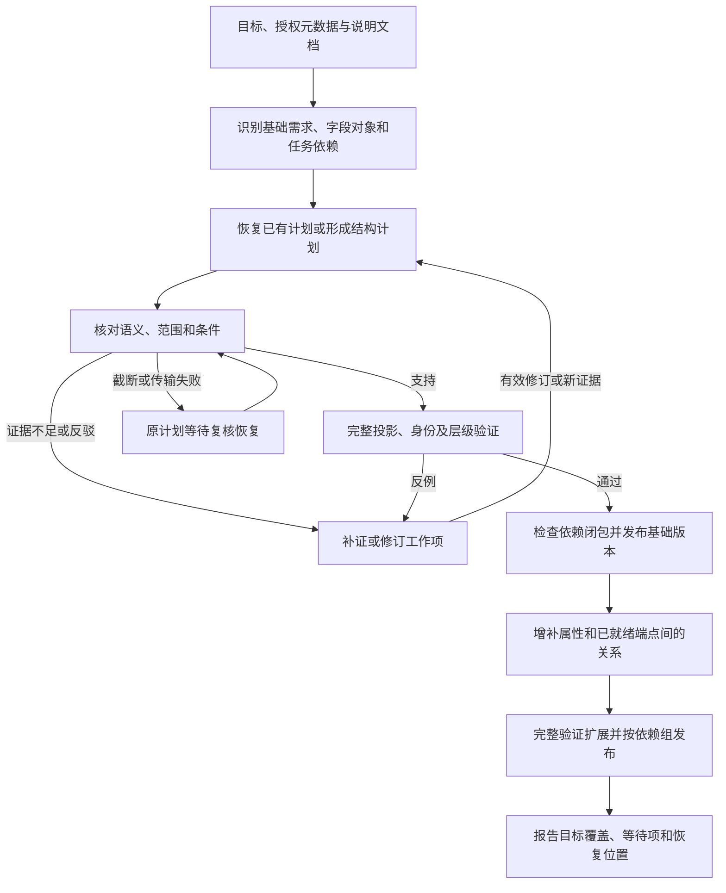

# 先确认基础结构，再扩展图谱

> 设计状态（2026-11-03）：本页保留原版本的方案、故障与验证记录。当前通用构图目标、Harness 迁移与 YAML 产物规范见 [按用户目标自主构图](GENERIC_GRAPH_CONSTRUCTION.md)。本文的历史通过结果不证明新路径已验收；未被迁移改变的接入、执行、权限及平台约束继续适用。

日期：2026-11-01。状态：设计方案，尚未实现。代码基线为 `1351d8b`。本方案承接 [US](US.md)、[目标驱动的迭代构图设计](GOAL_DRIVEN_ITERATIVE_GRAPH_DESIGN.md)和[可恢复发现](RESUMABLE_DISCOVERY_20261101.md)。只读、源数据不落盘、独立语义复核和依赖组原子发布继续有效。

## 1. 要改变的流程

把目标明确要求的基础对象及其结构，列为有独立状态、验证结果和恢复入口的工作。后续任务通过版本明确的已确认端点扩展图谱。

“基础”由目标、授权元数据与适用说明确定，不按表名、列数或行业写死。本次报表项层级是优先基础；指标、产品、渠道的定义是另一组基础。它们可以分别完成，只有真正依赖未完成基础的扩展任务需要等待。

最新续跑保住七条旧规则，但层级编译／审查发生回复截断，没有形成可继续的待审层级计划。随后新增三条关系规则，把旧 720 条连接以另一套关系名再表达一次。252 个节点没有增加，层级仍缺失。

当前代码已经先执行覆盖补查，再实际调用关系发现。缺口在准入条件：关系阶段检查已有规则的失败反馈和全局端点数量；层级没有产出规则时，不在这份失败反馈里。“已有规则没有失败”不等于“目标要求的基础已经就绪”。

## 2. 目标流程

图中的分支针对一个基础对象组及其依赖。层级未决不禁止独立定义表完成，也不要求指标、产品、渠道必须挂到报表项上。跨分支连接需要另行验证的映射。

| 阶段 | 主要工作 | 持久产物 | 退出条件 |
| --- | --- | --- | --- |
| A 结构准备 | 读取完整授权表列；定位说明；识别候选对象、层级和引用依赖 | 字段知识、基础需求、依赖引用、歧义 | 目标相关结构已列出，未知项有明确原因 |
| B 结构计划 | 复用字段知识，绑定身份、范围、名称别名、位置及父子语义 | 有版本的安全结构计划 | 引用和结构校验通过，进入待复核 |
| C 语义确认 | 阅读相关说明及反证，确认尚未确定的语义 | 判断、证据和条件引用 | 支持且条件满足；否则恢复、补证或修订 |
| D 基础验证与发布 | 完整读取必要投影，检查数据及当前图，发布依赖组 | RuleSpec、验证记录、发布版本、端点目录 | 完整验证和原子发布均成功 |
| E 扩展 | 增补属性、跨表融合、发现已就绪端点间的新关系 | 属性修订、关系候选与规则 | 经语义及数据验证，按依赖组发布 |
| F 覆盖报告 | 对照目标与基础需求核对 | 分项状态、可继续工作项 | 必需项完成，或明确标出缺口 |

列名、主外键和少量带列名的样本用于提出候选。不能仅凭 L1/L2 命名确认业务层级，也不能用两三行数据确认身份等价。文档缺失时仍可探索，无法确认的语义保留未决。

## 3. 报表项基础应包含什么

复用现有 `HierarchyPlan`，不另造业务规则语言。首份基础计划同时包含：

| 内容 | 本次数据声明 | 程序仍须验证 |
| --- | --- | --- |
| 身份 | 同主体内完整编码确定报表项 | 空键、范围、同码冲突、跨规则一致性 |
| 位置 | L1～L5 为相对位置，不属于身份 | 各位置列映射和路径完整性 |
| 父子 | 相邻非填充位置形成父子边，允许多父 | 端点、成环、多父与规则许可一致性 |
| 填充 | 连续重复编码不产生新对象或自环 | 连续填充与同一路径非连续回返的区别 |
| 属性 | 中文名为名称，英文写法为多值别名 | 编码到中文名的一致性、别名及其支持 |
| 来源 | 各位置和各父子链路分别有支持 | 去重不吞掉新位置、边和来源支持 |

例如同一主体的 `X → B` 与 `A → X → C` 产生一个 X，保留两份位置支持和三条相关边。X 位于不同深度不是冲突；`A → X → A` 不能因此被当作合法的跨位置复用。

编码、中文名、已明确的英文名、范围和层位在首次计划中一起映射。后续属性阶段只处理新增或尚未确认的属性。非身份属性的映射失败可以成为独立待办，并另行验证不依赖它的结构；不能静默删掉英文名后宣称目标完成。身份、中文主名称或父子语义冲突则影响基础本身。

多位置对象替代按列名猜出的单位置对象后，原候选退出当前对象认识，保留为层位映射和历史。自动替代只适用于映射兼容、无独立确认依据的元数据种子；已验证对象不能因列重叠自动消失。

## 4. 基础就绪是一项完整契约

扩展现有工作账本，增加基础职责和阶段字段，不建立第二套并行任务队列。

建议的逻辑记录 `FoundationPlan` 包括：目标修订、授权源和列引用、字段模型版本、结构类型、身份与范围选择、属性映射、层级选择、语义目录引用、条件与证据引用、结构指纹、依赖指纹、阶段、复核结论、规则及发布版本。

结构指纹仅基于允许保存的映射与语义选择，不含源行、样本、查询参数或其哈希。自由解释、完整模型响应、临时查询证据不写入计划；恢复时按引用重读。无法安全完整保存的计划标为需重建，不能声称可以恢复原命题。

同一记录区分三个维度：

- **阶段**：字段映射、语义复核、数据验证、发布、扩展。
- **工作状态**：沿用 pending/running/deferred/unresolved/resolved/superseded。
- **业务判断**：尚无判断、支持、未决、反驳。传输错误不属于业务判断。

`foundation_ready` 必须同时满足：当前目标和授权适用、所需语义有支持且条件满足、完整投影验证通过、依赖组检查通过、对应完整规则代次实际发布。缓存规则也须本轮重验后才能为新扩展提供已确认端点。

完成率按“必需基础需求”核对。目标要求层级而本轮没有层级规则，应显示“基础缺失”；其他四条实体规则正常不能替代它。

## 5. 截断后继续原阶段

入口校验通过后、调用独立审查前，先保存安全结构计划。恢复单位是尚未完成的审查，不是整张表或整段 Agent 对话。

| 情况 | 状态与动作 | 恢复边界 |
| --- | --- | --- |
| 截断或传输中断，尚无完整判断 | 保留待审阶段及协议失败原因 | 余量允许时自动恢复一次，重新读取材料，审查同一命题 |
| 自动恢复仍失败 | deferred，记录次数和失败类别 | 下轮仍显示该工作；显式恢复或协议／模型配置变化可再激活，不因重启清零次数 |
| 输出结构不合法 | 保留原命题及已有有效判断的约束 | 有界纠正格式或引用，不能借协议修复改变有效结论 |
| 证据不足 | unresolved，列出所需材料 | 补证后处理 |
| 明确反驳 | 保存反证，进入结构修订 | 新证据或实质结构变化才能再审，不能原样重投直到通过 |
| 数据验证发现反例 | 记录受影响基础及依赖 | 内存中重新查询反例，修订后完整重验 |

自动恢复次数按“计划版本＋证据版本＋审查阶段”累计，计入同一模型调用额度。引用失效或权限变化先刷新依赖。每次模型调用前关闭源数据库快照。

对尚无完整判断的协议失败，另记录 `recovery_epoch`：显式恢复或有效的输出上限、协议实现、模型配置变化可开启一次新的恢复额度，历史总次数保留。仅换输出目录、重新启动或增加总调用预算不重置次数；已有有效反驳不因这个机制重新投票。

新增无源值事件记录：阶段、任务 ID、计划指纹、调用序号、结束原因、用量和耗时。报告据此区分“提案没提交”“审查没答完”“审查反驳”“数据不通过”，无需保存原始响应。

## 6. 扩展如何依赖基础

### 属性及融合

属性增补绑定 `rule_id + revision + identity_contract`。补名称、别名或弱属性时沿用身份，不新造对象规则绕开覆盖冲突。公式、单位、粒度等可能影响语义的属性，仍须相应语义复核。完整重验后发布新修订。

跨表融合须有编码域、范围和身份依据。属性可增量加入；同码定义冲突、身份范围改变及拆分合并须进入基础修订，不能按普通属性补齐处理。

### 关系准入

具有候选物理关联或明确关系声明时才创建关系工作。任务列出具体端点需求及规则版本，不再仅凭全局存在两条实体规则，就给所有表派关系 Agent。

- 端点基础就绪：验证已有映射，缺语义时再调用 Agent。
- 端点尚未形成：登记所等待的基础任务，不反复要求填写不存在的实体引用。
- 端点归属未知：先有界探查列关联，返回列引用、计数和完整性，再提出对象需求。
- 只有值域重叠：保留关联候选，不直接确认业务关系。
- 授权范围已检查完且没有适用关系：允许 `no_applicable_relation`，连同覆盖范围完成任务。只弃权或尚未查完时保持未决。

报表项基础未就绪时，涉及报表项的扩展等待；指标、产品、渠道及联合上下文的独立依赖链仍可推进。新来源、新列关系或目标修订使原来的“无适用关系”结论按依赖失效，不能永久跳过。

### 关系定义复用

提案优先选择项目已有的规范关系 ID。提出新关系时，须说明与已有定义在含义、方向、角色、条件或范围上的差异。

已确认同义的关系使用同一规范 ID，其他名称作为别名。同一事实可有独立来源支持，同一依据经过两种转换不变成两份独立证据。

同端点同方向仅用于发现疑似重复，不能直接合并。“管理”和“供货”可以同时成立。历史 `applicability_*` 与 `applicability_of_*` 须检查定义和限定条件，经过可审计的关系迁移替换旧发布，不能直接删边。

上下文显示名称可引用已确认的指标、产品、渠道名称及主体；同名异码时加编码区分。身份仍由原键决定，不通过拆分或拼接名称推断身份。

## 7. 发布、预算和跨运行恢复

基础依赖闭包完成后即可作为检查点原子发布，不等待整次探索结束。发布前检查与当前图的共享身份、端点和层级约束，保留 `expected_heads` 并发检查。共享身份修订、端点迁移或撤回涉及的规则仍须同组验证，不能按阶段任意拆开事务。

后续扩展失败只撤销其未发布部分，不撤销无关且有效的基础。新反例影响基础时按依赖失效机制处理，不能继续标 ready。新增源行仍需完整重验，缓存命中不等于跳过数据处理。

调度按依赖就绪和目标优先级安排工作：先处理已有计划的待审恢复，再处理目标要求的基础、扩展所需的独立定义，最后处理可选扩展。独立基础公平获得机会；单项达到有界次数或时限后延期，不占住整个运行。

取消对象阶段固定占发现窗口 65% 的硬切分。基础、补证和关系共享发现期限，按任务依赖使用剩余额度；保留完整执行与发布的时间预留。没有就绪端点时，不为关系阶段空留时间而提前放弃基础。

本方案不调整用户刚确认的额度：240 次调用、120 分钟总时间、累计 tokens 不限；输入请求上限 1,048,576 字节，单次输出 65,536 tokens。次数与时间仍是硬约束。

跨运行按目标、授权、模式、文档、语义目录及规则版本校验检查点。只续做失效或未完成阶段。未决计划有状态，已发布结果有版本，二者不能混为“已完成”。

## 8. 实施批次

| 批次 | 当前代码的改动范围 | 独立验收 |
| --- | --- | --- |
| 1 审查恢复 | 结构计划的安全投影、`semantics.py` 协议失败分类、`workflow.py` 恢复入口及现有工作账本 | 首次审查截断后可恢复；重启不丢阶段；有效反驳不原样重投 |
| 2 基础依赖及发布检查点 | `pipeline.py` 增加基础需求/ready；复用 RuleEngine、发布分组和当前图校验；取消固定对象/关系时间切分 | 基础未就绪时只等待相关任务；独立分支可发布；扩展失败不撤回基础 |
| 3 扩展入口 | 复用 `coverage.py` 增补属性；关系选择已有端点和规范定义；重复关系候选及无适用关系的完成状态 | 别名不另造身份；同义边不翻倍；真正多关系保留；依赖变化触发重算 |
| 4 报告与真实验收 | 分阶段状态、调用事件、覆盖及 Gold 评测 | 工程回归、合成自动发现、真实接入分别报告 |

第一批先修最新运行已证明的中断点；第二批让恢复后的规则成为后续可依赖的基础。先做小范围层级真实实验，再做五表全量，避免用全部关系探索测试一次审查恢复。

## 9. 验收矩阵

| 场景 | 必须满足的结果 |
| --- | --- |
| 同主体同码跨 L1/L3 | 一个节点，多个位置支持，各自父子链保留 |
| 连续填充、重复源路径 | 不新增身份或填充自环，不虚增独立证据 |
| 多父与路径回返 | 有依据的多父保留，真实成环拒绝 |
| 同名异码、异主体同码 | 按身份与范围区分，不按名称合并 |
| 多种英文写法 | 首次映射，多值别名保留，不拆身份 |
| 初次审查截断后退出 | 原计划和阶段仍在；恢复时不重跑字段发现；未审完不释放依赖 |
| 审查明确反驳 | 原证据不重复投票；留下反证和修订任务 |
| 基础缺失、独立对象就绪 | 不向缺失端点派业务关系任务；独立分支可完成 |
| 同义关系与不同语义关系 | 前者经确认后规范化，后者分别保留 |
| 属性扩展失败 | 已发布且仍有效的基础节点和父子边保持可用 |
| 身份或范围修订 | 引用闭包共同验证发布，无悬空边或混用版本 |
| 新数据、权限及文档变化 | 重验或失效相关依赖，不以旧检查点绕过新约束 |

五表合成集分别评分：210 个报表项、210 条父子边、225 个英文名、594 个来源位置、210 个主体范围，12 个独立概念、240 个联合上下文。规范业务图对应 462 节点、930 条边；所有额外边单独审计，增加别名关系不能提高成绩。上下文可读性另评，不能用结构 exact 替代。

报告分别展示“基础已完成”“属性缺失”“关系等待端点”“语义待补证”“协议恢复延期”。必需基础未完成，整体仍不算完成；正确且独立的成果继续可见。
