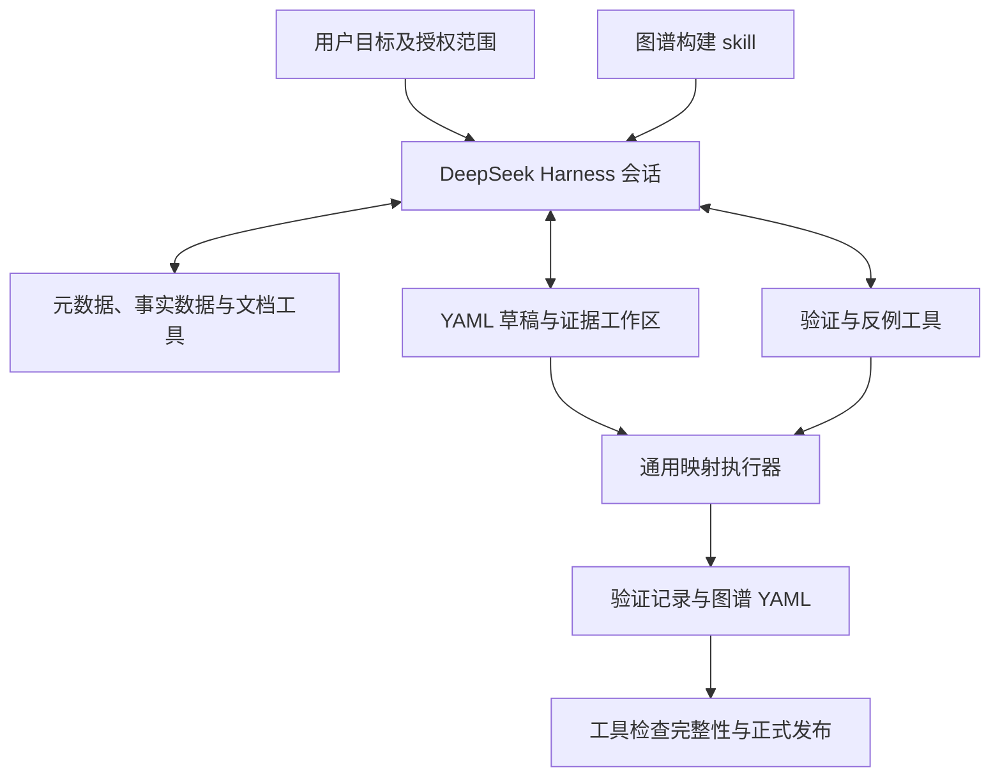

# 按用户目标自主构图

当前补充设计见 [字段映射、实例关联与发布修订](RELATION_MAPPING_AND_PUBLICATION_20261104.md)：结构检查与实例执行分开、查询次数可选、关系按真实记录匹配、校验产物独立保存、发布固定验证版本。实施与验收状态另行记录。

混合来源故障与历史结构查看的补充见[2026-11-05 修订](MIXED_SOURCE_FAILURES_20261105.md)：来源故障与建模反证分开，保留健康来源候选，修订删减给出提示，历史结构方案无需实例生成即可预览。

后续 [自主探查、重连与完整画布修订](DISCOVERY_RECOVERY_AND_FULL_GRAPH_20261105.md) 补上新快照前有界重连、结构化进程诊断及全部节点/边的分批加载；探查方法先保存候选解释，再选择必要验证，避免全列精确画像和故障后的无依据删减。

[只读快照连接与重复失败控制](SNAPSHOT_CONNECTION_LIFECYCLE_20261105.md) 将连接生命周期改为一次完整快照，模型思考期间释放连接；来源失败计数跨工具调用保留，恢复失败锁定来源，反复请求被阻来源触发 Harness 有界收尾。

设计日期：2026-11-03。本文记录本轮确认的目标与迁移方向；替代旧设计中的 AgentScope 发现编排、旧提案协议、固定任务阶段和场景限定。实际实施状态见 [IMPLEMENTATION_STATUS](../../IMPLEMENTATION_STATUS.md)。历史实验及故障分析保留原始结论，不能作为新内核的验收结果。

## 1. 产品目标与当前范围

用户提供构建目的、授权数据及可选知识文档，Agent 自主发现与该目的相关的对象、属性、身份和关系，生成可验证、可复现的图谱或本体。这是一项可迁移的数据发现能力，不预设行业、业务对象、表结构或字段名称。

经营分析是其中一个场景。例如用户希望了解指标、子指标、维度、度量之间的关系，Agent 应根据这个目标探查数据和文档，确定相关对象及映射。人员组织、设备部件、商品分类等目标使用同一机制；指标类型和报表层级不能成为通用兜底。用户可以补充解释或约束，无需先写完整抽取规则。

当前只实施图谱构建。后续本体目标采用另一份 skill，复用同一内核、数据工具、证据与版本机制。本体若完整绑定数据中的对象身份、属性和关系来源，可以由执行器实例化图谱。本轮不开发 Data Agent、问数、查询规划或经营分析应用。

目标与输入知识统一由 Markdown 承载，图谱知识产物仍为 YAML。数据接入逻辑不变。`goal_markdown` 是随项目配置修订保存的用户目标原文；省略时，将旧目标字段确定性转换为 Markdown。表列权限、作用域和其他程序约束继续由类型化配置控制，不能通过改写 Markdown 解除。普通工作台只显示模型配置，具体内核和上下文机制由后台适配。

## 2. 发现职责与执行职责

Agent 决定需要哪些信息、提出什么假设、如何修改假设。程序负责受控数据访问、结构检查、目标范围内的实例投影与记录匹配、身份计算、存储和发布。结构检查不要求读取全部事实数据。执行器提供通用算子，不包含某份数据应得到哪些业务节点的答案。

| 可以复用的通用能力 | 必须由当前目标和证据决定 |
| --- | --- |
| 读取元数据、抽样、统计、只读查询 | 哪些字段属于一个对象；对象的名称与含义 |
| 联合 DISTINCT、FD、引用覆盖与反例查询 | 哪些字段是身份、名称、别名、属性和作用域 |
| 按显式映射投影、连接、展开位置 | 是否存在层级、层位含义、关系方向与业务角色 |
| 身份去重、独立来源支持、完整性检查 | 同码是否同一对象、跨表是否共用身份域 |
| 候选版本、原子写入、依赖验证 | 哪些候选需要修订、排除或保留未决 |

列名、注释、值模式和已有主外键可以产生线索。命名不匹配不能直接得到“没有对象”；未验证的列角色可以被新证据修正。不得要求新候选保留已被反证的命名猜测。已经发布的身份变更则需要有版本的迁移与依赖检查。

规则由 Agent 在发现后生成，是可重复执行的成果。固定规则对照实验仍用于测试执行器，但不能证明自动发现成功，也不能作为真实发现的隐蔽输入。

## 3. 运行架构

DeepSeek Harness 作为独立进程运行，通过 Python SDK 接入。使用项目专用配置目录、工具集、会话存储和 skill 目录；不继承个人编码助手的工具权限与默认任务。仓库在 `vendor/deepseek-harness/` 固定上游源码、许可证和文件清单，实际运行该版本的 SDK 与内核。适配在项目配置和插件层完成，压缩与工具循环仍由上游内核负责。

一个主 Agent 围绕目标持续工作，可以在对象发现、属性补充、关系探查和修订之间往返。系统不按固定表序强制完成 T1～T5，不在预设的“最后两步”突然移除数据工具，也不按固定百分比将对象与关系发现切成互斥窗口。资源预算仍有效；到限保存当前成果和未决项，完整恢复后再继续。

语义判断由 Agent 在同一内核循环中根据证据完成；不再设置外部 LLM 二次语义闸门。`semantic_assessment=agent_authored` 明确结论来源，发布不宣称客观语义全真。工具验证数据、格式与完整性，不能将每个格式错误升级为新一轮完整发现。一次解析失败只影响该请求；一项候选不成立不使已验证的独立候选失效。共享身份或相互引用的映射仍需共同检查，不允许逐条发布破坏依赖。

## 4. Skill 与工具

本轮 skill 位于 `src/lightgraph/construction/skills/build-graph/`。入口只包含用户目标的使用方式、证据要求和通用发现方法；具体执行格式通过参考材料按需读取。业务示例用于解释方法，不提供固定字段识别规则。

Agent 使用以下领域工具自主完成探查、保存、验证、修订和收束：

| 工具 | 用途 |
| --- | --- |
| `describe_sources` | 查看授权来源与可用表列 |
| `inspect_source` | 根据当前问题选择元数据、统计、FD、引用或只读 SQL 探查 |
| `read_material` | 按需读取适用知识材料和执行格式参考 |
| `save_graph_draft` | 保存 Agent 提出的 YAML 草稿，不宣告语义已确认 |
| `validate_graph_draft` | 按 mode 选择目录与契约检查或完整实例检查；每次保存独立验证产物 |
| `publish_graph_draft` | 由 Agent 在依据充分时调用；工具核对修订、授权和固定验证产物，按所记录的读取范围发布 YAML 版本，数据库不重复查询 |
| `read_workspace` | 恢复草稿、验证记录与未决内容 |

初始上下文不装入所有表的数据行、所有知识文档和完整规则 schema。工具返回需要说明列名或列头、数据类型、范围、是否完整以及可再次读取的引用。对表格使用共享列头与二维行值，避免每行重复长字段名；可读性与省 token 同时检查。

初始意图只包含 Markdown 目标和知识材料目录。目标超过 16,000 字符时分段加载，通过 `read_material(name="goal", page=...)` 继续或重读；知识正文继续使用 `document:<id>` 分页读取。运行保存 `goal.md`，工作区适用性指纹包括目标 Markdown，目标变更后不沿用旧验证结论。

模型提交新的通用 YAML 映射，描述来源、身份、属性、位置及关系端点。它不要求填写旧 RuleSpec，也不经过旧 ProposalSession。工具负责解析、检查、执行和持久化。后端可以复用投影、连接和身份处理等算法，但不能重新接回旧发现状态机。

## 5. YAML 产物与状态

图谱与本体知识产物统一使用 YAML。工具传输和内核原始事件可以使用各自原生协议，它们不代替规范化的知识产物。

目标产物包含：

- 对象类型、属性、关系定义；实体、边及其属性。
- 来源与字段映射、身份域、作用域和关系生成规则。
- 文档或查询证据引用、数据修订、验证范围及完整性。
- 草稿、反证、未决项、版本和修订来源。

草稿包含 `draft_id`、`purpose`、`entities`、`relations`、`evidence_refs`、`rationale`、`unresolved`。实体声明包含类型、描述、键角色和一个或多个物理映射；关系声明包含端点类型、描述、限制和物理配对映射。具体字段以新的构建模块及按需读取的 schema 为准，不接受旧 RuleSpec 作为过渡输入。工具生成状态和验证结果；Agent 提供的说明不能自行将草稿标为已验证或已发布。

编码和标识按字符串保留，避免前导零、日期形字符串或布尔形字符串被隐式转换。拒绝重复键和未支持的 YAML 标签。图规模增大时可分片，通过版本清单索引；不得为满足单文件大小而静默截断图。

区分以下层次：保存成功、结构验证通过、候选图生成、语义依据与正式发布。当前重构目标包含完整构建与发布，不能停在只生成候选的旁路。发布工具必须记录实际检查与未决范围；Harness 正常结束或生成 YAML 本身不等于自动构图验收完成。解析失败、候选拒绝和运行资源耗尽分别报告。

## 6. 上下文、知识与留存

完整运行轨迹、持久业务知识和本轮模型上下文分别管理。

| 内容 | 管理方式 |
| --- | --- |
| 实际模型请求、响应、工具参数和结果 | 内核会话日志与本地运行轨迹；支持回查、导出；压缩不删除原记录 |
| 对象模型、字段映射、候选、反证、验证与未决项 | 项目内版本化 YAML 工作区；按来源和目标修订检查适用性 |
| 当前模型输入 | skill、当前目标、相关工作区内容、近期工具结果及按需历史 |

业务事实不能只保存在自然语言摘要中。恢复时读取保存的结构与证据状态，不根据摘要重新确认身份。完整轨迹和授权缓存由用户主动清理，运行结束不自动删除；源值缓存、模型出域和轨迹记录遵守项目配置，凭据不得写入知识产物。

最大模型输入窗口与日常工作上下文阈值分别配置。模型物理调用次数是主要额度，默认不限制累计 token；实际 token、估算 token、HTTP 字节和进程内存分别计量。摘要与重试等辅助模型调用也计入实际调用次数。当前上游 token-meter 使用字符数除以四等启发式估算，再结合服务商 usage 校准；这不是精确分词，报告必须区分估算与实际 usage。已配置的输入额度在原生 llm/stream 派发前按估算值检查，超过额度不发送请求。输入与总窗口均为空时不额外设置输入准入限制，1,048,576 tokens 仅保留为路由和压缩的默认容量元信息。`working_context_tokens: null` 关闭上游自动压缩，包括窗口溢出后的自动压缩恢复。

## 7. 统一入口与替换范围

`lightgraph run`、`lightgraph discover` 和工作台运行入口统一接入 DeepSeek Harness。用户提供的目标、来源、文档和模型配置进入内核；Agent 在内核循环中决定探查、保存、验证、修订和完成。`discover` 只做其明确请求的发现输出，`run` 负责图谱构建与发布；它们不能分别使用新旧发现引擎。

删除可运行的旧发现入口及自动回退。AgentScope 强制阶段、旧 ProposalSession 与 RuleSpec 提案协议不再是入口依赖。DeepSeek Harness SDK 必须被实际导入并启动运行时；只创建适配器名字、假内核或未接入口的旁路不算完成。内核不可用或配置不兼容应清楚报错。

旧代码版本和实验记录仍可用于历史对照，但不作为当前运行的兼容引擎。替换不清理用户数据、已生成图谱或运行记录；已启动的隔离实验保持其冻结版本。

实施检查覆盖 SDK 实际启动、领域工具调用、新 YAML 映射、验证与发布、CLI 与工作台路由、上下文压缩和持久恢复。当前仍处开发中，各项完成状态依实际测试记录更新。真实模型通用发现与客户语义另行验收；本体 skill、Data Agent 和问数应用不属于本轮实现。

## 8. 验收

机器可读的验收状态登记在 [construction_acceptance.yaml](construction_acceptance.yaml)。此清单定义要验证的能力，不代表测试或模型实验已经通过。

| 编号 | 输入或故障 | 必须观察的结果 |
| --- | --- | --- |
| G01 | 同一语义数据改表名、列名，保留可用注释或文档 | 依据现有信息发现映射；不依赖 CODE/L1 等固定拼写；信息不足明确未决 |
| G02 | 同类业务以宽表、长表、关联表表达；另有非经营分析数据 | 根据数据选择映射，不强制层级或指标模板 |
| G03 | 同一身份出现在多个位置、多条有效链路 | 一个实体保留多份来源支持；不因物理层位不同产生重复身份 |
| G04 | 跨表同码同义、同名异义、同码异义混合 | 共享、保留独立或未决均有依据；值重叠不能直接批准合并 |
| G05 | 一次坏 YAML、错误列映射、候选反证 | 诊断可操作，可局部修订；其他保存成果继续存在 |
| G06 | 长会话压缩后重新检查早期证据 | 原始记录可读取，候选与验证状态不依赖摘要猜测 |
| G07 | 进程中断后从同一工作区继续 | 草稿、修订与已有结果保留；来源或目标变化必须重新验证 |
| G08 | 全量执行被截断、超时或依赖不一致 | 不宣称完整候选或正式发布，明确报告未覆盖范围 |
| G09 | YAML 导出再读取 | 编码、身份、关系、属性和证据引用保持一致，无重复键歧义 |
| G10 | 相同模型与数据的旧路径、新路径对照 | 分别记录正确关系、漏发现、错误实体、未决、调用数与请求开销；不以节点数或 exit code 判优 |

工程测试、无密钥内核接线检查、真实模型发现、客户数据语义正确性分别记录。Gold 由评测器读取，不能进入 Agent 的工具、文档或提示。尚未执行的验收项保持未验证。
