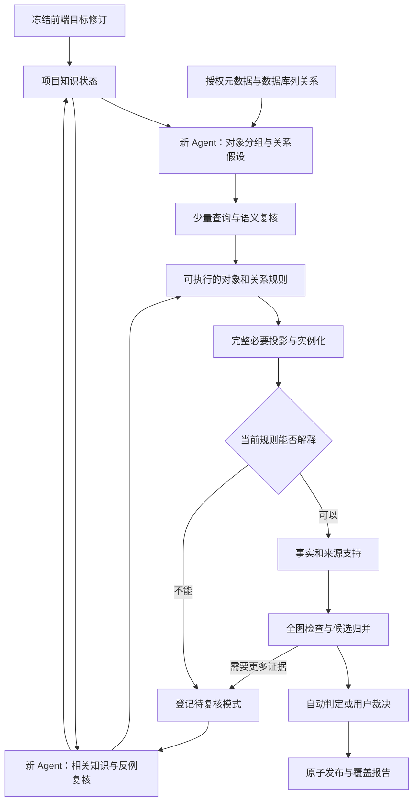

# 目标驱动的迭代构图设计

方案日期：2026-10-25；实施状态更新：2026-10-26。代码起点为 `66225ef3ee75278fd7d5e25700ddba11063b6d92`。

本轮已经实现目标修订、动态业务定义、反例驱动的跨任务修订、完整规则代际发布、有界图级候选复核及可撤销身份裁决。本文保留完整目标设计；具体实现、测试和尚未覆盖的要求以[本轮实施记录](ITERATIVE_ENGINE_IMPLEMENTATION.md)为准，不能把整份设计视作已验收功能。既有只读、预算、权限、源查询结果不落盘和原子发布约束继续有效。审查意见的取舍见[审查复核](AUDIT_REVIEW_20261025.md)。

## 1. 已确认的目的与边界

前端的抽取目标、排除内容、重点关注和补充提示决定本次希望发现什么。指标、度量、维度是目前的应用场景，不能成为平台固定词汇。用户不必提供完整本体、统一编号或逐条关联映射。

Agent 先从元数据提出“哪些字段组成对象、对象有哪些属性、对象之间可能有什么关系”；再通过少量查询、统计和相关知识核验。程序据此处理目标所需的完整数据投影。处理过程中出现现有规则无法解释的新模式，再启动一轮 Agent；最后复核全图的重复实体、多重关系和冲突。

相同对象再次出现时，最多跳过重复建节点，仍需处理新属性、位置、关系和来源支持。“父亲”“儿子”、一级或二级可以是对象在关系中的角色；是否代表不同身份，由当前业务解释决定，不能写死。

最终业务图以实体及其关系为主体；物理表列关系与实体的字段组成保留为可追溯依据。不确定的实体、关系和归并可以展示为候选，让用户决定。

## 2. 从一次目标到完整运行

一个程序调度器管理多轮短生命周期 Agent。每轮结束把结构化结果交给调度器；后续 Agent 从项目知识状态恢复相关知识，不依赖上一个 Agent 的完整对话。单轮内部仍可多次调用工具。

现有 `run_agent` 每任务创建并清理临时上下文的方式可以保留。需要扩展的是跨任务知识、工作队列、规则执行反馈和图级复核，而不是让多个自治 Agent 相互聊天。

## 3. 全局目标、轮次输入与项目知识

| 对象 | 内容 | 更新方式 |
| --- | --- | --- |
| `GoalRevision` | 前端目标、排除、关注、提示原文；允许来源范围；目标解释及其状态 | 保存配置时生成修订；运行冻结所用修订 |
| `KnowledgeState` | 对象/属性/关系定义、列组、物理关系、映射规则、身份裁决、已接受和候选事实索引、未决项 | 经校验的变更按版本提交 |
| `WorkItem` | 任务职责、目标修订、相关表列/规则/实体、知识版本、触发原因、依赖、范围、预算、状态、产出引用 | 调度器管理，不让 Agent 自行宣告完成 |

每个新 Agent 都显式得到同一目标修订，以及本轮阶段、问题、相关知识摘要、反对依据和剩余预算。前端这些目标文字不是新增 Markdown 文件注入机制；已有知识文档继续按用途、表列范围和章节提供上下文。

全局可见不要求每轮复制全图。新增按权限查询知识的工具：读取对象定义、字段关系、相关实体候选及邻域、属性和边的支持、未决问题与历史裁决。每次返回有界结果及覆盖说明，必要时继续检索。

任务输入版本固定，提交时重新检查相关依赖；迟到提案不能覆盖更新后的目标或规则。配置保存使用修订号或 ETag 条件更新，所有修改配置的入口遵守同一机制。旧页面保存冲突时保留草稿；运行记录写明实际使用的配置修订。

## 4. 平台业务词汇与输出控制

将固定的 Metric/Measure 等业务枚举替换为项目内有版本的语义定义目录。保留现有词汇作为可选初始模板，不把它作为其他业务的兜底分类。

| 定义 | 所需内容 |
| --- | --- |
| 对象类别 | 名称、含义、目标相关性、适用条件、状态、定义依据 |
| 属性 | 含义、标量值类型、是否多值、可选时间/条件、适用类别、输出许可 |
| 关系 | 含义、端点角色、方向、限定条件；有依据时声明逆关系、互斥、基数或无环要求 |
| 对象映射 | 字段组及其属性映射、候选身份解释、来源范围、可执行投影 |

Agent 可以提议新定义、引用已有定义或归并同义定义。程序仍固定执行结构、SQL、引用、权限、大小、预算及留存检查。动态词汇不能打开任意 JSON 属性、整行转存或任意代码执行；目标外的源值也不能借“自定义属性”落盘。

输出许可来自用户授权与项目输入/输出政策，Agent 接受一个语义定义不等于授予源值持久化权限。Agent 只能在既有许可内提议映射；候选和 accepted 遵守相同边界，不要求每个普通属性额外人工批准。

任务职责、状态和数据结构是程序契约；业务类别、编码含义、层级角色和关系名称由目标与证据决定。

## 5. 从物理字段关系到实体关系

关系需要保留完整链条：

> 物理表列 → 对象字段组与属性映射 → 列间关联及条件 → 实体关系解释 → 查询核验/裁决 → 具体实例边及来源支持。

需要区分四类记录：

| 记录 | 必须表达的内容 |
| --- | --- |
| `PhysicalRelation` | 两端有序列组、方向、关联谓词、空值和条件处理、声明/观察基数、数据库声明或发现来源、结构核验与语义状态 |
| `EntityMapping` | 哪些列组成一个对象，各列对应什么属性，当前身份解释与适用范围 |
| `RelationMapping` | 物理关系如何对应两个对象映射，端点键/属性对应、关系含义、基数、有效连接元组如何支持实例边的规则 |
| 实例关系支持 | 使用的规则修订、物理关系/语义判断引用、端点来源绑定、有效条件、发布和授权范围 |

例如 A 表的“编号、中文名、英文名”组成对象甲；映射表将 A 编号与 B 编号关联；B 的多个字段组成对象乙。执行时根据映射表的实际配对解析甲乙实例，再生成相应关系。不能把 A、B 各自的 DISTINCT 集合做笛卡尔积，也不能把三个属性列当三个业务实体。

数据库声明可以证明技术关联；“使用”“属于”等具体业务含义仍需解释。如果只能确认端点间存在引用，就保留相应引用含义，不凭字段名升级为特定业务关系。如果单个端点的对象身份存在歧义，则保留映射候选与原因。

身份歧义不同于合法的一对多、多对多。每个有效连接元组解析出确定端点后即可生成边，多条合法连接可以生成多条边，不要求整项关联全局满足 n→1。跨来源连接在各来源完成必要投影后受限比较，继续遵守预算和快照边界，不开放任意跨源 SQL。连接过程中的源元组只用于内存核验，持久化保留许可的图事实及映射依据。

同角色列对齐有时意味着两个来源表达同一对象，不一定要另建业务边。列关系本身仍要保留。一个物理关系也可能按条件对应多种业务关系。

数据库关联与 Agent 推断分别记录依据；同一条实体关系可得到多份支持。若两条依据来自同一个外键或同一段文档，不因经过两次转换就计为两份独立证据。

## 6. 语义判断与候选

关系和身份主张使用共同的判断结构：待判断命题、端点、方向、肯否、范围、条件、支持依据、反对依据、查询结论、判断方式、状态与未决原因。引用的依据应可重新定位，并说明是用户知识、数据库声明、数据观察还是 Agent 推断。

关键词、名称相同、值重合和 hash 相等只能成为检索或结构检查线索。不能因 `semantic_basis` 非空就接受，也不能只增加“不”字过滤。必须覆盖否定、条件未满足、假设、历史废止、无关端点、文档矛盾与跨范围限制。

Agent 可综合松散知识和多种弱线索做推断，不要求所有结论都有统一编号或直接写明结论的句子。确定性执行器检查可验证的结构条件；无法机械证明的业务判断，保留其推断来源和局限。

自动接受要求：当前目标相关、结构核验充分、依据适用、语义判断明确支持，且没有未解决的反对证据或依赖冲突。不能用模型自报分数代替这些条件；策略的实际错误率仍需独立 Gold 评估。证据不足保留候选，明确反对则拒绝对应主张。候选输出也必须遵守授权与留存契约。

## 7. 数据处理中的迭代调度

初版任务职责限定为 `metadata_discovery`、`semantic_probe`、`materialize`、`review_pattern`、`graph_reconcile`。这些职责可以复用已有 T1–T5 工具，但需要统一队列和依赖记录。

发现阶段少量查询用于提出、比较和修订规则。实例化阶段处理目标所需的完整投影，用已有规则生成节点、属性、边和支持。不能把抽样结束当作数据处理完整。

| 反馈 | 触发条件 | 后续动作 |
| --- | --- | --- |
| 未解释的位置/角色 | 同一对象出现新槽位，且当前身份或关系规则无法解释 | 复核身份与角色映射 |
| 身份冲突 | 当前身份解释对应冲突属性或定义 | 检索已有对象、补查、修订身份或留候选 |
| 待定同一对象 | 新来源表达可能对应已有对象 | 有界候选检索与身份复核 |
| 未解释的关联 | 列关系已有端点，但缺少实体关系解释或出现新条件 | 复核关系映射 |
| 规则反例 | FD、关系约束、引用范围或完整性验证失败 | 缓存规则也必须入队，不能只删除本轮标记 |
| 依赖变化 | 目标、文档、schema、规则或用户裁决更新 | 仅失效并重算相关依赖 |

例如首批只有 A→B，规则把 B 的层级位置误当身份限制；后续出现 B→C，触发一次复核。Agent 确认位置是相对角色后，B 保留一个身份，两份位置支持和两条边均保留。以后再遇到已解释的相对位置模式，不重复调用模型。若初始规则本就能解释，则直接处理。

新取值不等于新模式。符合当前规则的新增实体直接实例化；同一实体再次出现继续处理关系和支持；只有无法解释的差异才需要 Agent。

执行器先在完整分区结束或失败时产生反馈，再增加批次内的检测接口。对于在批次中发现的疑点，先停止受影响发布并登记任务，不能拿未完整读取的批次撤回旧事实。无关且依赖独立的任务可继续。

反馈持久化仅记录规则、表列、已获输出许可的实体引用、模式类别、计数、依赖版本和无源值的查询配方。原始反例、带值过滤参数及完整对话只在临时内存中使用；恢复后重新查询。

### 终止、恢复与当前图状态

- 以任务职责、相关引用、模式类别和依赖版本合并重复工作。具体源值不进入持久化去重键或其普通哈希。
- 一轮至少带来新证据、规则变化、状态变化或处理范围推进。同版本下反复无进展转为 unresolved，预算不足转为 deferred。
- 新证据或裁决到来后才重新激活相应任务；不能通过重复启动 Agent 消耗到预算上限后宣称完成。
- 模型等待前关闭源数据库快照。修订后重新读取受影响范围，并验证所需快照边界；不能把多轮不同快照拼成一次完整验证。跨数据库没有天然的分布式一致快照，应单独报告。
- 旧成功发布保留为历史。当前验证失败时，受影响支持标记需复核；只有该支持的事实不能继续无提示地作为当前有效结果。若另有有效支持，则按剩余支持计算状态。

报告分别列出目录覆盖、必要投影覆盖、规则解释覆盖、accepted/candidate/conflict 状态及剩余工作。候选存在时可以报告“范围处理完整、语义仍有未决”；预算不足不得报告范围完整。

如果来源没有可验证的修订或可续接的快照，跨轮等待关闭快照后，受影响发布代际的全部 staging 作废；规则修订后在新快照内重新读取完整提交范围。不能保留 t1 已读的 A 分区，再只重读 t2 的 B 分区后合成“完整发布”。仅当来源版本确实可验证且未变化、规则依赖仍有效，或提交单元已经证明彼此独立并各自完整时，才允许复用对应结果。崩溃恢复遵循同一规则。

## 8. 图级实体归并与关系复核

### 待发布图视图

新增带代际版本的 `GenerationView`，由未受影响的当前有效发布、本轮完整提交单元内通过结构检查的待提交事实，以及明确标注的候选组成。被替换范围的旧事实不再同时混入；不完整分区不能冒充完整替换结果。图级 Agent、候选检索和归并模拟针对这个固定、授权的视图，提交前再次核对规则依赖及发布头。

该视图独立于用户当前 accepted 图；staging 不为便于复核而提前发布。如果某个提交单元未完成，复核报告应列明未覆盖范围，不能宣称全图已检查。现有 `GraphStore.view()` 只读发布结果，不能直接替代这一接口。

### 候选生成

每轮图级检查遍历授权实体和关系，为允许保存的属性、别名、列组来源及邻域建立索引。候选通道包括已有映射、属性组合、文本语义检索、共享邻域和历史未决项。编号一致只是一个通道，编号不同不构成通用否定条件。

按通道限制每个对象的候选数量，在索引查询阶段处理高频值，避免先生成所有节点对再截断。未知类别不应因类别筛选直接失去候选。记录访问过的对象、候选来源、截断、延期与查询成本。候选生成的召回损失要用 Gold 测量，不能只展示数量减少。

全图扫描与索引处理通常随节点、边数量增长；有界候选复核接近节点数乘候选上限，但高频索引、簇检查和补查仍可能更贵，不承诺无条件线性复杂度。无需对所有节点做全局 n² 模型比较。

### 身份裁决与归并

Agent 对候选提出 same / different / unresolved，包含适用范围、条件、支持与反对依据。必要时安排针对性查询。程序检查当前业务定义所声明的冲突、权限和依赖。

裁决记录依赖谱系，使用决策前的依据版本。本次归并及依赖它产生的邻域或关系不能反过来成为它自己的独立支持；身份与关系互相依赖而没有其他依据时仍为候选。上游支持撤回后，重新评估依赖裁决及其投影。

`A≈B`、`B≈C` 只能形成候选簇，不能直接通过传递闭包宣布 A=B=C。接受合并前复核拟合并集合的整体一致性，包括明确不同实体的裁决、同条件下的属性矛盾和合并后关系。大簇分解或延期，不能用已检查的一部分代表整体。

发布版本化 `EntityResolutionDecision` 与 `ReconciliationPlan`：保留原实体 UUID、来源绑定、原始支持和旧发布，用版本化映射选择当前规范实体。选择哪个内部 UUID 作为显示主 ID 是工程决定，不构成业务同一性依据。

归并后的属性按值和支持聚合，冲突不采用最后写入覆盖。撤销归并时停用该决策，并重新投影受影响节点、属性和边；既有历史不改写。并查集至多作为当前已接受等价关系的内存索引，不能成为不可撤销的事实存储。

### 多条关系的处理

| 情形 | 处理 |
| --- | --- |
| 同含义、方向、语义条件和端点 | 合成一条事实，累加不同支持 |
| 已确认的同义关系或逆关系写法 | 根据关系定义规范化，保留原依据 |
| 同端点、不同业务含义 | 合法共存，例如父子关系与管理关系 |
| 时间、条件或分类体系不同 | 分别保留限定条件 |
| 同条件下确实互斥 | 形成冲突，补查或交给用户裁决 |

不能因为两个实体之间已经有边就强制二选一；也不能对所有业务关系统一禁止环或多父。约束来自当前关系定义。事实的语义限定与访问权限分开，支持来源不同本身不产生两条业务事实。

节点映射、属性、边、支持和裁决按依赖集原子发布；失败则当前发布不变。按支持权限过滤后再生成可见规范节点、标签与邻域，不能通过共享节点名称或归并建议泄露不可见属性。

same 和 different 身份裁决本身也具有有效支持与授权范围；当前可见规范身份只由该范围可用的裁决计算。隐藏范围的归并不能改变另一范围可见的节点数量、ID 对应或邻域。跨范围共享须由获准在这些范围生效的裁决支持，不能仅靠过滤私有标签实现隔离。

## 9. hash、分区与留存

| 用途 | 方案 |
| --- | --- |
| 业务实体 ID | 保留稳定 UUID；hash 不负责判断语义同一性 |
| 配置、规则和知识修订 | 用明确修订号及依赖引用控制并发和失效；避免重复全量摘要充当状态机 |
| 文件完整性、已许可输出事实去重 | 必要时保留摘要或唯一索引，说明用途；摘要相等不是业务证据 |
| 未许可输出的源分区键、参数、反例 | 不持久化原值或普通值派生哈希，也不换成可逆编码 |

为替换当前分区值 hash，第一版使用运行内不含源值的临时分区引用；完整规则范围或已证明独立的依赖范围对应一个发布代际。只有必要范围读取、验证及转换全部完成，才原子切换该代际的支持集合。失败或中断保留旧代际并报告过期原因；恢复重新枚举源范围，不要求记住原始键。

随机 token、序号只定位本轮工作，不能被当作跨运行稳定分区 ID。跨轮或恢复时的 staging 复用遵守第 7 节的来源版本与完整提交单元规则。只有已经授权持久化的逻辑范围才可复用稳定引用；不能把任意 tenant 列值自动视作获授权范围。若无法在预算内完成安全替换，应报告未完成，不能退回源值 hash 或按半批结果撤回。

已有违规派生标记的处理需覆盖 validation、publication、support、partition head 和历史导出。实施时提供可检查的迁移范围及验证结果；不在日常运行中静默删除历史库。新的成功、失败、取消和恢复路径都要扫描明文、派生标记及异常输出。

## 10. 工作台需要提供的操作

1. 目标配置显示当前修订和运行所用修订；普通表单与高级 JSON 有明确草稿状态，启动、上传和元数据刷新不能静默覆盖草稿。
2. 图提供“已接受”和“含候选”的明确视图；候选节点、边、归并建议与冲突具有状态和原因。候选显示策略可以由页面选择，消费接口明确限定 accepted。
3. 属性与边详情能查询来源支持、字段组、物理关联、规则修订、语义判断和当前验证状态。图被截断时详情接口仍按引用查询，不依赖画布已加载全集。
4. 用户可确认、拒绝或撤销候选裁决；提交前预览受影响的节点、属性和关系，提交使用版本检查。
5. 数据库接入提供能力清单生成指引、上传、校验和绑定入口，区分元数据读取与实例处理要求；Excel/CSV 统一使用配置预算。
6. 页面展示需要复核的旧结果与剩余任务，不能用“运行结束”替代“数据与语义都已完成”。发行方式明确区分源码启动与独立安装包。

## 11. 实施顺序与验收

| 批次 | 工作 | 完成依据 |
| --- | --- | --- |
| A | 阻止关键词直接确认关系/共享身份；修分区留存、配置覆盖和预算；建立 GoalRevision/WorkItem 最小契约 | 否定关系、否定共享、配置并发、Excel 与留存反例转为保护性回归；旧发布保留和对账仍正确 |
| B | 项目语义定义、字段组→实体关系映射、规则反例重新入队 | 指标之外的目标可运行；数据库关联形成实际实例边并可追溯；缓存 FD 反例启动新任务 |
| C | 处理反馈→新 Agent→规则修订→受影响范围重算 | 后续数据出现新角色后保留同一实体及新关系；相同已知模式不重复推理；无进展和预算不足正确终止 |
| D | 图级候选检索、簇复核、关系复核、可撤销裁决与工作台 | 错误传递合并被阻止；合法多关系保留；归并撤销、支持撤回和权限结果正确 |
| E | 逐项 F 台账、真实模型 D、选定数据库 I、客户 Gold | 工程、模型质量、实际接入和客户语义分别给出通过范围与缺口 |

每批先固定输入、正确结果、禁止结果和未决结果，再实施最小场景。复用现有引擎、SQL 守卫、预算、支持账本和原子发布，不整体推倒重写。

新增验收至少覆盖：

| 编号 | 输入/触发 | 必须观察到的结果 |
| --- | --- | --- |
| R01 | 跨两次以上 Agent 任务，修改或冻结目标 | 每次收到正确目标修订、相关知识与任务；旧提案不覆盖新修订 |
| R02 | 人员/组织等非指标目标，列名不提供固定模板 | 无需改 Python 业务枚举；输出定义和事实符合目标 |
| R03 | 编号、中英文名构成对象，跨表复合列关联 | 属性归入对象，按实际元组形成实体边，保留列关系推导链 |
| R04 | 不同编码或名称表达同一对象；同名但含义不同 | 前者可进入语义归并，后者不被名称/hash 合并；依据不足保持候选 |
| R05 | 首批 A→B，后续 B→C，初始规则不能解释 | 触发修订，B 一个身份、多位置与关系；再见同模式不重复触发 |
| R06 | 缓存规则新增 FD 反例，schema 不变 | 自动定向复核；旧结果标记当前状态；失败不错误撤回 |
| R07 | 否定、条件、无关端点、禁止跨范围共享 | 错误关系和归并不 accepted；正例仍能成立 |
| R08 | A≈B、B≈C，同时 A 与 C 有明确冲突 | 不做错误传递合并；候选簇保留冲突及解释 |
| R09 | 同端点两种合法关系、另有真正互斥关系 | 合法共存；冲突进入复核；不一概二选一或禁环 |
| R10 | 一个事实同时有数据库与推断支持，撤回一个 | 其余有效支持保留事实；由同一证据派生的支持不虚增独立性 |
| R11 | 归并后撤销，含不同来源的私有别名和身份裁决 | 节点、属性、关系可恢复；历史不改写；隐藏裁决不改变其他范围的身份投影 |
| R12 | 候选可视化与人工决定，另一页面同时改配置 | 状态/支持可查，裁决带版本可撤销；旧配置保存不覆盖新内容 |
| R13 | 罕见模式不在样本、完整投影出现；预算中止 | 可发现并反馈；未处理范围显式保留；不宣称全部完成 |
| R14 | 分区顺序变化、失败、取消、重启、Agent 等待期间源数据改变 | 无源键及值哈希落盘；支持对账正确；无版本证明时重读完整提交范围，不混合快照 |
| R15 | 有界候选检索的大图和高频同名值 | 不生成全局节点对；报告候选召回、截断及延期，不能只报告遍历完成 |
| R16 | 将排除列包装成新的动态属性 | 候选和 accepted 路径均拒绝越权持久化，不因新定义扩权 |
| R17 | 合法一对多、多对多连接，同时存在一个身份歧义端点 | 生成所有已确定实例边；仅歧义部分保留候选，不套用全局 n→1 限制 |
| R18 | 假设归并产生相同邻域，再用邻域证明该归并 | 识别循环依据，保持候选；不把派生结果当独立证据 |
| R19 | 本轮待提交图有重复节点，旧发布没有 | 图级复核读取正确 GenerationView；当前图不提前变化；提交冲突时不发布 |

上述 R 场景补充并映射到现有 F01–F15，不替代它们。替身 Agent 能验证调度和状态转换，真实模型才能用于评价推理质量；数据库替身不能证明真实产品版本可接入。实体、属性、边、误归并、漏归并及正确未决分别评价，评估真值仅供评估器使用。
