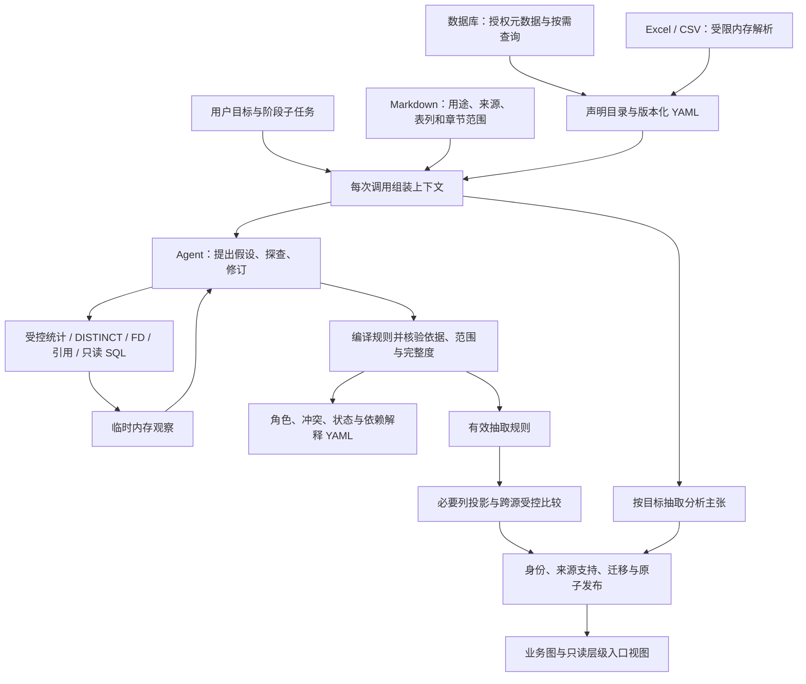

# 混合输入、文档范围与相对路径层级

需求日期：2026-10-19。实施状态更新：2026-10-20。本文对应 [SDD §18](SDD.md#18-混合输入上下文范围与可变层级2026-10-19-增补)，记录该次实现的行为和验证范围。运行源码、测试和 Schema 全部位于 `src/lightgraph/`。本轮使用合成输入、内存来源和模型替身，未连接真实 Gauss 或调用付费模型；不能据此认定业务语义和客户部署已经验收。

2026-10-26：本文作为混合输入、文档范围与相对层级的历史实现记录。前端目标的跨 Agent 传递、数据新模式调度和通用图级归并以 [US](US.md) 与[迭代构图方案](GOAL_DRIVEN_ITERATIVE_GRAPH_DESIGN.md)为准。

## 2026-10-20 流程

字段解释保留原声明和冲突代码；模型可以根据反例修订提案。规则仍需通过程序核验，临时观察和模型对话不进入目录或结果库。

## 已接入的模块

| 范围 | 当前行为 | 源码入口 |
| --- | --- | --- |
| 混合来源 | `RunConfig.sources` 接收 Gauss、Excel、CSV；每张表按来源、schema 和表名定位 | `runtime/config.py`、`sources/` |
| CSV | 显式配置 encoding、delimiter、header、null_values、type_inference；无表头配置 columns；当前按文本解析，保留前导零 | `sources/csv.py` |
| 元数据 YAML | `declared` 与 `semantic_annotations` 分开保存；组合约束保留列顺序，类型来源和约束读取范围显式标注 | `catalog.py` |
| 调用上下文 | 每次 T0～T5 及文档抽取调用携带 goal、阶段、子任务、实际涉及表、文档引用和当前观察 | `context.py`、`discovery/agent.py` |
| 文档范围 | 全局、来源、表、列和章节范围；无效绑定不回退全局，跨表任务补齐说明并核对修订 | `documents/core.py`、`discovery/tools.py` |
| 跨源比较 | 各端执行聚合和必要列 DISTINCT，核对覆盖和快照，再做有界内存比较；失败保留未决 | `cross_source.py`、`discovery/workflow.py` |
| 相对路径 | 身份域与路径深度分离，来源代码列组仍独立绑定；体系、业务条件和版本参与边核验 | `contracts.py`、`identity/registry.py`、`rules/engine.py` |
| 迁移与视图 | 新修订核对旧新绑定和属性，原子切换依赖闭包；入口视图只读取已发布图 | `identity/migration.py`、`rules/topology.py`、`rules/views.py` |
| 增量重试 | 按表记录完成的上下文版本；失败、延期和未访问表下次继续尝试，已完成表可复用 | `pipeline.py`、`documents/cache.py` |

使用配置和混合文件示例见 [工程 README](../../README.md) 与 [mixed_sources.yaml](../../examples/mixed_sources.yaml)。

## 元数据与文档怎样使用

`metadata.yaml` 同时给出声明和解释，历史修订分别保存在 `metadata/declarations/`、`metadata/interpretations/`。原表列、注释和约束不会被候选角色覆盖。`type_origin` 区分数据库声明、Excel 解析推断和 CSV 文本类型；文件解析结果不能伪装成数据库声明。角色解释带覆盖、候选或规则验证状态，以及规则和文档依赖。目标变化重新生成解释，不修改不变的原声明。

Markdown 的 `purpose` 使用 `data_description`、`analysis_knowledge` 或 `mixed`；`scope` 限定 source_ids、tables、columns，`sections` 按完整标题路径继承或收窄范围。无绑定文档在当前授权目录内全局适用，正文不必包含表名。完整表绑定如 `workbook.public.report_item`；短绑定只有唯一解析时才可使用。示例见 [mixed_context.md](../../examples/mixed_context.md)。

每次模型调用按“执行约束 → 目标 → 当前子任务 → 元数据与适用说明 → 临时观察 → 输出契约”组装。工具参数和 SQL AST 决定实际读取对象；Agent 查询第二张表时，下一次解释前补齐该表说明。检索到的章节登记文档、修订、位置、适用范围和读取状态，编译器重新核对这些引用。切换任务时清空旧观察和不适用的说明。

当前实现读取完整适用章节；必要上下文超过大小或数量限制时返回明确错误并延期，不截取半段后声明已经读取。分析经验可以指导假设，但不能单独批准共享身份或跨过缺层。派生说明不作为新的独立证据。YAML 和缓存不保存原始返回行、值域、SQL 参数、模型对话或完整调用上下文。

## 跨源核验的范围

CSV 与 Excel 解析在内存 SQLite 中完成。CSV 不猜测编码或自动转换数值；重复表头、行宽不一致、格式错误和预算超限都会失败。原始授权文件保留，不另写解析副本。

跨源比较调用 `check_cross_source_reference`。每端先计算投影的 DISTINCT 元组数，再读取必要列，最后复核聚合结果。比较支持复合键、作用域、NULL 和目标属性歧义；目标端也通过同一权限检查。返回内容只有计数、范围、版本摘要和覆盖状态，没有实例行。计数完全匹配只确认该范围内的结构引用，不确认业务身份。

任一端超限、返回不完整、快照不可信或比较期间变化时，结果为 `unresolved`，不能发布完整引用或据此撤回旧支持。各来源各自保持一致快照，不保证两端处于分布式同一时点。源端扫描量未知时保持 unknown，不能拿返回量代替扫描量。当前自动跨表发现最多接纳 64 张参与表和 64 个已验证实体端点；超限明确延期，跨表端点分页仍未实现。

## 相对层位、体系和入口

旧的 `level_qualified` 与 `code_with_fill_merge` 保留原有含义。跨记录的 L1/L2 表示相对路径位置时，显式使用 `relative_path`，并声明已验证身份域、业务键范围、属性依据、层级体系、父子顺序和编号含义。相同编码、名称或类型都不足以批准共享。

同一身份域内，`A→B` 与 `B→C` 可对应三个实体和两条父子边，B 的两处来源代码列组保持独立绑定。实体 ID 不含路径深度或 taxonomy；源位置保存为带来源支持的 `source_position`。同一实体可以属于多个已确认体系，各体系及条件中的父子关系分别保存。

`ordinal_slots` 将只声明 L1/L3 解释为缺 L2，按缺口切段；`ordered_slots` 表示编号只排列现有槽位。NULL 始终切段。连续重复仅在填充依据成立后压缩；非连续回到同一实体拒绝发布。同级兄弟不因为编码或排序而连成父子。发布前检查当前有效边与本次替换边的合并结果，防止跨规则成环；`allow_dag` 允许多父，但不允许环。

以“减值损失”为入口查看时，该对象的 `display_depth` 为 0，其后代按相对深度显示。`HierarchyView` 和 CLI `hierarchy-view` 只读取当前授权图或指定历史发布，不查询来源、不调用模型、不修改实体 ID 和父子事实。改变入口无需重新抽取。接口见 [层级规则说明](../../src/lightgraph/rules/README.md)。

## 迁移、失败与重试

旧身份迁移需要同一逻辑规则的新修订完整重投影。迁移候选按同源、同命名空间、完整业务键和对应列组匹配，再检查实体类别、属性冲突和独立依据。发布事务同时核验新旧绑定、属性、边及依赖闭包，并保存迁移审计；旧发布与支持保留可查。外部边还引用旧实体而未纳入重算时，端点检查拒绝发布。不能只删掉身份键中的 level 或按名称批量合并。

每张表的增量依赖包含目标、工作流和适用文档集合摘要。新增说明、章节修订和绑定范围变化会使相关表复核，无关表仍可复用。文档抽取缓存同时包含目标、子任务和上下文选择版本。失败或延期表不登记为完成；下次运行重新尝试，成功表可保持已发布结果。仅移除一个来源时，只撤回它提供的支持。

## 验证位置与未验证范围

专项覆盖见 `src/lightgraph/tests/`：

- `test_catalog_context_pipeline.py`：声明/解释版本、组合约束、目录保留边界和跨源引用集成。
- `test_call_context.py`：每次调用携带目标、全局及章节范围、跨表说明切换、动态引用和文档缓存。
- `test_sources_csv.py`、`test_cross_source.py`：混合文件与数据库替身、严格格式、复合键、NULL、超限、完整度、快照和鉴权失败。
- `test_relative_hierarchy.py`：跨深度、缺层、填充、同码冲突、多体系、跨规则环、迁移和只读入口视图。
- `test_context_integration_regressions.py`、`test_publication_upgrade_regressions.py`：失败表重试、预算不足、目标端说明、旧绑定迁移、发布标记失败与历史保留。

这些是可执行验证位置，不代表所有真实业务数据都满足预期。最终运行命令和测试快照见 [实施与验收记录](../../IMPLEMENTATION_STATUS.md)。真实 Gauss 产品与权限、付费模型的语义质量、操作系统和外部服务的保留策略仍需单独验收；当前也没有分布式快照或任意跨库 SQL。
