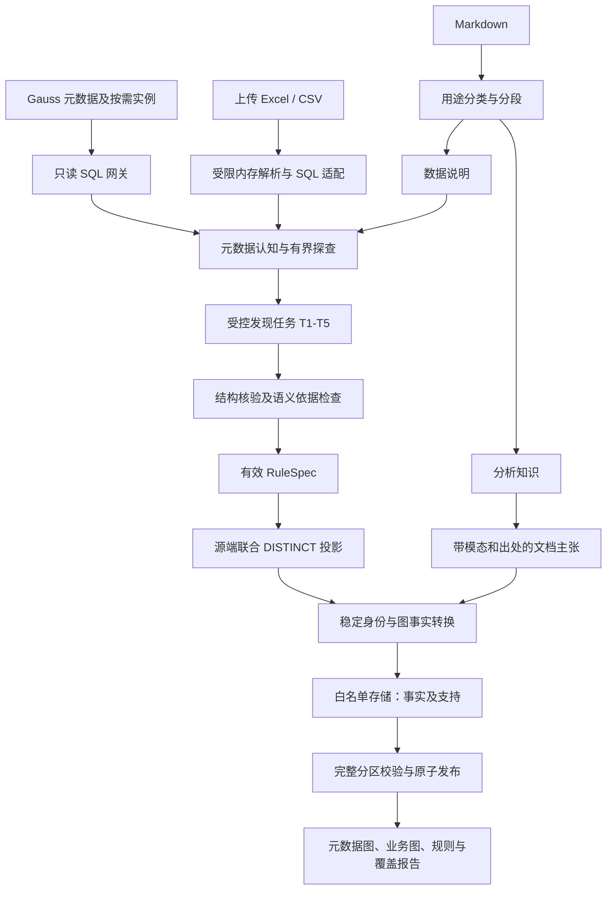

# 轻量知识图谱架构设计

当前需求与验收基线为 2026-10-27 更新的 [US](US.md) 和 [工作台 US](WORKBENCH_US.md)。新增运行流程见[目标驱动的迭代构图方案](GOAL_DRIVEN_ITERATIVE_GRAPH_DESIGN.md)，历史缺陷证据见[审查复核](AUDIT_REVIEW_20261025.md)。最新修复见[两份评审后的继续修复](REVIEW_CONTINUATION_20261027.md)，2026-10-26 协议修复见[真实数据反馈记录](REAL_DATA_DISCOVERY_REPAIR.md)，更早能力见[迭代引擎实施记录](ITERATIVE_ENGINE_IMPLEMENTATION.md)，更早的验证保留在[历史实施记录](../../IMPLEMENTATION_STATUS.md)。

本文保留整体架构与有效约束。旧的 W0～W6 计划、AgentScope 接入和 Markdown/层级增补用于解释历史实现，不再重复充当当前进度说明。

最新修改见[字段认识、对象模型与连续画布](SCHEMA_FIRST_DISCOVERY_20261030.md)，包含最新零发布实验的原因、采纳意见、实际实现与验证边界。

2026-10-30 五表自动实验的复核及本轮修复见[两份评审的采纳意见](REVIEW_REPAIR_20261030.md)：提交与编译引用约束、可修正拒绝、跨运行字段诊断、联合上下文呈现，以及同输入复跑的验收边界。

工程运行包位于 `src/lightgraph/`。主流程独立实现，按算子借鉴此前的 ontology route2 与 xiaomeng 项目；旧项目的源数据和本地存储没有迁入。真实数据库与模型接入仍待客户环境验证。

客户输入由结构化数据与知识文档组成：结构化数据可以是 **Gauss/MySQL 的元数据及按需实例数据、Excel 或 CSV**，一次运行可以混合来源；知识文档支持 Markdown。数据库检索返回的数据只在受限内存中使用；允许保存通过输出契约的抽取结果。最终输出为轻量属性图、抽取规则、声明与解释 YAML、数据说明和覆盖报告。

## 1. 架构决定

目标运行流程为“目标修订 → 元数据认知 → 少量探查 → 规则执行 → 未知模式复核 → 图级归并与关系复核 → 原子发布”。每次模型调用都携带目标、当前阶段及子任务，并按实际涉及表组装适用说明。Agent 根据工具结果继续探查并提出列组、语义角色和关联假设，程序负责查询验证、身份解析、批量生成和增量维护。规则验证后，符合该模式的新取值直接由程序处理。工具循环见 [发现 Agent 更新](AGENT_DISCOVERY_UPDATE.md)，新增上下文和身份契约见 [混合输入与层级说明](INPUT_CONTEXT_HIERARCHY_UPDATE.md)。

这条主流程解决三个具体问题：

- **少量知识来自大量事实行。** 先选择实体与关系需要的列，再在源库对联合元组做 DISTINCT。金额、交易流水等与当前目标无关的内容不进入图谱。
- **源结构需要探索。** 程序维护可续跑的假设队列，通过注册算子核验、找反例、修订；预算不足明确延期，不能靠一次大 prompt 猜完结构。
- **同一知识被多处引用。** 稳定语义实体、局部来源绑定、每个属性值的支持关系分开存。经身份判断并获准在相关范围共享的对象可跨表复用；同名不直接合并，冲突保留不同实体或未决。

首期使用客户批准的关系型结果库，不依赖图数据库、不构建 OWL 类继承体系，不把每个指标和维度成员派生成类型。API/Card 召回和线上问数不属于本轮范围；后续可消费导出的知识。

## 2. 数据流与部署

数据库查询和 Excel/CSV 中间投影由 `EphemeralBatch` 管理，不写样本、缓存、trace 或临时数据库文件。跨源核验在各端执行必要列 DISTINCT，再做受限内存比较；两端独立快照不代表分布式同一时点。超限、截断或一致性不足保留未决。源库只读账号与结果库写账号分开。模型运行位置、请求保留、应用日志、APM、临时目录和崩溃转储均在实际接入前检查。

文档可以补充数据解释，但不能改变工具权限、预算或 SQL 策略。用户上传的 Excel/CSV/Markdown 留在客户授权输入区；这不允许系统另存数据库查询结果作为“文档”或“证据”。

## 3. 从输入到图谱：销售费用示例

输入列：`report_item_l2_code / report_item_l2_sort_column / report_item_l2_cn_name / report_item_l2_en_name`；示例值为 `2150 / 112 / 销售费用 / Selling expense`。

1. 读取完整授权元数据，再用少量分层样本和聚合统计形成数据认知。只有一个 `l2` 序号，先提出“同一实体的属性列组”，不把四列展开成四个层级。
2. 核验命名空间内 `code → 名称/定义属性`。事实表里同一 code 重复十万次是正常现象；要检查的是相同 code 是否对应冲突定义。112 是展示排序，按目标排除。
3. 编译已验证规则，对身份、名称、别名和必要范围联合 DISTINCT。物理事实行不会逐行变成节点。
4. 得到一个“销售费用”实体，编码 2150、英文别名 Selling expense。类别有依据时标 Metric；含义不足时标 ReportItem 或保留待确认状态。
5. A/B 两处引用经确认属于同一定义时，绑定到同一实体，增加两份范围支持。A 独有别名撤回时仅删除该别名的 A 支持；B 的实体与别名继续存在。

多个 `l1..l5` 列组走宽层级规则：先确认层序和身份，按缺失切段，再压缩连续同身份的填充槽位，最后生成相邻父子边。`3/1/1/1/1` 在填充规则有效时得到 `3→1`；`A/NULL/C` 默认不生成 `A→C`。同级编码的一一对应、名称前缀和统计依赖都不能单独证明父子语义。

用户原始片段里的 `2711` 和 `2713` 位于同一父级下，应先作为兄弟节点。`2711→2713` 以及 `2→28` 等编码改写，须有独立父字段、映射表或说明文档依据；系统不能自行补成期待的树。

## 4. 六个模块的契约

| 模块 | 输入 → 处理 → 输出 | 边界 |
| --- | --- | --- |
| SourceAdapter 与查询网关 | 授权来源 + 工具请求或只读 SQL → 方言处理/安全校验/有界查询 → 临时批次 | 工具强制校验；模型不能绕过网关；源结果不保存 |
| 数据认知 | 完整元数据 + 聚合/受限样本 + 适用说明 → declared/observed/inferred/conflict | 不覆盖原 schema；生成说明不能反过来充当独立证据 |
| 发现工作流 | 目标、未决项、已知模式 → 提假设/核验/反例修订 → 规则或明确未决 | 结构通过与业务含义确认分开 |
| 规则执行器 | 有效规则 + 当前来源 → 联合投影/层级处理/身份解析 → 图事实 | 不按源行调用模型，不把单列 DISTINCT 集合做笛卡尔积 |
| 身份与发布 | 图事实 + 来源范围 → 稳定身份/属性支持/分区对账 → 当前授权视图 | 失败、截断、读范围不一致时不按缺失撤回 |
| 文档与展示 | 两类 Markdown / 已发布图 → 上下文、主张、元数据对照、导出 | 保留建议/可能/条件模态；导出和搜索同样按属性支持授权 |

接口、字段与状态在 [SDD](SDD.md) 中定义；工作流不得另建冲突的身份或保留契约。

## 5. 受控发现流程

一个程序调度器管理五类模型任务，不需要五个相互聊天的自治智能体：

| 任务 | 要解决的问题 | 如何判断提案可用 |
| --- | --- | --- |
| T1 表内发现 | 哪些列构成实体、属性、范围或应排除字段 | 列组存在性、函数依赖、属性冲突、目标相关性 |
| T2 跨表发现 | 引用、条件映射、同角色列、身份候选、实例关系 | 有效连接元组、端点身份、基数、覆盖、反例、适用语义依据；支持一对多和多对多 |
| T3 层级发现 | 宽层级、填充、方向、命名空间 | 层序依据、缺层、同码异义、多父/环、全声明范围验证 |
| T4 文档解释 | 文档用途、定义、分析主张与实体对齐 | 文档出处、适用范围、模态条件、唯一绑定或候选 |
| T5 反例修订 | 已有假设为什么失败，规则怎样收窄 | 仅在反例/漂移触发；修订必须改变可验证条件，不能靠提高置信度放行 |

查询由受限算子及谓词 DSL 编译，再递归检查完整 SQL AST、对象/列/函数授权、数据库只读事务及资源上限。历史 BI SQL 的容错解析器只能解释证据，不能作为安全执行检查器。

预算分别管理 DB 成本、LLM 调用/token、时间与内存。提出新假设前预留最低验证成本；不够就延期。各阶段预留比例可配置，不能解释为客户验证覆盖保证。所有目标范围对象有处理状态，L3、未决、延期分别计数。

候选按目标、列组、类型、作用域和结构特征先筛选，再探查；通用字段同名或值碰撞只产生技术线索。规则、依赖与新数据模式都未改变时，复用规则不调用 LLM；未知判别值、新口径或违反规则的取值触发定向复核。

## 6. 图模型、身份与元数据

图包含物理元数据、业务知识、来源与规则三层。业务类别、属性和关系由项目目标与数据形成版本化定义；Metric、Measure 等作为现有场景模板。支撑对象和规则不混入业务节点数量。动态词汇仍受输出许可、结构和留存限制。

- `source_binding` 定位来源内的局部编码和命名空间。
- `semantic_signature` 为共享候选提供定义、单位、公式、口径等比较信息。
- `entity_id` 是接受后的稳定身份。改标签不换 ID；同名不足以合并，定义冲突须拆分或未决。
- `fact_id` 由事实内容和语义限定决定，**不含规则 ID、规则版本或访问范围**。
- `support_id` 记录来源、规则修订、分区和权限范围。节点存在、每个属性值、别名、边和主张分别有支持。

读取时先过滤当前有效且有权限的支持，再生成标签、属性、边和状态。共享节点不表示能看到其他租户的私有别名；搜索、计数、导出和追溯遵守同一规则。

元数据视图完整显示授权的库→schema→表→列（Excel 为工作簿→工作表→列）。跨表关系区分声明外键、值域交集、同属性角色、核验引用、概念映射和实体同一性。`technical_link` 保留语义 unresolved，不能因技术匹配通过就标成业务确认。双表对照能直接回答“A.a 与 B.c 是否都是指标中文名，以及这是否允许 JOIN”。唯一关系注册表见 [SDD §11](SDD.md#11-图模型元数据视图与来源)。

## 7. 持久化、增量与回滚

**允许保存**：通过严格输出契约与保留检查的目标图事实及受控候选、来源绑定和引用范围、规则、无样本的数据说明、文档主张、验证结论、非值检查点与覆盖计数。候选带状态，不进入 accepted 视图。使用定型输出结构及获准的项目属性定义，不能把整行或反例原文装进 `properties/evidence`。

**禁止保存**：数据库返回的原始行、样本、distinct 元组、原始画像字典、逐行投影或哈希列表、含业务值的模型请求/响应、调试正文和源数据副本。参数值的普通哈希也不进日志；低基数值可以被枚举。

规则在声明分区内执行，暂存的是已通过输出契约的图事实和支持。读取完整且一致、规则依赖仍有效后，事务切换分区发布指针并提交检查点。未完成分区重启时重新查询；不能保存最后一行业务键来绕过不落盘约束。

增量按源能力选择：已有且可靠的变更视图优先；有更新时间时重算受影响分区并定期完整对账；没有变更源时在源库重扫关键投影。SELECT-only 不会自动创建 CDC、触发器、复制槽或索引。源端扫描量可能仍大，程序不会因此把源结果搬到本地缓存。

回滚旧规则必须对当前来源重验、重算受影响分区，并迁移身份与支持。旧发布可作为历史结果查看；无历史源快照时不承诺恢复过去的原始数据。

## 8. 两个项目的复用边界

| 来源 | 迁移内容 | 必须改造的部分 |
| --- | --- | --- |
| route2 | 统计、键与作用域、列角色、引用核验、共享定义比较、元数据图、预算/反例测试 | 改为 SourceAdapter；补联合 DISTINCT、宽层级、属性支持与规则执行；移除每定义派生类型 |
| xiaomeng | 候选/校验/归并/发布职责，输出 schema 思路，文档/BI 语义处理经验，事件结构 | 新建 DB/Excel/Markdown 输入；重新设计身份、模态主张与数据边界 |
| 可选 BI 适配 | 历史 SQL AST、组件血缘 | 方言逐项适配；容错 AST 不参与 SQL 执行授权 |
| 两者都不直接迁移 | 本地源库、source_snapshot、逐行证据、完整 trace、模型请求缓存 | 原路径在新工程不可达；旧混合 results.sqlite 不复制，新的合格结果库可以使用 SQLite |

旧项目的详细代码核查属于本地历史研究资料，不随公开仓库发布。旧测试数和运行耗时不属于新系统验收；当前接口及验证范围见工程 README 与实施记录。

## 9. 开发顺序与独立验收门

当前按 [US §3](US.md#3-优先级依赖与交付批次) 的 A～E 顺序推进缺陷修复、项目语义定义、跨轮迭代、图级裁决和独立验收。原 W0～W6 留作历史工程阶段；F01～F15 的实际测试映射与缺口见[场景台账](acceptance_matrix.yaml)。

| 验收门 | 必须验证 | 不能据此声称 |
| --- | --- | --- |
| E：规则执行 | 固定 RuleSpec 得到正确实体/边/属性支持；重复不增节点；A 撤回不损坏 B；六类路径不落盘 | 模型能自动发现规则 |
| D：自动发现 | 模型只见目标、元数据、允许探查与说明文档；规则与图对照评估器持有的隐藏真值 | Mock 调度成功就是发现质量通过 |
| I：实际接入与增量 | 选定 Gauss 产品/版本的只读、超时、取消、查询语义、增量与恢复、一致性和部署保留检查 | 内存 SQL 或其他数据库测试替代 Gauss |

首轮使用 8～12 张小表、约 3,000～10,000 行、3～6 份 Markdown，包含回声注释、错误 schema、重复事实、编码碰撞、缺层、同名异义和文档冲突。千万行演练放在扩大试点之前，不阻塞第一条执行实验。

46～59 人日是当前工作分解粗估，不是完成承诺。接入与前两阶段实测后再估；不把未知客户语义正确率、模型调用数或预处理时长写成保证。

## 10. 文档职责与交付

| 文档 | 唯一负责的内容 |
| --- | --- |
| [SDD](SDD.md) | 架构、输入与保留策略、稳定身份、RuleSpec、图事实/支持、关系注册表、发布与增量 |
| [发现工作流](DISCOVERY_WORKFLOW.md) | 假设 DSL、探查算子、任务输入输出、状态转移、预算、层级算法、错误码 |
| [US](US.md) | 34 条用户故事、F01–F16、现有覆盖与缺口、E/D/I 分门与通过条件 |
| [实施计划](IMPLEMENTATION_PLAN.md) | W0–W6 任务、依赖、复用清单、交付顺序与工时重估点 |
| [设计核对记录](DESIGN_VALIDATION.md) | 本次文档修改、静态检查结果、尚未执行的运行验证 |

落地时产出元数据图、轻量业务图、属性与来源支持、可读 RuleSpec、数据说明 Markdown、文档主张、冲突与覆盖报告。存储实现、JSON Schema、测试文件和 CLI 已在 `src/lightgraph/` 落地；实际通过与未验证项见工程根目录实施记录。

## 11. 实际接入前的环境配置

下列项保留为接入阶段配置，不再阻止架构定稿：

- Gauss 的具体产品、版本、兼容模式、驱动及授权库表列。
- 只读账号、允许的函数/视图、查询负载窗口、超时与取消能力。
- 可靠变更来源和一致读取能力；没有时启用投影重扫方案。
- 模型运行位置与零保留条件、结果库位置及权限隔离域。
- Excel 大小、表区与格式约定；文档的来源、适用范围和修订规则。
- 业务验收真值与负责人；没有业务标注时只报告已验证的结构和工程边界。

不能满足源结果不保存、只读执行或范围授权的环境，不能进入实例探查；不得通过免责配置自动放宽用户约束。
