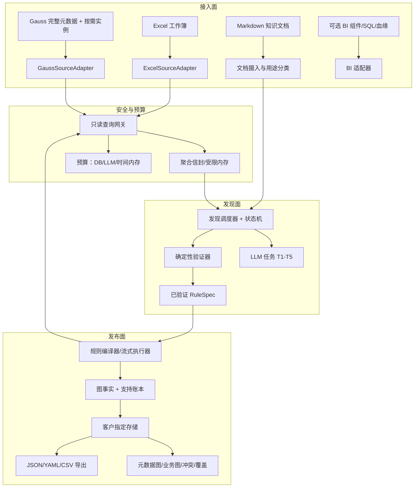

# SDD：Gauss、Excel 与知识文档驱动的轻量图谱

版本：1.0（2026-10-17）。状态：最终架构基线，待实现、待运行验收。本文冻结系统边界与契约；阈值和工时仍是试点初值。

需求来源：客户新环境（Gauss 元数据 + 按需实例、Excel、Markdown 知识文档；只读 SQL；数据库返回数据不落盘；轻量图而非本体）以及 [README](README.md) 的核查结论。用户验收见 [US](US.md)，发现工作流的实现细节见 [DISCOVERY_WORKFLOW.md](DISCOVERY_WORKFLOW.md)，开发顺序与工时见 [IMPLEMENTATION_PLAN.md](IMPLEMENTATION_PLAN.md)。

本文的早期代码结论来自 `xiaomeng`、`route2` 两个项目的只读核查，旧代码行号以 2026-10-17 工作区为准。当前实现位于 `src/lightgraph/`；§13 和 §18 中注明的接口以源码契约及生成 Schema 为准，其余示意代码仍用于说明设计，不保证与实现逐行对应。本文是身份、图事实、关系注册表、保留策略和发布契约的唯一规范来源；发现任务与算子细节以 DISCOVERY_WORKFLOW 为准，需求验收以 US 为准。

## 1. 范围与设计决策

### 1.1 输出目标

构建可解释、可增量维护的轻量属性图。图中的内容分三层：

1. **物理资产层**：数据库、schema、表、列、列组、上传文件/工作表；声明主键、外键、注释；表→列包含关系。
2. **业务知识层**：指标、度量、维度、维度成员、报表项目、业务术语、分析概念、分析方法；实体之间的 `parent_of`、`member_of`、`uses_measure`、`analyzes`、`defined_by`、`verified_reference` 等关系；文档主张。
3. **来源与规则层**：哪个列组产生哪个实体，哪条规则产生哪条边，来自哪个来源范围、哪次验证、覆盖哪些分区、何时失效。

不要求 OWL 推理、完整类继承树、每个定义派生一个本体类型。`Metric`、`DimensionMember` 等是节点的类别标签，不是需要维护公理的类。类型含义不足时保留 `ReportItem` 或 `unknown`，不凭表名/字段名强制归类。

第一阶段不抽取每条交易、订单或财务观测值。用户目标可以明确要求某些事实关系，但要单独声明粒度和规模预算。

### 1.2 核心决策

| 编号 | 决策 | 原因 |
| --- | --- | --- |
| D01 | 新建独立 `lightgraph` 主流程，从两个旧项目拆算子复用 | 避免继承报表包、本地全量导入与本体类型推导 |
| D02 | 数据源统一走 `SourceAdapter`；模型通过注册工具提交探查请求或只读 SQL | 工具内部统一校验 SQL、权限、成本与取消 |
| D03 | 模型提出结构假设，程序用查询找反例并验证 | 少量样本证明不了全表规律；命名不能代替语义 |
| D04 | 实体投影与关系投影分开，按目标粒度做联合 DISTINCT | 去掉事实重复，同时保留关系两端的真实配对 |
| D05 | 语义身份与来源绑定、引用范围分离 | 同一指标跨范围共享；同名不同口径不误合并 |
| D06 | 数据说明文档与分析文档分开处理 | 前者解释结构，后者产生主张；证据地位不同 |
| D07 | 查询结果只在受限内存消费；持久化只经过输出契约 | 满足“数据库返回数据不落盘” |
| D08 | 增量建立在图事实支持关系与规则依赖上 | 不引入原始结果缓存或逐行指纹库 |
| D09 | 不一致、预算不足、来源失效都显式报告 | 不把抽样成功或正常退出表示为完整发现 |
| D10 | 首期图存储用关系表，导出格式与存储解耦 | 客户环境不一定有图数据库；交付需要可移植格式 |
| D11 | 模型运行位置与数据出域边界可配置 | 客户可能不允许样本离开环境 |
| D12 | 规则有版本、验证记录、失效条件和回滚路径 | 错误规则不能长期污染图谱 |
| D13 | 旧项目保留入口，不再扩展；新能力只进 `lightgraph` | 迁移期可对照，避免两条主干同时维护 |
| D14 | 语义质量与工程正确性分开验收 | 没有业务 Gold 时不能宣称“语义准确” |

### 1.3 系统不做的事

- 不做通用多 Agent 平台、微服务、消息队列、图数据库集群。
- 不自动创建源库对象（视图、物化视图、索引、触发器、统计表、复制槽）。
- 不保存源数据库返回结果、样本、原始投影、含样本的 prompt、完整模型请求/响应。
- 不承诺“零扫描的精确增量”“自动还原所有错误 schema”“任意数据压缩到固定节点数”。
- 不把文档主张、同名、同值域自动升级为业务事实或实体合并。

## 2. 系统结构与部署边界

### 2.1 三面结构



### 2.2 部署与信任边界

建议部署在客户环境。开发电脑不接收业务样本。组件边界：

| 组件 | 位置 | 权限 |
| --- | --- | --- |
| 源库连接 | 客户网络内 | 只读账号；无写、无 DDL、无导出；函数受白名单限制 |
| 查询网关/发现/执行 | 客户应用环境 | 读源库只读凭证；不持有写凭证 |
| 模型网关 | 客户批准的位置 | 只接收配置允许的内容；不落请求正文 |
| 结果存储 | 客户指定位置 | 独立写凭证；与源库账号分离 |
| 查看器/导出 | 客户内网 | 只读结果存储 |

模型请求路径也是数据边界的一部分：LLM SDK 的 prompt cache、代理请求日志、APM body capture、异常附件、core dump、交换分区都要在部署预检中处理。不能只在应用代码里删文件。

### 2.3 存储选择

首期不引入图数据库。用客户现有的关系库（或 SQLite/PostgreSQL/MySQL 中已批准的一种）存节点、边、属性、支持、规则、文档、验证记录。图查询用邻接表与索引，复杂图遍历在应用层做。导出 JSON/YAML/CSV；图数据库和 DataHub 是可选导出目标，不作为运行依赖。

### 2.4 任务模型

单进程 CLI/任务 runner 起步，支持中断续跑；不引入分布式调度。任务单位是“规则 × 分区”与“假设 × 探查”，不是源表全量。并发限制分两类：数据库连接并发（受客户库负载约束，初始 2）与模型并发（初始 2）。

## 3. 输入契约与数据保留

### 3.1 结构化输入

```yaml
StructuredSource:
  id: source_001
  kind: gauss_database | excel_workbook
  connection_secret_ref: secret://customer/graph_reader
  allowed_objects: [catalog.schema.table]        # 或 schema/表/列白名单
  engine_profile:
    product: pending_detection                   # GaussDB 集中式/分布式/openGauss/...
    version: pending_detection
    compatibility_mode: pending_detection
    driver: pending_detection
  data_scope: complete_database | export | unknown
  change_capability: cdc | updated_at | none | unknown
  schema_document_refs: []
```

数据库：读取授权范围内的完整表列元数据、类型、注释、声明约束、可用的表统计。元数据可以持久化，但应转换成元数据图或数据说明，禁止顺手保存目录查询的原始 JSON。完整元数据不等于一次全部放入模型上下文：按表/列组分包，记录覆盖范围。

Excel：工作簿/工作表是来源；表头与可选 schema 产生声明元数据，单元格产生观察。要求：

- 保留原始列名、前导零、空值语义（空串与 NULL 不混同）、类型推断结果、工作表位置。
- 合并表头、多表区域、隐藏行列、公式缓存值、日期格式都要有解析规则；不执行宏、外部链接或公式；无缓存结果的公式单元格标 `pending`。
- 原文件留在客户上传区；解析中间表只在内存。需要 SQL 计算时用内存引擎，关闭磁盘 spill，超内存则减小批次或失败。
- 首期上限初值：单文件 ≤200MB、单工作表 ≤200,000 行、≤2,000 列；超过时拒绝或要求拆分。流式读取 Excel 仍可能遍历整个文件，不能承诺像数据库索引一样随机取数。

### 3.2 知识文档输入

```yaml
KnowledgeDocument:
  id: doc_001
  revision: v3
  media_type: text/markdown
  purpose: data_description | analysis_knowledge | mixed | unresolved
  applies_to: [source_001.schema.table]
  valid_from: null
  authority: customer_supplied
  content_ref: customer_document_store://doc_001/v3
  headings: []          # 解析后回填
  segments: []          # 段落/切片定位，按需取
```

- 文档可以有 YAML front matter 标明用途、范围、版本、作者；没有标注时由模型提议分类，保留 `unresolved`。
- 同一文档不同段落可以承担两种用途；按标题层级、表格、代码块切片，保证定义与条件不被截断。
- Markdown 渲染禁用危险 HTML/脚本与默认外部资源加载；文档中的指令文本不能修改工具权限、SQL 策略、预算或输出 schema。
- 文档修订用内容哈希与版本链记录；删除文档只撤回该文档支持的主张，不删仍由数据或其他文档支持的事实。

### 3.3 持久化白名单

| 内容 | 是否保存 | 条件/位置 |
| --- | --- | --- |
| 数据库查询返回的原始行、样本、distinct 原始元组 | 禁止 | 只在受限内存消费；异常/崩溃也不落盘 |
| 含上述数据的 prompt、模型请求/响应正文、调试轨迹 | 禁止原样保存 | 只保存不含取值的请求形状哈希、schema 版本、白名单结果与计数 |
| 原始画像字典、含样本值的 profile、来源快照、DuckDB/本地源表副本 | 禁止 | 旧实现对应路径在新模式不可达 |
| 原始投影逐行哈希表、可重建取值的缓存 | 禁止 | 不能以“增量状态”名义保存源数据衍生副本 |
| 图节点、边、业务标签/编码、别名、定义（含受控候选） | 允许 | 必须属于抽取目标和输出契约；候选独立标记且不进入 accepted 视图，不能把整行塞进 properties |
| 来源绑定、引用范围、支持关系 | 允许 | 只保存图结果所需的语义编码、范围、表列定位、规则引用 |
| 抽取规则、数据说明、验证结论、文档主张 | 允许 | 只含模式、聚合结论、角色与冲突说明，不附样本 |
| schema/规则/文档版本、逻辑分区检查点、发布 ID、聚合计数 | 允许 | 结果维护状态；不携带原始查询内容或逐行投影 |
| 原始上传的 Excel/Markdown | 输入管理 | 留在客户授权上传区，按输入保留策略管理；不是结果缓存 |

“允许保存的图属性”与“原始结果集”必须分类型：`EphemeralBatch` 不提供序列化/落盘接口；持久化入口只接受 `GraphFact`、`RuleSpec`、`DataUnderstanding`、`DocumentClaim`、`ValidationRecord`、`RunBatch` 等类型。

禁止的是旧项目的混合存储内容（图对象、断言、evidence、搜索索引、完整 target 行混在一起），不是禁止关系库或 SQLite。新结果库用哪种存储是独立选择；只要内容经受白名单 `Store` 校验、不夹带源行/样本，就允许。

### 3.4 内存与落盘闸门

- 查询结果以游标/批次返回，单批有行数、字节数、生命周期上限；批内只做聚合或转换，转换后立即产生图事实并释放。
- 需要内存 SQL 计算时（Excel、或把少量投影做连接），引擎设置内存上限并关闭磁盘 spill；达到上限就减小批次或报 `memory_budget_exhausted`。
- 写盘函数集中到一个 `PersistencePolicy`/`Store` 接口，只有白名单类型能进入；文件路径来自配置，不在业务代码里散落 `open()`/`write_text()`。
- 开发期提供 retain-check：在合成输入的非抽取字段、样本和错误载荷中植入唯一标记，覆盖成功、异常、取消、重试、崩溃、流式输出六类路径，扫描输出目录、临时目录、日志、异常、模型网关；命中即 `retention_policy_violation` 并中止发布。另设白名单图属性标记作为正例，防止用“任何源值都不能出现在图中”的错误检查替代内容契约。

### 3.5 日志、追踪与模型网关

日志只允许：任务 ID、规则 ID、查询模板 ID、算子、耗时、扫描/返回行数、字节数、错误类别、预算计数。禁止：SQL 参数、业务值、样本、响应正文、认证信息。

部署预检还包括：关闭 SDK prompt cache、代理 body 日志、APM 自动采集、异常附件、shell history、core dump、交换分区（由部署预检验证，不满足则阻止实例接入）。应用层不能证明运行时绝无内存残留；验收记录覆盖过的写盘路径和部署控制，不作超出检查范围的保证。源库内部执行 SELECT 所需的缓冲或临时页属于源库运行边界；禁止的是查询结果在应用、模型服务和可观测系统中形成持久副本。

### 3.6 敏感列与模型出域

配置项：

```yaml
privacy:
  excluded_columns: [schema.table.column]
  sensitive_patterns: [id_card, phone, email, secret, token, address]
  sample_policy:
    default: aggregates_only        # aggregates_only | allow_sampled
    allow_sampled_columns: []
  llm_boundary:
    mode: in_environment            # in_environment | approved_external | metadata_only
    provider_retention: none        # 由采购/合规确认
```

- 敏感列默认只参与聚合/计数，不返回样本值；命中敏感形态的列不进入 LLM 输入包。
- `metadata_only` 模式只发送经授权的元数据、无取值聚合结论与文档片段，不发送样本；模型仍可提出结构假设，依赖实例语义而无法验证的项保持未决。
- 向量化只对已发布知识文本执行，不对源实例行执行；客户认为向量可还原原文时，要求加密、访问控制或关闭向量。
- 配置变更写入运行契约；违反策略时拒绝调用并报 `data_boundary_violation`。

## 4. 只读 SQL 网关

### 4.1 连接预检与 CapabilityManifest

首期使用 Gauss 系列数据库；具体产品、版本、驱动和兼容模式在连接预检时确定，不能假定与 PostgreSQL 完全兼容。以下是能力清单模板，`verified` 只能由实际预检写入，默认全部 `unknown`：

```yaml
CapabilityManifest:
  product: GaussDB | openGauss | unknown
  version: "..."
  deployment: centralized | distributed | unknown
  compatibility_mode: "..."
  driver: {name: "...", version: "..."}
  read_only_transaction: verified | unsupported | unknown
  metadata_reading: unknown
  parameter_binding: unknown
  distinct_projection: unknown
  cursor_paging: unknown
  query_cancel: unknown
  statement_timeout: unknown
  window_functions: unknown
  cte: unknown
  aggregate_filter: verified | fallback
  json_functions: supported | partial | unsupported
  approx_distinct: supported | unsupported
  explain: supported | unsupported
  tablesample: supported | unsupported
  change_capture: cdc | updated_at | none
```

只编译能力矩阵确认支持的 SQL 形状。未知项不用“试试看”兜底；不支持时返回 `unsupported_dialect` 或降级为确定性安全子集，并写入报告。预检不创建源库对象。

**能力探测矩阵**（每项必须记录探测方式、证据、失败降级）：

| 能力 | 探测方式 | 证据 | 不支持时 |
| --- | --- | --- | --- |
| 产品/版本 | 只读查询版本函数/连接元数据 | 版本字符串 | 标 unknown，按最小兼容集 |
| 只读事务 | 会话级 `SET TRANSACTION READ ONLY` 后查询 `transaction_read_only` | 参数值 | 拒绝实例探查 |
| 元数据读取 | 查询系统目录表/视图 | 表列清单 | 阻止发现 |
| 参数绑定 | 预处理一条 `SELECT :p` | 驱动返回 | 拒绝，不改拼接 |
| 超时 | 由连接器设置方言对应超时；在隔离测试库执行有界慢查询 | 超时触发、驱动返回、服务器查询终止三项证据 | 禁止实例查询；不能用 `SELECT 1` 代替超时验证 |
| 取消 | 发起长查询后调用驱动 cancel | 查询终止 | 不允许长查询 |
| 分页/游标 | 键集/游标查询对比 | 连续两页无重叠 | 只允许小结果或分区 |
| 窗口函数 | 对常量表窗口查询 | 结果 | 层级模板降级并报告 |
| CTE | 只读 CTE 查询 | 结果 | 重写为子查询 |
| 聚合 `FILTER` | `SUM(...) FILTER (...)` | 结果 | 改 `SUM(CASE WHEN ...)` |
| 近似基数 | `approx_count_distinct` 查询 | 结果 | 采样估计或精确计数（计成本） |
| JSON | 解析函数查询 | 结果 | 只做字符串形态统计 |
| `EXPLAIN` | 只读计划 | 计划文本 | 用元数据统计估成本 |
| 表采样 | `TABLESAMPLE` 查询 | 结果 | 键集分层采样 |
| 变更来源 | 目录/视图/接口探测 | 能力结论 | 按无变更标记档处理 |

探测查询计入预算与审计，不返回业务行；未知能力不等于支持。表中的事务命令、参数名和版本函数是适配器测试项，不能直接当成所有 Gauss 产品的可执行语法。事务控制只能由适配器固定路径发出，模型和规则无此权限。长查询取消测试先在隔离测试库完成，生产预检只执行已批准的有界探测。

### 4.2 五层约束

1. **统一查询工具。** 模型可调用统计、函数依赖等结构化探查工具，也可向只读 SQL 工具提交查询和绑定参数。两类工具共用强制执行的 SQL 检查；表列必须属于授权目录。不安全查询整体拒绝，不通过删词或自动改写绕过检查。事务控制和图谱发布不开放给模型。
2. **严格 AST 校验。** 解析完整 SQL，必须恰好一条查询语句；递归检查 CTE、子查询、表达式、函数、表引用、锁子句、导出子句。解析失败、未知语法、自动修复都拒绝。
3. **数据库权限与会话。** 专用最小权限账号；只读事务由连接器初始化并确认；对象白名单与列授权在连接器侧再校验一次；结果存储用另一个账号。
4. **资源约束。** 执行前检查允许对象、关联规模、投影基数估计；执行时限制时间、并发、返回行数、字节数、内存与取消超时。`LIMIT` 只能限制返回，不能限制聚合、JOIN、DISTINCT 的计算量。
5. **结果生命周期。** 结果只进入 `EphemeralBatch`；不允许调用任何写文件/序列化 API；批结束即释放。

### 4.3 AST 允许与拒绝

设计允许范围：通过严格校验的单条 `SELECT`、只读 `WITH`、`UNION ALL`、聚合、过滤、`GROUP BY`、`DISTINCT`、受限 `JOIN`、固定深度层级展开模板。查询可以由编译器产生，也可以由发现 Agent 经工具提交；具体开放形状以工具和连接器的已验证白名单为准。`EXPLAIN`（不含 `ANALYZE`）可作为受控成本探针，未验证前不开放给 Agent。

必须拒绝：

- 多语句；`INSERT`、`UPDATE`、`DELETE`、`MERGE`、`TRUNCATE`、`UPSERT`。
- 数据修改 CTE（PostgreSQL 系语法）；`SELECT INTO`；`COPY`/`OUTFILE`；`CALL`/`DO`/`EXECUTE`；DDL；行锁/表锁；`EXPLAIN ANALYZE`；会话修改（`SET`/`BEGIN`/`COMMIT`）。
- 递归 CTE（首期不开放给模型；确有需求时做固定深度、防环模板）。
- 外部表函数、文件/网络函数、序列修改函数、未知 UDF、任意用户代码。
- 越权表/列、跨库引用、未授权视图内的函数。视图展开、对象解析与隐式 cast/operator 同样受可信目录策略限制；不能只检查顶层 SELECT 的函数名。
- 函数按“命名空间 + 名称 + 参数类型”白名单匹配，避免同名重载或隐式转换绕过。

数据库只读事务不是“零磁盘写入”的保证，也不替代对象权限；两者都要有。

### 4.4 资源与预算

```yaml
query_limits:
  statement_timeout_ms: 60000
  lock_timeout_ms: 5000
  max_return_rows_per_batch: 5000
  max_return_bytes_per_batch: 65536
  max_concurrent_queries: 2
  max_scanned_rows_per_run: 20000000       # 试点初值
  max_rows_returned_per_run: 400000
db_budget:
  max_queries_per_run: 240
  max_query_cu_per_run: 240
  reserve_for_verify: 0.55
```

成本按“扫描行数估计 + 返回行数 + 模板开销”估算，不按 `LIMIT` 估算。源库不能提供实际扫描量时，报告 `estimated/unknown`，不得把估算填成实测；扫描量预算是准入估计，超时、取消、连接数、返回字节与内存是执行期硬限制。超时/取消要真的取消源库查询，返回 `query_timeout`；截断标 `result_truncated`，不把截断结果当完整结果。扫描量与返回量分开记账。

### 4.5 方言与 SQL 模板

SQL 模板按 `CapabilityManifest` 选择：`FILTER` 不支持时改成 `SUM(CASE WHEN ...)`；`approx_count_distinct` 不支持时用采样估计或精确 `COUNT(DISTINCT)`（带成本预算）；`regexp` 语义差异由适配器提供等价写法；分页用稳定键/游标，不用 `OFFSET` 走大偏移。

route2 的统计 SQL 结构可以复用，但不能直接搬：`profiling.py:28-51` 用了 `approx_count_distinct`、`regexp_full_match`、`octet_length(encode())`、`FILTER`，`storage.py:122` 用 `read_csv` 与 `__r2_row` 本地行号。新项目必须逐条改写并做 Gauss 契约测试。

### 4.6 审计

每次查询记录：查询模板 ID、不含参数值的形状哈希、算子、授权表/列范围、状态、扫描/返回量及其 measured/estimated/unknown 标记、字节数、耗时、预算消耗。不保存参数值或由参数值计算的普通哈希；低基数值的哈希可被枚举。已接受图事实的内容哈希只用于结果库去重，遵守该事实的权限，不能复用到普通日志。

## 5. 目标与数据认知

### 5.1 ExtractionGoal

```yaml
goal_id: operating_analysis
purpose: 构建经营分析所需的指标、度量和维度图谱
include: [指标定义与计算依赖, 维度成员与上下级关系]
exclude: [每笔交易记录, 具体业务观测值]
discovery_guidance: [根据证据判断列组, 规则验证后对关键列去重]
entity_kinds: [Metric, Measure, Dimension, DimensionMember, ReportItem, BusinessConcept]
relation_kinds: [parent_of, member_of, uses_measure, verified_reference]
source_scope: []                         # 可选：表、schema 或来源范围
excluded_columns: []                     # 可选：禁止查询的列
evidence_only_columns: []                # 可选：可探查但不输出值的列
observation_values: false
```

目标在首次发现调用前进入 Agent 的系统上下文，并贯穿探查、规则生成和输出校验。文字字段表达业务方向，类型、来源和列范围由程序检查。目标不能扩张连接器权限；来源中的元数据、样本与 Markdown 仍是待核查证据。数字列的元数据可以表示指标定义，排除观测值不能直接排除所有数值列。每个候选列区分输出用途、仅辅助理解或本次无关。系统自动产生映射规则，规则要可读、可验证、可撤销；用户已有映射也仍须验证。

目标全部字段参与发现依赖摘要；变更后重新发现，不复用上一目标的规则为当前目标提供覆盖证明。知识文档、数据库预算与模型预算在运行配置的对应字段提供，不混入目标权限。2026-10-19 的工具循环、配置与边界见 [发现 Agent 更新](AGENT_DISCOVERY_UPDATE.md)。

### 5.2 DataUnderstanding

每张表/列组形成结构化结果，并渲染为数据说明 Markdown：

- `declared`：字段名、类型、注释、约束的原文解释，保持声明来源；元数据文本也受字段长度和授权范围约束。
- `observed`：空值/空串/空白、基数、长度、格式计数、值域形态、依赖；注明采样/分区/全量，不保存 top-k 原值或值域列表。
- `inferred`：实体列组、语义角色、命名空间、层级模式、排除列；带假设与备选解释。
- `conflict`：声明与观察冲突、列间冲突、文档与数据冲突；带定位与计数。
- `downstream`：可编译的规则、尚需探查的问题、禁止自动转换的字段。

数据说明可以保存聚合结论与已接受语义描述，不保存样本行。模型生成的数据说明标 `derived`，不回灌成更高权威的原始文档。派生说明必须保留依赖规则、来源结构和验证版本；再次引用它不产生第二份独立证据，依赖失效时同步失效。

采样策略：已有统计优先；无统计时按空/非空、常见/少见形态、判别值分层、时间分区、异常值模式抽取；固定前 N 行只作为一种观察。初始每表 8～32 行内存样本，只在当次调用中存在。

### 5.3 schema 与值不一致

检测项：

- 声明类型与观测形态冲突（numeric 列多数是文本；date 列月/日颠倒或含中文）。
- 注释/名称与值域冲突（注释“地区”，值是两位国家码；注释“编码”，值是名称）。
- 前导零丢失（数值列里出现 `1` 但业务编码应为 `0001`；需要文档或编码表佐证）。
- 同名列不同义、不同列同角色。
- JSON 混存、分隔列表、公式文本、枚举混写。
- 空值语义（NULL 与空串、`'null'`、`'-'`、占位符）。

处理原则：报告冲突，保留原声明，不静默纠正；无证据时保留 unknown。自动纠正只允许发生在“已验证的规则内部”，并把规则与依据写进来源。

## 6. 发现工作流

### 6.1 角色与状态机

工作流由程序调度器、五类 LLM 任务（T1 表内发现、T2 跨表发现、T3 层级发现、T4 文档解释、T5 反例修订）、一个确定性验证器组成。不是一个多 Agent 聊天系统，也不是逐表一次大 prompt。

状态机：`DISCOVERED → SCOPED → PROFILED → HYPOTHESIS_PROPOSED → PROBING → SUPPORTED | COUNTEREXAMPLE_FOUND → REVISED → RULE_VALIDATED → CANARY_CHECKED → PUBLISHED`，旁路 `UNRESOLVED / REJECTED / DEFERRED / STALE / FAILED`。完整转移、守卫与持久化见 [DISCOVERY_WORKFLOW.md](DISCOVERY_WORKFLOW.md) §5。

### 6.2 假设与规则契约

假设按六类组织：`column_group`、`entity_key`、`wide_hierarchy`、`reference`、`discriminator`、`exclusion`。每个假设带：目标表列、结构化 claim、证据等级（L0 声明 → L1 观察 → L2 抽样 → L3 全范围核验 → L4 发布）、支持与反例计数、修订链、预算消耗、指纹。

验证通过的假设编译为 RuleSpec（见 §9.3 与 [DISCOVERY_WORKFLOW.md](DISCOVERY_WORKFLOW.md) §8）。没有 `validation_ref` 的假设不能生成 RuleSpec。

### 6.3 预算与优先级

三套池：DB 成本、LLM 调用与 token、时间/内存，分开记账，不折算成同一个百分比。启动新假设前，先估算并预留其**最低验证成本**；剩余预算覆盖不了预留时，不启动新假设，转入核验或标记 `DEFERRED`。40%（LLM）/55%（DB）只是试点初值与兜底红线，不是客户数据标定过的保证。

优先级 = 目标收益 × 信息增益 × 覆盖收益 ÷ 成本；模型自评置信度只用于排序，不作为接受门槛。预算耗尽进入 `DEFERRED` 并带续跑提示，报告 `PARTIAL`。预算公式、成本模型与停止规则见 [DISCOVERY_WORKFLOW.md](DISCOVERY_WORKFLOW.md) §6。

### 6.4 确定性边界

| 决策/动作 | 谁做 |
| --- | --- |
| 列组、语义角色、实体类别、文档解释 | LLM 提议，程序校验 |
| 层级列组分类、方向、填充判定 | 程序（列名模式 + 父子一致性 + 填充统计） |
| 连续重复压缩、父子边、去重、环/自环检测 | 程序 |
| FD、值域、引用覆盖、联合 DISTINCT | 程序 |
| 编码映射、业务口径、冲突消解 | 只有映射表/文档/用户确认；模型只能提“疑似” |
| 发布图事实 | 程序单一写入者 |
| 增量复用 | 程序按规则/结构/文档契约指纹 |

### 6.5 人工提示（P1）

用户可对未决项录入提示或裁决，附来源。提示作为 `created_by=user` 的假设进入流程，仍需数据验证；裁决作为有来源的映射，可消解冲突。人工输入可追溯、可撤回，不覆盖自动证据。没有人工输入时系统必须能完成首版（P0 优先级）范围。

## 7. 列组、身份与投影

### 7.1 列角色

角色枚举：`identity_code`、`namespace`、`label`、`alias`、`semantic_attribute`、`display_order`、`level_position`、`fact_value`、`relation_endpoint`、`discriminator`、`audit`、`unknown`。

同一列在不同规则中可有不同作用。例如租户用于本地编码查找和引用授权，但经确认共享的指标不把租户放进全局语义身份；日期用于观测值过滤时可以忽略，用于定义版本时需要保留。

确定性规则（可复用 route2 的 `column_roles.py:245-310` 思路）：敏感/排除优先；全空列；审计时间/审计元数据；技术标识；语义名/注释线索；未知。模型只提议 `in_identity`、`multi_value`、`display_order` 等，程序按列存在、FD 冲突、值形态复核。

### 7.2 三层身份

1. `source_binding`：来源 + 命名空间 + 局部业务编码 + 适用版本，解决“这一处引用了谁”。
2. `semantic_signature`：种类、定义、单位、公式依赖、口径、粒度，提供合并依据；标签只是其中一个特征。
3. `entity_id`：已接受语义实体的稳定 ID。身份签名用于匹配候选，不用每次重新计算的内容哈希替代稳定 ID。

两个租户引用同一定义，更新同一个实体的支持关系和引用范围。一个租户修改公式，不应自动修改其他租户所引用的定义；重新判定为定义修订或拆分，更新相应绑定。实体拆分、别名修订、规则迁移留版本记录。跨客户隔离域不做自动共享。

归并规则：已核验结构映射优先；强定义冲突禁止合并；信息不足保留候选。标准化保留前导零、大小写含义与 SQL 字符串字面量；NULL、空串、字符串 `"null"` 不能无条件混同。同名称但不同单位/公式可以保留多个节点，展示时带限定。

共享对象仍需按来源引用权限过滤：一个租户不能因为共享节点看到其他租户的引用范围、私有别名或定义证据。

### 7.3 FD 与重复事实行

物理行唯一与业务实体可识别是两件事。事实表中同一 code 重复十万次正常。验证的是：在候选命名空间下，相同 code 是否对应相容的定义属性。

验证步骤：

1. 确定身份列组（如 `namespace + code`），先去掉与身份无关的列。
2. 对属性列检查函数依赖：每个身份组下属性是否单值；多值别名允许，但记录最大值与分布；单值属性冲突即反例。
3. 排序列用于排查，不因 `code → display_order` 稳定就纳入语义；本例已明确排除 `report_item_l2_sort_column`。
4. 检查空值/空串/占位符策略。
5. 检查身份组数量与覆盖；抽样通过只能标 L2，全范围核验才升 L3。

### 7.4 联合 DISTINCT 的粒度

实体规则投影：`命名空间 + 编码 + 标签/别名 + 必要定义属性`。

关系规则投影：`关系两端身份 + 关系所需条件 + 版本/范围`。

引用规则投影：`已识别实体 + 引用范围`，而不是对每条事实行生成一个 source_ref。

禁止先对每列单独 DISTINCT，再把集合相乘；必须对已存在的端点元组联合去重。也不能把所有实体属性都放进每个关系投影，否则无关变化会扩大关系数量。

截断保护：投影结果超过 `cap`（试点 20,000，客户环境可到 200,000）时返回 `projection_truncated`，按作用域分区（租户/分类体系/时间分区）重跑；不允许把部分结果当全量。报告区分源库扫描行数、不同元组数、接收行数、最终图事实数；`DISTINCT` 可能扫描全表，不承诺成本与结果数量成正比。

### 7.5 共享实体与权限

实体属性分：单值、多值、定义属性、别名、业务编码。每个属性值/别名分别挂来源支持。A 提供别名 X、B 提供 Y：B 不因共享实体看到 X；A 撤回后只影响 X。

合并候选的来源：已核验结构映射、同一来源的编码/定义、文档明确声明。名称相同、值域重叠、向量相似只能作为候选通道，不能单独合并。

## 8. 宽表层级规则

### 8.1 先分类，再展开

`report_item_l2_code / report_item_l2_sort_column / report_item_l2_cn_name / report_item_l2_en_name` 里有 `l2`，但它们是**同一个实体的四个属性**，不是宽表层级。判别规则：

- 提取 level 序号与属性后缀；只有一个 level 序号 → `entity_column_group`。
- 至少两个 level 且每层有 key + label/alias → `wide_hierarchy_candidate`。
- 其他 → `mixed_or_ambiguous`，保留未决。

这一步决定后续完全不同的规则路径。把单序号列组误当层级，会凭空造出 L2 层级；把多序号层级误当列组，会丢掉父子关系。

### 8.2 执行顺序

1. **发现层级列组**：列名模式、类型、属性集一致度提出槽位候选。缺号和空槽保留；单个 `l2` 属性组走实体投影，不生成层级。
2. **确认层序与语义**：结合已解释的层位、父字段或适用说明文档。父子唯一率、编码前缀、基数和填充比例只作核验线索；DAG 可以多父，编码可以不含父前缀。仅有相关统计不能确认方向，语义不足保留未决。
3. **解析身份**：先用命名空间、分类体系和局部编码定位，再按已验证的填充/等价规则绑定稳定实体。相同 code 跨层出现时不能默认合并；确认为层级局部编码才采用 `level_qualified`，同一实体的填充副本仍共享 ID。冲突槽位不参与已确认边生成。
4. **联合路径投影**：SQL 只取已确认身份、名称、别名与必要范围列，按路径联合 DISTINCT；金额、无关日期、排序列不参与。超结果/内存上限则分区或延期，结果小仍可能需要源端全表扫描。
5. **先切段，再压缩**：先按 NULL/未知缺层切段，再在每段内压缩连续且稳定身份相同的槽位。`A→NULL→A` 是两个单点段，不用压缩消除缺口；`A→B→A` 不压缩，进入环检测。
6. **生成和验证边**：只连每段相邻实体。`A→NULL→C` 默认不生成 `A→C`；独立规则获得“最近非空祖先”语义依据并完成验证后才允许跨缺口。多父按 tree/DAG 契约校验；环上边拒绝，其他边仅在独立验证通过后保留。记录源层位与适用范围，但不按层位重复造节点。

SQL 负责投影、过滤与统计；程序在受限投影上压缩路径、查环并组装图事实。若知识基数本身超预算，报告未覆盖范围，不能假定 DISTINCT 后一定放得进内存。

### 8.3 冲突与未决

| 冲突码 | 含义 | 处理 |
| --- | --- | --- |
| `same_code_diff_label` | 同命名空间同码多个名称 | 报告；多值别名或拆版本；不合并、不选主 |
| `cross_level_same_code` | 同码出现在多层 | 填充副本则合并；有层级局部编码证据才拆 `level_qualified`，否则未决 |
| `multiple_parent` | 同一子节点多个父 | DAG 候选或未决 |
| `cycle` / `self_loop` | 有向环/自环 | 拒绝受影响边；回退填充规则 |
| `gap_in_path` | 中间缺层 | 缺层两侧不连；除非有依据 |
| `code_series_mismatch` | 观察编码与目标树/文档编码体系不一致 | 只报告差集；不自动映射 |
| `level_count_conflict` | 文档层数与表内层数不同 | 未决 |
| `fill_mismatch` | 重复形态与填充策略矛盾 | 关闭压缩，重新验证 |
| `code_format_conflict` | 同层编码格式不统一 | 报告；不做隐式规范化 |

编码重映射（如 `2→28`、`24→2408`）必须另有来源：映射表、数据说明文档、用户确认。模型只能提“疑似映射”并标 `mapping_source=model_hypothesis`，进入未决队列，不进入已发布边或实体编码。

### 8.4 样例边界

- `3/1/1/1/1`：压缩为 `3 → 1`，只产生两个节点一条边；不产生 4 个“贡献利润”，不产生自环；“贡献利润”记录来源层位 `[2,3,4,5]`。
- `3/2/27/271/2711` 与 `3/2/27/271/2713`：产生 `271→2711`、`271→2713` 两条兄弟边；没有证据不产生 `2711→2713`。
- 用户目标树中的 `2711 → 2713` 需要另一列（父级编码）或说明文档支持；仅凭编码前后缀不能推出。
- 原始片段编码与目标树编码不一致时，作为对照报告，不写成唯一真值。

## 9. 规则、算子与执行

### 9.1 SourceAdapter

```python
class SourceAdapter(Protocol):
    def capabilities(self) -> CapabilityManifest: ...
    def describe(self, scope: AuthorizedScope) -> CatalogView: ...
    def execute(self, query: ValidatedQuery) -> Iterator[EphemeralBatch]: ...
    def cancel(self, query_id: str) -> None: ...
    def change_capability(self) -> ChangeCapability: ...

class EphemeralBatch(Protocol):
    # 只有迭代、列元数据、计数；没有 save/write/to_parquet 等序列化入口
    def rows(self) -> Iterator[tuple]: ...
    def stats(self) -> BatchStats: ...

class Store(Protocol):
    # 持久化入口只接受已接受类型
    def stage_fact(self, publication_id: str, fact: GraphFact) -> None: ...
    def put_rule(self, rule: RuleSpec) -> None: ...
    def put_document_claim(self, claim: DocumentClaim) -> None: ...
    def put_understanding(self, summary: DataUnderstanding) -> None: ...
    def publish_partition(self, completed: PartitionCompletion) -> Publication: ...
```

`EphemeralBatch` 没有序列化方法是设计约束，不是安全证明；日志、追踪与部署配置另行审计。`BudgetAllocator`（准入/记账/预留/快照）接口与 `budget.json` 见 [DISCOVERY_WORKFLOW.md](DISCOVERY_WORKFLOW.md) §6.6。

```python
class PersistencePolicy(Protocol):
    allowed_types: frozenset[type]                 # GraphFact / RuleSpec / DataUnderstanding / ...
    def check_write(self, target: Path, payload: object) -> None: ...   # 越权/未知类型抛异常
    def scan_for_canary(self, roots: list[Path], canary: str) -> CanaryReport: ...

class Cursor(Protocol):
    def next_page(self, size: int) -> EphemeralBatch: ... # 活跃会话内稳定键/服务端游标
    def restart_partition(self, partition_ref: str) -> "Cursor": ...
```

**分区与游标契约**：`enumerate_partitions(table, partition_by)` 通过元数据/字典表/时间范围枚举分区，记录分区键与行数估计；无法枚举时返回单分区并标 `partition_unknown`。无稳定键的表使用服务端游标；只能 `OFFSET` 时限制偏移上限，超出则要求按分区重跑。持久检查点只含规则、逻辑分区引用、已发布批次和完成状态。最后一行的业务键、样本或逐行哈希不能放进 token；稳定键分页位置只留内存，进程重启重查未完成分区。分区键若是允许保存的引用范围，存其 scope_ref；其余键通过授权来源重新枚举。

### 9.2 算子目录

| 算子 | 作用 | 主要返回（聚合） | LLM 可调用 |
| --- | --- | --- | --- |
| `describe_catalog` | 读授权元数据 | 表列/类型/注释/约束 | 否（程序） |
| `profile_column` | 单列形态 | 行数、空值/空串、基数、长度、格式计数；top-k 原值仅临时可见 | 是 |
| `profile_column_group` | 联合元组 | 不同元组数、重复组数、null 元组 | 是 |
| `check_fd` | 函数依赖 | 反例组数、多值分布、受影响组数 | 是 |
| `check_value_domain` | 值域/判断列 | 基数、越界计数、形态计数 | 是 |
| `sample_strata` | 分层样本 | 内存样本包（≤32 行/次），不落盘 | 是 |
| `check_reference` | 引用覆盖 | 可引用数、未匹配、歧义、缺作用域、分区计数 | 是 |
| `distinct_projection` | 联合去重投影 | 不同元组数、截断标志、属性冲突计数 | 是 |
| `path_probe` | 路径/填充模式 | 空值模式、逐层重复率、路径数 | 是 |
| `level_probe` | 层级方向/排序列 | 每层基数、跨层同码、排序判别 | 是 |
| `unpivot_probe` | 宽转长候选 | 槽位数、节点候选计数、截断 | 是 |
| `compare_attribute_role` | 跨表属性角色 | 值交集、角色对齐计数、单位冲突计数 | 是 |
| `enumerate_partitions` | 分区枚举 | 分区键、边界、行数估计 | 否（程序） |
| `estimate_plan` | 查询计划/成本 | 估算行数（不含数据） | 否 |
| `emit_entity/emit_relation` | 图事实发出 | 变更计数 | 否 |
| `reconcile_supports` | 支持对账 | 增删计数 | 否 |

每个探查算子带参数白名单、SQL 模板、成本估算、输出 schema、拒绝码。完整目录与 SQL 模板见 [DISCOVERY_WORKFLOW.md](DISCOVERY_WORKFLOW.md) §4。

**执行态算子注册表**（规则编译后才可用，模型不可调用）：

| 算子 | 输入 → 输出 | 约束 |
| --- | --- | --- |
| `project_attributes` | 实体投影行 → 属性行 | 只允许已声明属性列；别名多值不合并 |
| `emit_entity` | 实体行 → 图节点 | 身份列来自已验证 `entity_key`；幂等 |
| `emit_alias` | 实体行 → 别名属性 | 多值；每值单独挂支持 |
| `emit_relation` | 关系投影行 → 图边 | 端点必须存在或同批创建；悬空进 pending |
| `unpivot_levels` | 层级路径 → 槽位 | 固定层数、列白名单 |
| `compress_paths` | 槽位路径 → 压缩路径 | 只压连续同身份；冲突输出 |
| `validate_nodes` | 图事实批次 → 校验结果 | 唯一性、悬空端点、环、自环 |
| `reconcile_supports` | 完成分区 → 支持增删 | 仅签发完成记录后撤回 |
| `canary_check` | 暂存图事实批次 → 校验结论 | 不改变当前视图；未通过则丢弃暂存 |

每个执行态算子的 `args`/`output` schema 与探查算子一样冻结在 `contracts/operators/*.json`；新增算子必须先注册并补拒绝样例。

### 9.3 RuleSpec

```yaml
rule_id: rule_report_item_l2_registry
revision: 3
kind: column_group_entity
goal_refs: [operating_analysis]
source: {source_id: gauss_1, schema: finance, table: report_item_l2}
scope:
  namespaces: [tenant_id]
  predicate:                                  # 受限谓词 DSL，不是 SQL 文本
    all:
      - {column: tenant_id, op: is_not_null}
      - {column: item_status, op: in, values: [active, approved]}
  partition_by: [tenant_id]
identity:
  key_columns: [tenant_id, report_item_l2_code]  # source_binding 的局部查找键
  entity_kind: ReportItem
  semantic_resolution: verified_definition_registry # 稳定 entity_id，tenant 不直接进入共享身份
  level_policy: not_applicable                   # 单 l2 列组不是宽层级
attributes:
  single_valued: {label: report_item_l2_cn_name}
  multi_valued: {alias: report_item_l2_en_name}
  excluded: [{column: report_item_l2_sort_column, reason: display_order}]
normalization: {version: n1, keep_leading_zeros: true}
required_capabilities: [metadata_reading, read_only_transaction, parameter_binding, distinct_projection]
dependencies: {schema: schema_v1, documents: [doc_001@v3], identity_policy: identity_v1}
status: validated
operators:
  - {op: distinct_projection, args: {tuple: [tenant_id, report_item_l2_code,
        report_item_l2_cn_name, report_item_l2_en_name], cap: 200000}, output: entity_rows}
  - {op: emit_entity, args: {from: entity_rows, kind: ReportItem}, output: nodes}
  - {op: project_attributes, args: {from: entity_rows, single_valued: {label: report_item_l2_cn_name}}, output: properties}
  - {op: emit_alias, args: {from: entity_rows, alias: report_item_l2_en_name}, output: aliases}
validation_ref: validation_0007
coverage: {scope: full, partitions: [t1, t2, t3], rows_scanned: 118422, entities: 2150}
evidence: {hypothesis: h_2b93c07a1f5d4e88, document: [doc_001#2.1], probe_refs: [probe_8812]}
budget: {max_db_cu: 40, max_rows_returned: 220000, max_seconds: 120}
publish: {mode: staged, target: graph, idempotent: true}
stale_when: {schema_hash_changed: true, rule_version_changed: true, doc_revision_changed: true}
errors: {on_truncated: partition_retry, on_timeout: defer, on_conflict: keep_candidate}
```

样例中的 `active/approved` 是规则所需的限定枚举，只有经验证并通过规则字段白名单才可持久化；任意业务样本不得塞入谓词或 evidence。`coverage` 是验证时的范围，不授权未来分区，也不替代每次执行的完成记录。依赖文档发生变化必须失效，即使规则其他字段没变。

每条规则必须有：目标、来源表列、命名空间、实体/关系粒度、选取条件、属性映射、排除字段及原因、标准化策略、算子 DAG、所需能力、证据依赖、验证范围、版本、预算和失效条件。规则状态分：`draft / validated / canary_checked / published / deprecated / rolled_back`；状态之外单独记录依赖有效性 `valid/stale`。配置中的 stale_when 只能增加检查，不能关闭 dependencies 声明的失效条件。

#### 9.3.1 受限谓词 DSL（替代裸 SQL filter）

规则里的选取条件只能是谓词树，不允许字符串 SQL。契约版本 `Predicate/1.0`；每个节点禁止未知字段，必须恰好匹配下列一种形状：

| 节点 | 必填且唯一允许的键 | 值约束 |
| --- | --- | --- |
| AND / OR | `all` 或 `any` | 1～16 个子谓词 |
| NOT | `not` | 单个子谓词 |
| 空值判断 | `column, op` | op 为 `is_null/is_not_null`，禁止 value/values |
| 单值比较 | `column, op, value` | eq/ne/gt/ge/lt/le/prefix；非 NULL，按列类型验证 |
| 集合判断 | `column, op, values` | in/not_in；1～64 个同类型非 NULL 值 |
| 区间 | `column, op, values` | between；恰好两个有序同类型数值/日期边界 |

W0 将此判别联合生成严格 JSON Schema；这里的表是规范，不能用“所有键均可选”的宽松 object 代替。NULL 判断只能用专用操作符，禁止 `eq: null`；日期按适配器已验证类型绑定。`not` 保留 SQL 三值逻辑，不把 UNKNOWN 自动变成 true。

编译规则：

- `column` 必须来自当前规则授权列；`value`/`values` 通过驱动绑定，不拼进 SQL；文本里的引号、分号、注释都按普通字面量处理。
- 谓词树深度 ≤3、节点数 ≤32；`in`/`not_in` 值 ≤64；`between` 只允许数值/日期，两端类型一致。
- 不允许子查询、函数、正则文本、列间比较（首期）；需要正则时使用已注册的枚举谓词（如 `prefix`），不接受任意 regex 字符串。
- 拒绝样例：`filter: "1=1; DROP ..."`、`op: "raw"`、未知列、深度超限、值类型与声明类型不符——编译期全部 `phase='compile'` 拒绝，不执行。
- 谓词编译为参数化 SQL 片段，先与模板合并，再对完整查询递归 AST 校验；日志只记不含值的结构摘要。

#### 9.3.2 规范化 v1（身份比较与 ID 生成）

`normalization.version=n1` 的规则：

1. 默认保留原字符串：不做 trim、大小写折叠、Unicode 兼容归一、全半角转换、前导零去除。
2. 空值语义由规则显式声明：`null`、空串、字符串 `"null"`、`"-"` 分别计数，除非规则声明等同，否则不相等。
3. 身份元组用有类型标记、UTF-8 字节长度前缀的规范编码，区分字符串、整数、布尔、NULL 与空串；字段顺序由契约固定，不能直接字符串拼接。事实 payload 按契约规范化后计算 ID（§9.5），hash 不替代语义归并。
4. 可选规范化（如大小写、trim）只在规则声明并附来源时启用；启用后必须报告归一化前后的碰撞数。
5. 测试向量：`("001", "1")` 不相等；`("销售费用", " 销售费用")` 不相等；`("", " ")` 不相等；`("Ä", "Ä")` 不相等；`(NULL, "")` 不相等。新增规范版本时保留旧版本 ID，禁止复用。

#### 9.3.3 规则回滚语义

规则回退不是恢复历史源数据，也不是把旧图结果重新标成当前事实。定义如下：

1. 回退到旧 RuleSpec 版本后，先检查它与当前 schema、文档、身份绑定的兼容性；不兼容则拒绝回退或标 `STALE`。
2. 对**当前来源**重新执行受影响分区，重算节点、属性/别名、边及其支持关系；旧版本产生的支持被替换，不能与旧图结果简单做并集。
3. 若规则变化导致实体身份拆分/合并，必须同时迁移引用绑定与别名；只换 RuleSpec 文件会留下旧语义结果。
4. 旧发布版本可以作为“历史视图”保留（带发布时间、规则版本、来源状态），但不能称为当前验证结果。
5. 没有源数据快照时，不能承诺恢复过去某个原始单元格或重建历史来源事实；能恢复的是规则定义、图结果版本与验证记录。

**历史结果查看**与**规则回退**是两种操作：前者只读旧发布，后者必须对当前数据重验并更新依赖结果。两者都写入审计。

### 9.4 编译与流式执行

1. 校验规则字段与算子能力；缺失能力返回 `unsupported_dialect`，不降级为“试试看”。
2. 把受限谓词树编译为参数化 SQL 片段，与模板合并；生成只含绑定参数与目录签发标识符的 SQL；AST 校验；成本估算；超预算延期。
3. 按分区执行：稳定排序 + 键集分页或服务端游标；每批最多 5,000 行且 65,536 字节，先到任一上限即分批；单行超限则显式拒绝或调整已批准预算，不截断身份/名称后发布。
4. 每批写 `RunBatch`（规则版本、逻辑分区、batch 序号、seen 计数、白名单事实摘要）；没有原始行或键值指纹。
5. 完整分区完成后才签发完成记录；失败/超时/截断不签发，不触发撤回。
6. 发布顺序：节点 → 属性/别名 → 边；悬空端点进 pending，不发布。

关系规则示例：`SELECT DISTINCT 源身份..., 目标身份... FROM source JOIN target_keys ON 条件 WHERE scope`。复合作用域整体比较；多态引用按判别列分区；值重合只产生 `value_overlap`，不产生确认引用。

### 9.5 图事实与幂等

- `entity_id` 由身份登记器稳定分配；相同已确认语义实体跨表、租户、规则共享，隔离域之间不共享。修改标签不更换实体 ID；定义拆分/合并显式迁移绑定。
- `fact_id = digest(isolation_domain, fact_kind, canonical_payload)`，**不含来源、规则版本、发布批次或访问范围**。`NodeExistence` payload 为 entity_id；`PropertyValue` 为 entity_id、属性名、类型化值、必要语义限定；`Edge` 为端点、注册关系、必要语义限定；`DocumentClaim` 为规范主张、模态、适用条件。业务口径限定属于内容，访问 scope 属于支持，不能混用。
- `support_id = digest(origin, source_binding, rule_id, rule_revision, scope_ref, partition_id, fact_id)`。同一事实可以有多份支持；同一规则/分区中的重复物理行只贡献一份支持，不为每行建立见证记录。
- 规则升级得到相同事实时沿用 fact_id、替换该规则支持；A/B 两源支持相同属性值时只有一条 PropertyValue 和两条 support。撤回 A 不改变 B 的支持；A 独有别名单独撤回。
- 所有 ID 的规范编码遵守 §9.3.2。图事实与支持 ID 的唯一约束由结果存储保证；并发发现只产生提案，单一发布者决定身份和写入。

### 9.6 覆盖报告

每次运行必须报告：授权表数、已读元数据数、已画像列组数、已验证规则数（全范围/分区/仅抽样）、未决项与原因、冲突清单、预算账、数据库扫描/返回量、LLM 调用/token、未覆盖范围。状态只允许 `COMPLETED / COMPLETED_WITH_GAPS / PARTIAL / FAILED`，不输出容易误解的“成功”。

## 10. 两类知识文档

### 10.1 摄入与分类

- 解析 Markdown/YAML front matter；按标题层级、段落、表格、代码块切分，保留文件、修订、标题路径、行号。
- 用途分类：`data_description`、`analysis_knowledge`、`mixed`、`unresolved`；可以用规则（标题/关键词/适用范围）+ 模型提议，但必须可修订。
- 切片要保证定义与条件完整：同一小节内的“适用条件、例外、单位、版本”不能拆散。
- 文档版本 = 内容哈希 + 修订标签；段落级哈希用于增量。删除只撤回该文档支持的主张。

### 10.2 数据说明文档

先按来源/表/列组/业务范围筛文档，再按当前假设检索相关章节。上下文包包括：目标、元数据摘要、临时观察（聚合/少量样本）、适用文档片段、已知冲突、待检验假设。

文档说“L2 是指标层级”可以支持类型解释，但数据库出现冲突时不能忽略反例；文档版本不明时不能覆盖新版本源结构。文档片段进入模型上下文只在内存；引用链指回真实来源与段落。

### 10.3 分析知识文档

独立按完整语义段落抽取 `AnalysisMethod`、`AnalysisQuestion`、`BusinessConcept`、`Claim` 及条件。Claim 契约：

```yaml
claim:
  id: claim_001
  subject: 收入下降
  predicate: analyzed_by
  object: 区域 × 产品
  modality: recommended            # asserted | possible | recommended | conditional
  conditions: {metric: 收入, scenario: 下降}
  document: {id: doc_002, revision: r3, locator: "line:120-138"}
  alignment: {entity_id: metric_revenue, status: candidate | accepted | unresolved}
  status: accepted | candidate | unresolved | deprecated
```

`Claim.predicate` 属于受控的文档主张词汇，`analyzed_by` 在此是主张内容，不是 GraphEdge 关系名。转成图边时必须按注册表转换方向（AnalysisMethod → Entity 的 `analyzes`），保留原主张的模态/条件与支持；不能将任意谓词直接发成边。

连接到已确认指标/度量时，用候选名称、定义、单位、范围匹配；无法唯一绑定就保留候选关系，不造一个同名已确认指标。文档中的“通常影响”“建议检查”“可能导致”保留模态与限定，不能升级为数据库已验证的因果。每条主张有文档 ID、修订号、段落定位、必要引用与适用范围。数据库行证据与文档段落证据不共用真实性等级。

### 10.4 文档增量与冲突

- 按修订/段落定位变化；未变段落不重新抽取。
- 数据说明变化只触发依赖它的规则复核；分析段落变化更新对应主张与支持关系。
- 文档与元数据/数据冲突：保留双方与冲突状态，不自动覆盖。
- 文档中的指令不能改变工具权限、SQL 策略、预算、输出 schema 或保留策略。Markdown 渲染禁用危险 HTML/脚本与外部资源。

## 11. 图模型、元数据视图与来源

### 11.1 最小图契约

```yaml
GraphNode:
  id: entity_stable_id
  layer: business                  # business | metadata | provenance
  kind: Metric                      # 由下方分层种类注册表约束
  label: 销售费用
  aliases: [Selling expense]
  properties: {business_code: "2150"}       # 只放通过输出契约的目标属性；候选必须带状态
  status: accepted | candidate | unresolved | deprecated
  revision: 1
  support_ids: [support_1, support_2]

GraphEdge:
  id: edge_stable_id
  source: parent_entity_id
  relation: parent_of             # enum 唯一来自 §11.1.1；不在此重复维护
  target: entity_stable_id
  qualifiers: {taxonomy: report_items, valid_period: null} # 语义限定，不是 ACL scope
  status: accepted | candidate | unresolved | deprecated
  support_ids: [support_3]

GraphSupport:
  id: support_1
  fact_id: node_existence_fact_1
  origin: catalog | database_rule | document_claim | user_input
  source_binding: binding_1
  scope_ref: authorized_business_scope
  partition_id: partition_1
  rule_id: report_item_registry
  rule_revision: 2
  validation_ref: validation_1
  status: accepted                  # accepted | candidate | unresolved | deprecated
  document_ref: null                # document_claim 来源必须填写文档修订与段落
  last_seen_publication: publication_3 # 便于展示，真值由 publication_support 成员关系决定
```

**种类与分层注册表**：business = Metric、Measure、Dimension、DimensionMember、ReportItem、AnalysisMethod、AnalysisQuestion、BusinessConcept；metadata = Database、Schema、Table、Column、ColumnGroup、SemanticSlot、Workbook、Worksheet；provenance = Document、DocumentSection、Rule、GraphFact。GraphFact 是支持查询中的事实定位对象，不再次生成业务实体；Rule 的 ID 包含修订，DocumentSection 的 ID 包含文档修订。未知业务语义使用 candidate/unresolved 的 BusinessConcept，不凭表名制造新种类。

GraphSupport 也是按 publication_id 读取的支持视图：逻辑支持身份在 fact_support，验证引用、文档修订、binding_revision、状态等在 publication_support 中不可变地保存；不能覆盖旧发布的出处。GraphNode/GraphEdge 是查询用聚合视图。底层支持账本按图事实细分：`NodeExistence`、`PropertyValue`、`Edge`、`DocumentClaim`。标签、英文名、别名、定义、业务编码等每个属性值分别关联支持。多值属性保持多值；单值属性冲突进入版本或未决策略。先按当前有效支持和调用者权限筛事实，再生成 label、aliases、properties 和状态；禁止先读取全局合并属性再遮盖来源。状态由可见 publication_support 的版本化状态计算，A 的 accepted 支持不能把 B 只有 candidate 的知识提升为 accepted。

#### 11.1.1 关系类型注册表（唯一来源）

各规范文档引用同一张表；新增关系必须先在这里注册，不允许各模块自造名称。

| 关系 | 源 → 目标 | 最小证据 | 允许状态 | 判定与拒绝 |
| --- | --- | --- | --- | --- |
| `has_schema` | Database → Schema | 目录声明 | accepted | 授权目录缺 schema 时不建 |
| `has_table` | Schema → Table | 目录声明 | accepted | 同上 |
| `table_has_column` | Table → Column | 目录声明 | accepted | 列不在授权范围时不建 |
| `member_of_group` | Column → ColumnGroup | 列组假设与范围核验 | candidate/accepted | L2 仅 candidate；accepted 需有效验证与语义依据 |
| `expresses_role` | Column/ColumnGroup → SemanticSlot | 规则映射 + 验证 | accepted | 角色与身份列冲突时拒绝 |
| `declared_fk` | Column → Column | 声明外键 | accepted | accepted 表示已读取声明，不表示实例一定符合 |
| `technical_link` | Column → Column | 技术匹配/规则核验记录 | unresolved | 保留 technical_status 与 coverage；不改成业务确认 |
| `value_overlap` | Column ↔ Column | 值交集计数 | candidate | 只说明可比较；不产生 JOIN/同义 |
| `same_attribute_role` | Column ↔ Column | 两侧列组角色均验证 + 可选值域相容 | candidate/accepted | 角色相同不等于可 JOIN、不等于同一实体 |
| `verified_reference` | Column → Column（可复合） | 源键包含 + 唯一定位率 + 作用域 + 条件覆盖 + 反例 | accepted | 无条件全连接、缺作用域、歧义/缺目标不升级 |
| `maps_to_concept` | ColumnGroup/Column → BusinessConcept | 规则 + 文档/术语证据 | candidate/accepted | 仅名称相似不升级；冲突保留未决 |
| `same_entity` | Entity ↔ Entity | 相容定义 + 独立同一性证据 + 允许共享范围 | candidate/accepted | 只有名称/空属性不够；accepted 后迁移绑定至规范 ID，历史重定向仅供溯源 |
| `parent_of` | Entity → Entity | 层级规则验证通过 | accepted | 缺层/多父/环按 SDD §8.3 处理 |
| `member_of` | DimensionMember → Dimension | 成员规则验证 | accepted | 无维度证据不建 |
| `uses_measure` | Metric → Measure | 公式/依赖 AST 有出处 | accepted | 解析不完整标 partial |
| `analyzes` | AnalysisMethod → Entity | 文档主张 + 对齐 | candidate/accepted | 保留模态与条件 |
| `defined_by` | Entity → DocumentSection/Rule | 定义来源 | accepted | 出处缺失不建 |
| `documented_by` | Table/Column → DocumentSection | 文档适用性 | candidate/accepted | 文档适用范围未确认时 candidate |
| `supported_by_rule` | GraphFact → Rule | 规则来源支持 | accepted | 仅 database_rule 类支持要求规则/验证；文档支持必须有文档段落 |
| `has_sheet` | Workbook → Worksheet | 上传文件结构 | accepted | 不复制单元格 |
| `sheet_has_column` | Worksheet → Column | 解析后的授权元数据 | accepted | 记录表区，避免多表区域错并 |
| `has_section` | Document → DocumentSection | 文档解析结构 | accepted | 带修订与定位 |

`technical_link` 仍保留“技术匹配、语义未定”的状态，不能为了看图方便把它改成业务确认；语义角色边、引用边、实体等价边是另外产生的层。

**六类跨表结论的分工**（对应 US-10）：`declared_fk` 是声明；`value_overlap` 是观察；`same_attribute_role` 是角色对齐；`verified_reference` 是可执行的引用；`maps_to_concept` 是概念映射；`same_entity` 是身份合并。前四类都不能单独推出第五、六类。

- `same_entity` 判定：两侧实体都由已验证规则产生；结构签名（label、定义、单位、公式、口径、粒度）相容；还需已验证定义登记、显式映射或文档同一性证据；作用范围允许共享；无强定义冲突。只有名称或编码相同、或值域重叠时保持 candidate，不合并。
- `maps_to_concept` 判定：列组角色 + 文档/术语表/业务词条证据支持“这列表示某概念”；仅有名称相似或嵌入相似时标 candidate；概念与实体冲突时保留未决，不覆盖。

**状态映射**：Hypothesis（proposed/probing/supported/counterexample/revised/validated/unresolved/rejected/deferred/stale）→ Rule（draft/validated/canary_checked/published/deprecated/rolled_back）→ GraphNode/GraphEdge（accepted/candidate/unresolved/deprecated）；DocumentClaim 使用（accepted/candidate/unresolved/deprecated）。前端聚合视图使用 GraphNode/Edge 的状态，账本另存每份支持的状态与有效性；查询“为什么有这条边”时回溯 Rule 与 ValidationRecord。

### 11.2 元数据图与双表字段对照

授权范围内的 `Database → Schema → Table → Column` 始终完整可见（`has_schema`/`has_table`/`table_has_column`）。`ColumnGroup` 表示编码/名称/别名/排序等组合。`Rule` 把 ColumnGroup 映射到业务节点类别和身份规则。列之间的边严格按 §11.1.1 注册表：

- `declared_fk`：声明外键。
- `value_overlap`：观察到的值交集，只说明可比较。
- `same_attribute_role`：两列表达同一语义角色（如都是指标中文名）。
- `verified_reference`：带条件、覆盖、唯一定位验证的引用。
- `same_entity`：定义/编码/作用域支持同一业务实体。

`verified_reference` 的复合列序、namespace 和判别条件必须整体挂在同一 relation_group 上；逐列画出的连线不是多条独立外键。`same_attribute_role` 不要求两列值唯一，也不能单独形成 JOIN 依据。Excel 用 `Workbook → Worksheet → Column` 展示，不能伪造数据库声明。

例如：

```text
A表 → a列 ──expresses_role──> Metric.label
B表 → c列 ──expresses_role──> Metric.label
A.a ──same_attribute_role──> B.c       （角色对齐，弱证据）
A.a ──verified_reference──> B.c        （仅当条件、覆盖、唯一性通过）
```

只改展示不改模型，会得到“有连线但没有语义说明”的假解决。修复顺序是先补列组/语义边，再改交互。

界面提供：库/表总览；单表列组与规则；双表字段对照（角色、类型、基数、覆盖率、关系类型、状态、验证时间）；业务实体来源回溯；未决冲突列表。折叠只改变展示，不隐藏边的存在与统计。点击边可看规则、条件、验证范围、最后验证时间。

### 11.3 不保存原始行后的可追溯性

保存规则、表列定位、已发布业务编码、验证版本与时间。需要查看来源时重新按授权查询；结果只临时显示。源库没有历史查询能力时，只能展示当前来源，明确不能复现过去某个原始单元格。不为“完整证据”悄悄保存快照。没有稳定源键的表，来源定位只能到列组/规则/分区，不伪造稳定行号。

### 11.4 存储表建议

采用一个事实表、一份支持账本和分区发布指针。下面是**结果库逻辑模型**，不发送到源库；字段类型、外键和迁移脚本在 W0/W1 按选定后端落实。JSON 字段必须经过类型化白名单，不能作为任意载荷容器。

| 表/对象 | 主键与关键字段 | 约束 |
| --- | --- | --- |
| `entity_identity` | entity_id；isolation_domain、kind、identity_revision、redirect_to | 稳定实体登记；合并/拆分事务迁移来源绑定，不能用标签哈希替代 |
| `source_binding` | binding_id；source_ref、namespace_ref、accepted_business_key、definition_version、entity_id | 只存已接受实体的引用键与范围，不存每条观测行主键 |
| `graph_fact` | fact_id；fact_kind、canonical_payload | 按 §9.5 生成唯一事实；属性事实不含 support_id；元数据和来源对象也按固定 schema 存储 |
| `fact_support` | support_id；fact_id、origin、binding_id、scope_ref、partition_id、rule_id/revision | 不可变逻辑支持身份；每值独立支持；不含原始行证据 |
| `publication` | publication_id；logical_rule_id、revision、partition_id、state、source_version_vector、base_generation | state=staging/ready/published/aborted；staging 不进入用户查询/导出 |
| `publication_support` | (publication_id, support_id)；validation_ref、document_ref/revision、binding_revision、status | 一个发布的完整支持集合及不可变证据状态；origin 决定必填出处；新核验不能覆盖历史发布证据 |
| `publication_binding` | (publication_id, binding_id, binding_revision) | 来源绑定与身份重定向按发布保留版本，历史查看不被当前合并/拆分覆盖 |
| `partition_head` | (logical_rule_id, partition_id)；publication_id、generation、checkpoint_ref | 新修订沿用 logical_rule_id，对账替换旧支持，不能因 revision 改变新建互不覆盖的 head |
| `rule` / `validation_record` | (rule_id,revision) / validation_id | 不可变规则修订；验证范围、语义依据、结构计数和失效依赖分开记录 |
| `hypothesis` / `hypothesis_event` | hypothesis_id/revision / event_id | 仅经校验的结构化假设、状态变化、无值计数；未经严格输出契约与保留策略校验的模型解释不得持久化 |
| `data_understanding` / `conflict` | understanding_id/revision / conflict_id | 派生说明与冲突类别、定位、计数、依赖；禁止反例原值和原始 quote |
| `document` / `document_section` | document_id/revision / section_id | 授权文档引用、用途、范围、段落定位；输入原文仍在客户文档库 |
| `run_manifest` / `coverage_report` | run_id / report_id | 已发布分区、预算、完成/延期/未决、来源版本向量；无请求正文、键值游标 |

`graph_node`、`node_property`、`graph_edge`、`meta_object`、`meta_edge` 是上述事实的视图或可重建索引。属性值只在 graph_fact 中定义一次，多个支持存 fact_support；缓存或物化索引必须使用同一权限策略，不能把全局 label/aliases 暴露给无权来源。

文档更新也用发布单元：`logical_rule_id=document_extraction_rule`、`partition_id=document_id/segment_id`，文档修订属于 publication 的来源版本。新修订替换旧支持而不保留两份“当前事实”；段落拆并要核对旧覆盖范围。删除文档或来源必须由授权输入清单确认，不能把读取失败当删除。

最低存储验证包括：同事实多支持唯一性；属性值类型化去重；多范围权限读取；悬空端点约束；并发发布冲突；崩溃后 head 与检查点一致；导出只读同一发布视图。完整 DDL 随 W0 契约产出，本设计不冒充已执行迁移。

### 11.5 导出

至少提供：

- `nodes.json/yaml`、`edges.json/yaml`、`attributes.json/yaml`、`supports.json/yaml`、`rules.yaml`、`data_understanding.md`、`document_claims.yaml`、`coverage.md`、`conflicts.yaml`。
- 节点/边 CSV 供图库导入；可选 DataHub metadata-file 与 Neo4j CSV（不作为运行依赖）。
- 导出清单含版本、来源、生成时间、校验和；排序确定、ID 稳定；只含调用者有权查看的已发布图结果，不含源行/样本/prompt。搜索、计数、节点标签、导出（含 supports/rules）与来源追溯统一使用支持授权后的视图；边要求两端同样可见。没有可见 label 时显示安全占位或 ID，不能回退全局合并标签。导出固定一个发布视图，不能混用切换前后的数据。

## 12. 增量与一致性

### 12.1 三类变化分开处理

“规则/结构/文档不变 → 模型调用为零”需要条件：**新增数据必须满足已确认模式**。出现未知判别值、同码异义、新口径或违反已验证规则的数据形态时，只对受影响模式做定向复核；不能因为 schema 没变就忽略数据内容。


- **模式/语义变化**：schema、列角色、规则、相关说明文档或分类体系变化，重新发现/验证受影响规则。
- **图实体取值变化**：新成员、新指标编码、别名、父子关系变化，按现有规则执行，不默认调模型。
- **与目标无关的事实变化**：金额、交易 ID、记录时间变化且不影响规则条件，图结果保持不变。

新数据出现违反已验证规则的形态时，创建例外发现任务；不是每行调用模型。

### 12.2 三档增量

| 源能力 | 运行方式 | 保证与限制 |
| --- | --- | --- |
| 有可靠变更日志/CDC，含更新删除 | 只读消费已有变更源，重算受影响分区 | 不自行启用复制或建触发器；日志缺口要重新对账；权限/保留/旧键可见性确认 |
| 更新时间/版本号，可定位分区 | 带重叠窗口和稳定并列键读取，再重算分区 | 物理删除、时间回填、旧分区归属缺失不能靠时间戳解决；需软删除或定期完整对账 |
| 没有可靠变化标记 | 重扫关键列投影，与已发布图事实对账 | 允许数据库扫描；规则复用通常不增加 LLM 调用；不能承诺零扫描精确增量 |

在只有 SELECT 的前提下，已有变更视图可以读取；主动配置 CDC 是客户的独立基础设施工作，不作为默认可用能力。

### 12.3 支持账本与对账

1. 针对“逻辑规则 + 分区”建立 staging publication，记录旧 head 的 generation、规则修订和依赖来源版本向量。暂存只接受通过输出契约的图事实/支持，不存原始元组。未确认假设不得借暂存区保存源数据。
2. 受限内存读取联合投影并验证，事实唯一化后写 graph_fact 与该 publication 的支持集合。候选事实仅保存受控语义表达与计数，绝不附原始反例；候选不会进入 accepted 查询视图。
3. 读完声明的一致范围且无截断/错误后签发 PartitionCompletion。验证其规则、schema、文档和身份版本仍有效。仅缺失未证明完整时不签发；失效分区重新查询。
4. 单一发布者在结果库事务内，以 `base_generation` 做比较并切换 partition_head，同时写完成记录和非值检查点。身份绑定迁移、端点检查与受影响依赖规则必须同一发布集合提交，或先把受影响依赖标无效；禁止短暂悬空。generation 冲突时丢弃或重验该暂存批次，不覆盖较新发布。
5. 撤回是当前 head 的支持集合中缺少旧 support；其他规则/分区的 head 不受影响。当前可见事实必须有当前 head 下至少一份有效、可授权支持；属性、边和文档主张各自计算，不以节点仍存在为由保留旧别名。
6. 中断/超时/截断只留下非可见 staging；恢复时重新查询未完成分区。历史发布保存的是允许持久化的图结果；可以回看，但不标成当前来源事实。

源级 CDC/更新时间水位只有在该窗口触及的全部规则与分区发布完成后才推进；一个分区成功不能跳过另一个未完成分区。分区清单要有完整枚举记录，已消失分区的撤回不能凭单次空结果或枚举失败触发。

并发只用于独立探查或不同分区计算，身份解析与 head 提交仍走单一写入者。依赖分区未完成时，下游不得沿用已失效的身份或删除判断。只拥有源库版本号但无法证明查询范围一致时，按 §12.4 降级，不签发用于撤回的完成记录。

### 12.4 快照与并发

一条规则涉及多次查询时需要一致读取范围：优先在同一受支持的只读一致性事务里执行；跨连接快照共享不假定可用。无法确保快照一致时，只有可靠的源端数据变更版本才可用于检测与重试；schema/规则哈希、应用时间戳、两次 COUNT 相同均不能证明一致。无可靠标记则结果只作观察候选，不执行缺失撤回。

跨数据库、Excel 和文档没有天然全局事务，发布记录各来源版本向量。长事务会增加源库负担；按稳定分区执行，并在完成记录中明确范围。源变更期间使用 `OFFSET` 分页可能漏重，优先经验证的服务端游标或稳定键分页。

### 12.5 示例

- 租户 A/B 都引用“销售费用”：一节点、两份范围支持。A 删除该引用：撤回 A 支持，B 继续存在；不能删除共享节点。若所有数据库支持消失但文档仍在描述，可保留文档概念状态，不继续显示为当前数据库存在的指标。
- 重复来源行减少一条，只要联合 DISTINCT 投影仍存在，不改变节点和关系。
- 规则变化导致一组同名定义拆分时，发布新身份版本和绑定迁移，不以“去重”覆盖冲突。
- 文档修订只更新该版本贡献的主张；旧支持消失且无其他有效支持时，主张及其独有属性从当前视图撤回，仅历史发布保留。

### 12.6 失效与漂移

- `STALE` 只影响依赖该 schema/文档/规则版本的假设与结果，不触发全库重抽。
- 字段删除/类型改变/判别值扩展/权限变化/能力退化/预算中断分别给出错误码与恢复建议。
- 按算子语义版本记录依赖：格式/注释改动不重跑，规范化、解析、验证器、身份策略等影响结果的实现变更必须提升版本并定向重验；未知影响的变化不能继续把旧验证当作当前有效。

## 13. 模块、接口、配置与 CLI

### 13.1 实际模块目录

2026-10-18 的 CLI 实现按以下目录组织；接口以 `src/lightgraph/contracts.py`、生成的 JSON Schema 和命令帮助为准。运行范围及尚未验证项见 [实施记录](../../IMPLEMENTATION_STATUS.md)。

```text
src/lightgraph/
  contracts.py               # 来源、规则、图事实、支持、报告
  sources/  query/            # Gauss/Excel、内存批次、SQL、谓词、预算
  discovery/                 # 假设、验证预留、模型提案、漂移检查
  documents/                 # Markdown、说明上下文、分析主张、章节缓存
  rules/                     # 规则编译、完整投影验证、层级、引用、分区
  identity/  store/           # 身份修订、支持账本、原子发布、历史
  metadata.py                # 表列图、列组、语义槽位、引用证据
  metadata_alignment.py      # 跨表同角色列候选
  presentation/              # 图导出、导入、HTML
  runtime/                   # 配置、运行锁、受控持久化
  pipeline.py  cli.py         # 主流程与命令入口
  schemas/  tests/            # 输出契约与可执行验证
```

### 13.2 可执行配置

以下为实际配置字段。相对路径按配置文件所在目录解析；不支持旧草案的 `run:` 包装、`secret://` 或 `allowed_objects` 通配授权。Gauss 必须逐表授权。服务端密钥管理器、PostgreSQL 结果存储适配器和 CDC 接入留给部署扩展。

```yaml
isolation_domain: customer_demo
sources:
  - id: excel
    kind: excel_workbook
    path: sample/input.xlsx
  # Gauss 示例见 examples/gauss.yaml：dsn_env、allowed_tables、capability_manifest。
documents:
  - sample/data_description.md
  - sample/analysis.md
rules: [sample/rules.yaml]  # 省略或空列表时自动发现
output_dir: ../runs/example
scopes: [A, B, public]
document_scopes: [A, B]
goal:
  entity_kinds: [Metric, Measure, Dimension, DimensionMember, ReportItem, BusinessConcept]
  relation_kinds: [parent_of, member_of, uses_measure, verified_reference]
  excluded_columns: [private_note]
limits:
  max_result_rows: 20000
  max_batch_rows: 5000
  max_batch_bytes: 65536
max_db_queries: 240
max_run_seconds: 1800
max_working_bytes: 33554432
max_partitions: 256
model:
  mode: disabled
  max_calls: 40
  max_tokens: 120000
deployment_retention_verified: false
```

模型启用时用 `base_url`、`model`、`api_key_env`。`metadata_only` 不发送实例样本；其他模式须满足相应使用条件。配置不得包含连接串或 API key。查询返回值不保存；文档章节缓存只保存已经形成候选主张的字段及依赖指纹，只有当前文档成功发布后才更新。

### 13.3 实际 CLI

```text
lightgraph connect-check examples/gauss.yaml
lightgraph connect-check examples/gauss.yaml --verify-runtime --output gauss-capabilities.json
lightgraph sample examples/sample --rows 5000
lightgraph discover examples/discovery.yaml
lightgraph run examples/run.yaml
lightgraph report runs/example
lightgraph inspect runs/example/graph.sqlite --scope A --scope public --domain customer_demo
lightgraph search runs/example/graph.sqlite 销售费用 --scope A --domain customer_demo
lightgraph export runs/example/graph.sqlite runs/export --scope A --domain customer_demo
lightgraph import-graph runs/example/graph.json runs/imported/graph.sqlite
lightgraph validate examples/sample/rules.yaml
lightgraph verify --output runs/acceptance --rows 5000
lightgraph retain-check runs/example --marker RETENTION_CANARY_9f2d17
lightgraph rollback examples/run.yaml items 1
lightgraph schema src/lightgraph/schemas
```

`validate` 只验证规则契约和受控算子；源数据的完整核验发生在 `run`。`verify` 执行固定规则 E 与确定性发现 D 的合成实验，真实环境 I 单列未执行。命令返回 `0` 不替代语义验收：报告可能是 `COMPLETED_WITH_GAPS`；`PARTIAL` 返回 `2`，失败返回 `1`。

### 13.4 失败语义

错误码至少包含：

`sql_policy_rejected`、`unsupported_dialect`、`source_permission_denied`、`query_budget_exhausted`、`probe_budget_exhausted`、`query_timeout`、`result_truncated`、`projection_truncated`、`memory_budget_exhausted`、`schema_drift`、`identity_conflict`、`hierarchy_cycle`、`hierarchy_self_loop`、`multiple_parent`、`gap_in_path`、`level_group_ambiguous`、`fill_mismatch`、`cross_level_same_code`、`same_code_diff_label`、`same_label_diff_definition`、`schema_value_conflict`、`label_conflict`、`code_series_mismatch`、`snapshot_unavailable`、`document_scope_conflict`、`document_conflict`、`data_boundary_violation`、`retention_policy_violation`、`llm_schema_invalid`、`llm_citation_unresolved`、`llm_revision_no_change`、`unsupported_feature`。完整错误码注册表、退出码与可重试语义见 [DISCOVERY_WORKFLOW.md](DISCOVERY_WORKFLOW.md) 附录 A。

只有依赖均有效且不受失败规则影响的已验证规则可以继续发布。失败影响删除判定时，必须停止相应分区撤回。报告按“已发布/候选/未验证/失败”分列，不给整个任务一个成功布尔值。

## 14. 安全与合规

### 14.1 威胁模型

| 威胁 | 场景 | 防护 |
| --- | --- | --- |
| SQL 注入/越权 | 模型或文档诱导执行任意 SQL、访问未授权对象 | 模板化算子、AST 白名单、对象/列授权、参数绑定、只读账号 |
| 数据外泄 | 结果集/样本被日志、缓存、异常、模型网关保存 | EphemeralBatch、写盘白名单、canary、部署预检 |
| 文档注入 | Markdown 指令要求提权/导数据/改 schema | 文档只作数据；工具权限与策略不随文档变化 |
| 模型出域 | 样本发送到未批准的模型服务 | `llm_boundary` 配置；未批准时只发元数据/聚合/文档 |
| 身份误合并 | 同名/同值跨租户合并 | 三层身份、来源绑定、属性级权限、冲突未决 |
| 供应链/依赖 | 驱动、SQL 解析器、Markdown 渲染漏洞 | 固定版本、最小依赖、禁用外部资源、安全更新流程 |
| 审计缺失 | 无法解释图事实来源 | 规则/验证/支持账本；日志只含元数据 |

### 14.2 部署检查清单

1. 源库只读账号、对象白名单、函数白名单、禁止导出；预检确认只读事务。
2. 结果存储独立账号；源库凭证不可写结果。
3. 关闭模型 SDK prompt cache、APM body、代理 body、异常附件、core dump、交换（预检不通过则禁止实例接入）。
4. 关闭本地临时目录、DuckDB spill；内存上限与失败策略明确。
5. 运行后 canary 检查；检查输出目录、日志、追踪、模型网关。
6. 客户确认模型位置、保留策略、向量可逆性风险。
7. 文档渲染禁用 HTML/脚本/外部资源；前端只读结果存储。

## 15. 验证、性能与容量

### 15.1 正确性指标

- 实体精确率/召回率（先按真值等价集合对齐稳定身份，再核对来源绑定、种类与定义，不能只按命名空间+编码计算）。
- 边精确率/召回率；禁止边数（`2711→2713`、自环）必须为 0。
- 冲突召回（`same_code_diff_label`、`multiple_parent`、`gap_in_path`、`code_series_mismatch` 等）。
- 错误合并/错误拆分计数。
- 文档主张绑定正确率与出处可溯率。
- 增量撤回正确性：不误删共享实体；最后支持消失才撤回。
- 权限隔离：A 范围看不到 B 私有属性/证据。
- 不完整读取时不删除。
- 组合投影不产生源中不存在的配对。
- **探索可核对性**：目标范围内的表/列组和候选必须 100% 有处理状态；分别报告 L3、DEFERRED、UNRESOLVED 的数量和比例，不把延期也算作发现成功。自动发现质量另用隐藏 Gold 的规则、实体和边准确率验收（§15.4）。

### 15.2 资源与成本

分列报告：元数据读取、画像、精确验证、去重投影、规则执行、文档抽取的查询次数/耗时/扫描行/返回行/字节；LLM 调用/token/规则复用数；数据库并发与取消次数；内存峰值；未覆盖范围。

### 15.3 测试分层

1. **单元测试**：DSL 校验、SQL 模板渲染与拒绝集、FD 计数、压缩、边/环/多父、身份合并、预算准入、状态机非法转移、导出 schema。
2. **契约测试**：SourceAdapter 接口（Gauss/Excel 各一）、模型输出 schema、存储接口、CLI 退出码。
3. **集成测试**：小样例从元数据到发布；固定真值对照；canary 不落盘。
4. **Gauss 契约测试**：在客户实际产品/版本验证连接、只读、元数据、超时/取消、DISTINCT、分页、能力矩阵；其他数据库通过不替代。
5. **规模测试**：重复事实放大 10/100 倍，图集合不变；语义组合增加时能发现新实体；成本分别计量。

### 15.4 固定夹具与验收门

夹具与反例矩阵见 [US.md](US.md) §7 与 [DISCOVERY_WORKFLOW.md](DISCOVERY_WORKFLOW.md) §11。分开记录以下验收门，不能相互替代：

| 门 | 输入与操作 | 通过含义 |
| --- | --- | --- |
| E：规则执行 | 固定 RuleSpec 跑销售费用列组、宽层级、两类 Markdown、A/B 共享支持及撤回；校验 F01–F15 中对应执行断言 | 证明编译、身份、事实、文档接入、撤回和落盘边界；不证明自动发现 |
| D：自动发现 | 只提供目标、元数据、受限探查和适用说明文档；无人工 RuleSpec、字段映射和 Gold 输入。评估器独立持有规则/图真值，并包含错 schema、缺注释、反例变体 | 发现产生的规则和图与真值对齐；记录漏规则、误规则、未决和预算。Mock 只能验证编排，真实模型试点才验证发现效果 |
| I：实际接入与增量 | 在确定的 Gauss 产品/版本上验证只读、安全拒绝、超时/取消、查询语义、增量变更、失败恢复、分区一致性与源结果不保存 | 该产品版本可以进入客户试点；Excel/内存引擎测试不代替此门 |

首版 P0 还要求：28 条故事中全部 P0 对应断言、F01–F15、六类路径 retain-check、属性级权限和撤回均通过，报告列出未支持和未覆盖项。首轮 E 不以千万行演练为前提；扩大试点前再验证容量。各门测试记录必须写输入版本、规则来源、模型/方言版本、预期、实际、失败项与未验证项。

### 15.5 性能与容量初值

- 试点：8 张试点表（从 18 张夹具中选）、3,000～10,000 行、3～6 份 Markdown。
- 表列画像：每批 ≤32 列一条聚合 SQL；每个画像批次预计 1～2 次扫描；宽表、分层反例和全范围验证可能增加扫描（单列数多不能承诺整表只扫两次）。
- 宽层级：路径 DISTINCT 1 次扫描；节点/边在程序内 O(路径数 × 层数)。
- 事实重复放大：DISTINCT 的源库成本可能上升；图事实数稳定。
- LLM 调用：试点计划 15～26 次（上限 40）；按模式和反例数安排，不按事实逐行调用。新模式和文档增加仍可能增加调用。

这些是设计初值，不是承诺；W1/W2 后按实测重估。

### 15.6 语义质量评价边界

没有客户业务 Gold 时，只能验收结构发现、冲突报告、来源可追溯、增量正确性与数据不落盘。分类准确率、指标口径正确性、分析主张有效性必须由客户或独立标注验证，不能拿测试通过、图连通或节点数量代替。

## 16. 能力边界与开放问题

### 16.1 明确边界

1. 只读、无变更源、无源结果缓存的系统，不可能同时保证“完全不重读数据”和“准确发现所有更新删除”。本方案允许源端投影重扫。
2. 数据库已验证的函数依赖不等于业务定义已确认；文档提供业务解释也不等于数据始终符合约束。
3. 无历史快照且不保存原始数据，不能完整重现过去的单元格证据。
4. 图谱精简取决于目标知识基数；真实需要千万条关系时，不能用无依据聚合假装只有十条。
5. schema、值与文档三方都含糊时，系统应给出未决项，不承诺全自动得到唯一业务解释。
6. 编码映射、业务口径、指标定义冲突必须有外部来源（映射表、文档、用户确认）；模型只能提疑似。
7. 首期只承诺一个经验证的 Gauss 产品/版本；其他版本需单独契约测试。

### 16.2 开放问题

见 [README](README.md) §11 的环境配置清单；这些配置不阻止本架构定稿，实际接入前必须确定。实施前至少确认：Gauss 具体产品/版本、变更源、授权范围、模型位置与保留策略、结果存储、Excel 规模、文档质量、验收 Gold、是否接受首期单版本。

### 16.3 后续演进

- 更多 Gauss 产品/版本与驱动适配。
- 已有 CDC 接口接入与更细粒度删除优化（不改变源库只读）。
- 可选 BI 组件/SQL/血缘适配。
- 更复杂 JSON、交叉表、跨表层级、公式绑定。
- 图数据库后端、向量检索、在线查询服务（客户数据规模证明需要后再加）。

## 17. 与现有项目的关系

### 17.1 复用映射

| 新模块/能力 | 旧项目来源 | 处置 |
| --- | --- | --- |
| 统计/键/作用域 | `route2/profiling.py`、`table_keys.py` | 复用口径，SQL 按 Gauss 重写 |
| 列角色与复核 | `route2/column_roles.py`、`column_role_inference.py` | 复用边界与采样，补 `display_order`/`level_position` 角色 |
| 成员/登记表 | `route2/dimension_members.py`、`quantity_registry.py` | 复用识别算法，先 DISTINCT 去重，扩宽层级 |
| 共享身份/引用范围 | `route2/registry_identity.py`、`registry_rows.py` | 复用结构签名，输出图节点，去掉本体 DerivedType |
| 引用核验 | `route2/structural_relations.py`、`discovery.py` | 复用计数口径与拒绝逻辑，扩展语义边类型 |
| 发现 Agent 骨架 | `route2/association_rules.py` | 复用只读工具/DSL/反例/deferred；改假设队列与分池预算 |
| 元数据图 | `route2/metadata_graph.py` | 复用节点/边构造，补 ColumnGroup 与语义边 |
| 文档检索 | `route2/knowledge.py` | 复用引用校验/冲突；新增摄入与分类 |
| 发布与目录 | `xiaomeng/knowledge.py`、`schemas.py` | 复用发布产物与 JSON Schema；去掉快照依赖 |
| SQL AST/血缘 | `xiaomeng/sql_ast.py` | 作为可选 BI 证据解释器；执行闸门另建 |
| 事件/脱敏 | `xiaomeng/pipeline.py`、`usage_log.py` | 只复用事件结构；脱敏与内容白名单重做（`_redacted_error` 仅替换 API key，流式事件转发 `content_delta`，usage_log 保存传入事件） |

### 17.2 禁止迁移

两个项目的本地源数据落盘路径、完整 prompt 落盘、LLM 响应缓存、逐行证据/语义卡、本地 DuckDB 源副本、快照回读、legacy 目录、实验评测写完整对话轨迹，都不进入新项目。清单见 [IMPLEMENTATION_PLAN.md](IMPLEMENTATION_PLAN.md) §4。

### 17.3 迁移步骤

1. 新建 `lightgraph` 包与测试目录，旧项目不改入口。
2. 先写 contracts、SourceAdapter、SQL 网关、写盘闸门与预算。
3. 迁移确定性算子（画像、键、角色、登记表识别、引用核验），带测试。
4. 新写宽层级、DISTINCT 执行、图事实/支持账本、Markdown 摄入。
5. 接发现工作流（模型任务 + 验证器）。
6. 接展示、导出、增量对账。
7. 旧项目只作为测试对照与迁移参考，不再扩功能。

详细阶段、任务、工时与验收见 [IMPLEMENTATION_PLAN.md](IMPLEMENTATION_PLAN.md)。


## 18. 混合输入、上下文范围与可变层级（2026-10-19 增补）

状态更新（2026-10-20）：本节契约已接入 `src/lightgraph/`，覆盖元数据目录、逐次调用上下文、文档范围、CSV、受控跨源比较、相对路径身份、视图和迁移；合成数据与模型替身验证位置见 [实现说明](INPUT_CONTEXT_HIERARCHY_UPDATE.md)。真实 Gauss、付费模型和客户部署尚未验收。原有 SQL 安全、来源权限、保留、支持账本与原子发布约束继续有效。旧 `level_qualified` / `code_with_fill_merge` 策略保留原行为；相对路径必须显式配置 `relative_path` 及其身份、体系和证据字段，不能只换一个层位键。

### 18.1 混合来源与元数据目录

一次运行可以包含数据库、Excel、CSV。每个来源有稳定的 `source_id`，表使用完整的 `source_id + schema + table` 标识；Excel 工作表、CSV 逻辑表也转换到这一契约。文件来源标明表头、编码、空值和类型推断方法。声明的类型与解析时推断的类型分别保存。自动探测不可靠时显式要求输入格式配置，不静默改变编码或类型。

当前 `csv_file` 配置必须提供 `encoding`、`delimiter`、`header`、`null_values`、`type_inference`；无表头还需 `columns`。`type_inference` 当前只支持 `text`，保留编码前导零和空格。格式、编码或行宽错误直接失败。目录中的 `type_origin` 标明 `declared`、`parser_inferred` 或 `parser_assigned`，避免将 Excel 推断类型和 CSV 文本类型解释为数据库声明。

统一目录导出为版本化的元数据 YAML，供 Agent 和元数据图共同使用：

- `declared`：表列、原始名称/注释、数据类型、主键、唯一约束、外键及其组合列。其他约束按连接器能力读取，未读取与不存在必须区分。Excel/CSV 没有声明外键时不能伪造声明。
- `semantic_annotations`：候选角色、列组、语义解释、原声明与观察的冲突、适用目标、验证状态及规则/文档依赖。每次修订保留版本，不覆盖原声明，也不修改源库。
- `capabilities` 与 `coverage`：来源产品和连接器能力、授权范围、元数据读取完整度；语义验证另记作用域和完整度。

物理目录版本不依赖抽取目标。目标改变时重新判断语义选择，不必重写不变的物理目录。元数据图先投影声明的表列和约束，再追加经过验证的角色、列组与关联；技术候选与业务语义确认保持区分。组合外键必须保留约束组，不能只剩互不相关的单列边。

YAML 只保存获准的元数据和解释产物，不含连接凭证、抽样行、原始值域、反例原文、SQL 参数或模型对话。自动生成的解释通过白名单检查，禁止用自然语言转存源查询值。安全统计和验证摘要按既有保留契约处理；原始观察在内存中使用后释放。自动解释标记为派生产物，后续复用时不得被当成第二份独立证据。

目录实现入口为 `catalog.py`。`run` 与 `discover` 输出 `metadata.yaml`，其中 `declared` 与 `semantic_annotations` 分开；不可变修订分别写入 `metadata/declarations/` 和 `metadata/interpretations/`。解释只允许登记角色、冲突代码、候选/规则验证状态和依赖引用，不接收自由文本观察。修订摘要与内容在写入前核对。

### 18.2 分析目的、文档用途和文档范围

三者分别配置：

| 配置 | 回答的问题 | 注入方式 |
| --- | --- | --- |
| 抽取目标 `goal` | 本次要构建哪些知识、排除哪些观测内容 | 每次相关模型调用保留；不赋予数据库权限 |
| 文档用途 `purpose` | 解释数据、提供发现经验、贡献分析知识中的哪些用途 | 按章节及当前任务选择；一份文档可有多个用途 |
| 文档适用范围 `scope` | 哪些来源、表、列的分析可以使用它 | 全局或精确表列绑定；与访问授权单独检查 |

当前 `DocumentScope` 接收 `source_ids`、`tables`、`columns`，并兼容旧 `applies_to` 表绑定。完整表绑定可写 `source_id.schema.table`；短绑定必须唯一解析。全局只表示在当前授权目录中适用，不表示跨客户可见。无绑定文档按全局处理；显式绑定失效或有歧义时报错，不能自动回退全局。同名表按来源区分。`sections` 以完整标题路径设置用途和范围；章节只能继承或收窄父级范围。混合用途文档使用 `purpose: mixed`，再按章节声明 `data_description` 或 `analysis_knowledge`。

全局文档不能因正文没有表名/列名就被排除。当前实现携带适用章节目录及完整片段；确认规则所需的定义、条件和例外不能只引用摘要。必要上下文超过大小或数量限制时报告错误并延期；当前没有自动摘要后继续确认的路径。绑定表文档仅在分析涉及该表时使用；跨表任务使用全部实际涉及表的适用文档。

自然语言经验可以指导提出假设，例如“层级深度取决于当前分析入口”。它不能自行批准合并实体或跨过缺失层。作为确定性规则使用时，需编译成有适用条件、版本和验证样例的策略。文档是证据；其中的提示词不得改写系统权限、预算、SQL 检查或保留策略。用户主动配置的任务目标与上传文档正文分开传递。

### 18.3 每次调用统一组装上下文

`context.py` 的统一组装接口供元数据澄清、发现、反例修订和文档知识抽取调用。每次调用包含目标版本、当前阶段及子任务、实际涉及表列集合、来源授权范围、适用说明、文档版本、已有假设与本次临时观察；T0～T5 和文档抽取使用同一目标契约。

组装次序为：不可覆盖的执行约束 → 用户目标 → 当前子任务 → 元数据和适用说明 → 有界观察 → 输出契约。目标一直保留，但子任务决定本次输出：元数据澄清输出字段解释，发现输出候选规则，文档抽取输出相关知识主张。不能让所有调用都重复生成整张图。

涉及表的集合由工具参数和 SQL AST 中的实际读取对象共同计算，不只相信 Agent 声明的主表。跨表查询产生结果前后，调度器补齐涉及表的说明，下一次模型解释结果时必须能够看到这些说明。仅列举目录不等于已经对所有表展开分析。切换到无关任务时重新组包，清除不适用的表级文档和临时观察，不让旧对话绕过范围控制。

`search_knowledge` 返回的段落进入工具管理的引用登记：文档、修订、章节、适用范围和读取状态。提案、编译器及验证器使用同一登记，并重新核对引用和范围；动态涉及第二张表时同步更新，不能仍只核验最初主表的说明。模型自行编造的引用不进入登记。持久化只保留获准的依赖引用、策略和安全摘要，不保存完整调用上下文。`metadata_only` 的模型工具禁止实例查询，元数据和知识检索仍受授权范围约束。

### 18.4 内存数据与跨来源探查

数据库的取样、聚合、DISTINCT、关联检查优先在其所在数据库执行，受现有只读工具网关约束。Excel/CSV 在受限内存中解析并提供 SQL 能力。现有 Excel 使用内存 SQLite；是否换成 DuckDB 是执行器选择，不是统一目录的前提。任何执行器都必须验证不产生临时数据库、查询日志或溢写文件；内存不足明确停止或延期。

用户原始上传文件属于授权输入，不因此被删除。禁止新增数据库结果副本或文件解析副本到本地缓存。“临时 DuckDB 文件”仍属于落盘，不能满足这一约束。

混合接入与跨来源 SQL 是两项能力：

1. 同一来源内用 SQL 完成受限联合分析。
2. 不同来源先在目录层发现候选；需要取值验证时，各端执行必要列的源端去重，以有上限的内存批次执行受控比较算子。遵守各来源的出域与授权要求，不把数据库整表导入文件执行器，也不把一端原始值写入另一数据库。
3. 完整性证明应记录两端覆盖和版本。超过预算、无法证明集合完整、或来源在比较期间变化时，只输出候选/未决，不发布“已确认完整引用”，也不据此撤回旧结果。

当前实现为 `cross_source.check_cross_source_reference`：两端分别在本地快照内执行 DISTINCT 计数、必要列投影及聚合复核，返回复合引用、NULL、未匹配、歧义和唯一匹配计数，以及 `complete`、`consistent` 和两端覆盖。不完整时状态为 `unresolved`，确认计数不用于发布。这里的一致性范围是各来源独立快照，不保证分布式同一时点。自动跨表发现当前最多接纳 64 张参与表和 64 个已验证实体端点，超限以 `reference_catalog_limit` 明确延期；尚未实现跨表端点分页。

不要求发现阶段遍历所有事实行；但是全范围 DISTINCT、FD 或引用核验可能扫描大量数据。返回几十条不等于源库只读了几十条。扫描代价、返回量和模型输入量分别记录，未知代价不得标成零。

### 18.5 实体、层级关系与展示入口

需要区分三种场景：

- 同一层级树换一个查看入口，原 L3 对象显示为当前视图 L1：只改变视图根和显示深度，原父子事实继续存在。
- 两份宽表从不同起点记录同一条业务路径：先按确认的身份规则对齐实体，再合并路径边的来源支持。源列中的 L1/L2 只是路径位置，不自动成为永久属性或身份。
- 同一实体参与不同的组织、报表或分析体系：实体可以共享，各体系内的父子关系分别保存。真正的语义层级如“地区部/代表处”可作为体系内的成员角色，不能仅凭列位置推定。

当前契约及注册表区分以下对象：

| 对象 | 必要信息 | 约束 |
| --- | --- | --- |
| 业务实体 | 稳定实体 ID、语义身份域、经过验证的业务键、属性支持 | 相对深度、入口和源表列位置不默认进入 ID |
| 来源绑定 | 来源表列组、局部编码空间、绑定版本、实体 ID | 保留列组隔离；经验证的多个绑定可以指向同一实体 |
| 层级成员记录 | 实体、层级体系、源路径位置、可选语义层级、来源支持 | 可出现多个位置；属于结构说明，不重复生成业务实体 |
| `parent_of` 边 | 父实体、子实体、层级体系、有效业务条件、每条来源支持 | 在同一体系、有效条件和版本内核验方向、多父与环 |
| 视图定义 | 层级体系、入口实体、展示范围和相对深度 | 视图入口不声明实体在全部业务数据中没有父节点 |

身份域与层级体系分别定义。业务已确认属于同一定义的对象可跨表、跨层位共享；同名、同码或相同类型不足以证明同一对象。原有“独立共享定义依据 + 属性支持授权”保持有效。层级体系可以限制业务键的含义，但不能仅因实体出现在另一视图就分裂身份。同一业务范围中确有编码重用时保留必要的身份域，不盲目去掉全部限定。

宽表规则新增“相对路径位置”的解释方式，并声明身份域、层序依据、层级体系、缺层和重复填充策略。实体是否相同与重复槽位是否表示填充分别核验：跨记录出现在不同位置可合法；同一路径连续重复只在填充依据成立时压缩；非连续回到同一实体需要排查环或路径错误。`A → NULL → C` 仍按缺口切段，不默认建立 `A → C`。同级节点不会因编码或排序而自动连成父子。只存在 L1/L3 两个列组时，也要确认编号的业务含义；若代表缺失 L2，按缺口切段，不能因规则列表中二者相邻就连边。源路径位置记入成员记录或来源支持，不加入业务边的去重键，否则同一关系会因显示深度不同而重复。

`allow_dag` 只允许指定体系内经确认的多父，不允许环。不同体系、时间或条件的边不能无条件混成一棵树再判错，也不能为了绕过冲突临时制造新体系。缺少体系含义或身份依据时保留未决，并明确需要验证的假设。环和多父检查覆盖同一上下文内当前有效关系与本次替换集合，不能只检查当前单条规则产生的边。

相对路径的执行规则使用 `IdentitySpec.level_policy=relative_path` 与 `semantic_resolution=verified_identity_domain`，显式声明身份域和证据；Agent 对应字段为 `WideHierarchy.path_semantics=relative_path`。`position_semantics=ordinal_slots` 检查缺失编号，`ordered_slots` 仅用编号排列槽位；NULL 在两种模式下都切段。成员位置实现为 `source_position` 属性事实，带 taxonomy、source_group 和业务条件；实体 ID 不含相对深度和 taxonomy。`HierarchyView` 及 CLI `hierarchy-view` 从已授权图生成入口深度为 0 的只读视图，可选择历史发布，不改变源事实。

### 18.6 迁移、增量与撤回

旧 `level_qualified` 把层位放进键，`code_with_fill_merge` 继续检查跨层编码复用；这些历史策略没有自动改成相对路径。迁移通过同一逻辑规则的新修订完整重投影，发现提案、身份解析、规则执行、关系限定和视图共同采用新契约，不能只删除键中的 level。

`identity.migration.plan_identity_migration` 在发布前生成旧绑定到新实体的候选对照，按同源、命名空间、完整业务键及对应列组匹配，再核对身份域、属性冲突和独立依据。发布事务同时重绑实体、属性、边及各自支持，写入迁移审计并核对依赖闭包；仍引用旧实体的外部边未纳入重算时拒绝发布。旧发布保留可查，不重写历史。冲突对象保持分离或未决，禁止按显示名称批量合并。仅改变视图入口时，不重抽数据、不调用模型、不重建实体。

增量依赖至少包含：来源结构、目标、适用文档修订、解释版本、规则版本、身份策略及层级体系。表级说明变化只使受影响规则及其后续依赖失效；全局策略变化按实际依赖集合重验。另存每个任务的适用文档集合摘要，覆盖新增文档、删除文档、绑定范围变化和检索选择版本；不能只检查旧引用，否则新加入的相关说明永远不会触发复核。文档知识抽取缓存同时包含目标、子任务与上下文选择策略版本。规则和依赖未变、且新增值符合已确认模式时，由程序生成新的事实与支持。重新发现新模式与重算既有投影分别计费和报告。

撤回一个来源只撤回它支持的成员记录、属性和边。其他来源仍支持的实体与关系继续存在。删除一个视图不撤回任何源事实。原有完整分区、失败不撤回和原子发布约束保持不变。

完成标记按表保存已完成的上下文版本。失败、延期和未访问表不能登记为完成，下次运行继续尝试；成功表可复用。图事实发布后的完成标记失败单独报告，清理只处理未发布的暂存，不能把已发布结果记成回滚。强制重发现也必须重新进入相关跨表任务，不能因结构和文档未变而跳过。

## 19. 工作台交互与服务接入（2026-10-20）

本轮范围为统一设计和合成可交互原型。正式 Web 服务尚未实现；规范见 [工作台交互与接入设计](WORKBENCH_DESIGN.md)，新增验收编号见 [WB 用户故事](WORKBENCH_US.md)。引擎现有 CLI、Python 接口与导出浏览页继续有效。

工作台必须提供独立抽取目标、混合来源管理、Markdown 默认全局或精确多表绑定、声明与解释对照、元数据图、业务图与运行记录。原声明由服务端采集并版本化；前端只提交配置草稿和语义修正建议，不能直接把修改后的 YAML 当成数据库声明。

工作台复用现有 SQL 守卫、来源适配器、上下文与发布契约。Agent 不能直连驱动；SELECT/CTE、DISTINCT、样本、FD 和联合查询都按完整 AST、对象/列/函数授权及资源预算核验。可信连接控制和目录采集由适配器固定实现，不能作为模型绕过守卫的入口。

原始查询结果和模型原文不进入浏览器、项目库、任务事件或持久化日志。批次使用后释放，运行结束或取消时完成最终资源清理；清理不可确认时显式 unknown。用户主动上传的文件与通过白名单的图结果按各自策略保留，不能因清理样本而一并删除。

每次运行冻结目标、来源、文档和当前图基线。任务生命周期、执行结论、依赖组发布与清理分别记录。现有引擎分阶段发布，工作台不承诺全运行单事务回滚。首期 Web 设计支持同项目、同隔离域在非空图上继续构建；跨项目继承和任意外部图的执行状态迁移留作后续 US。页面原型中的开始、取消和清理均为合成演示。


## 19. AgentScope 运行时与独立模型配置（2026-10-20）

关键列发现改用 AgentScope `ReActAgent`、`Toolkit` 和 `ChatModelBase`。所有发现工具通过参数校验、权限与 SQL 守卫后执行；支持 Chat Completions JSON 与 SSE，完整工具调用到达后才调度。独立 `agent_config` 配置模型 URL、名称、密钥来源、模式和限额；目标仍保留在运行配置 `goal`。详细调用路径、内存清理、版本约束与验证边界见 [AgentScope 接入设计](AGENTSCOPE_RUNTIME.md)。
