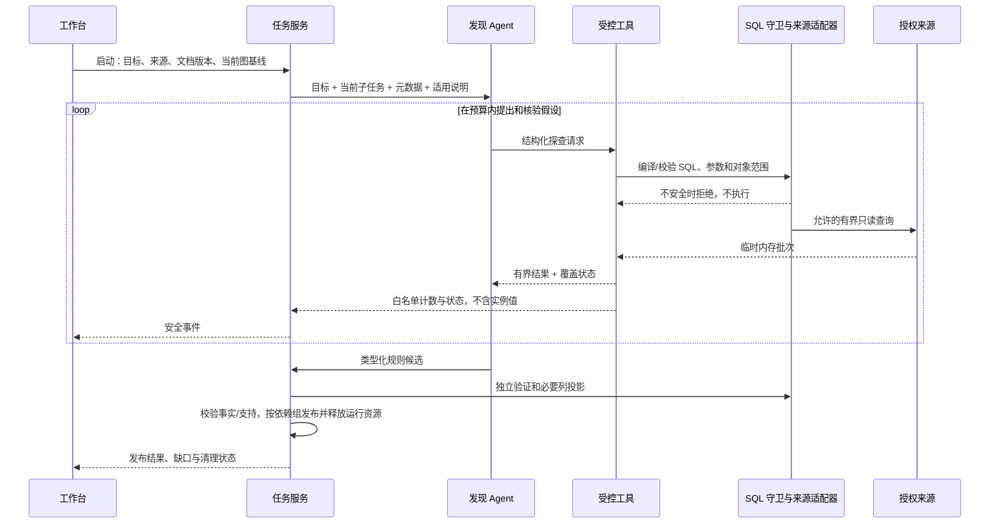
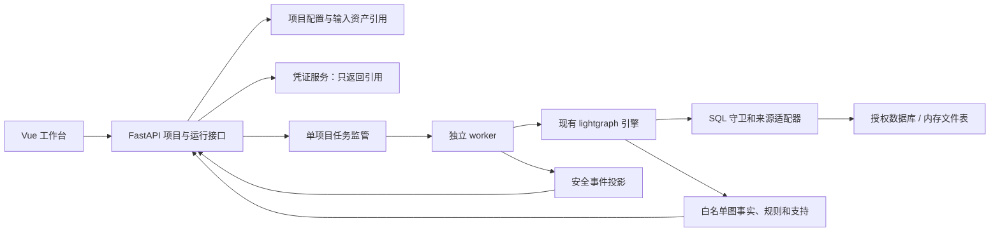

# 数据抽取工作台：交互与接入设计

原设计日期：2026-10-20。2026-10-21 已实现 Vue 3 工作台与真实 FastAPI 项目服务，源码位于 `src/workbench/` 和 `src/lightgraph/web/`。实际接口、workspace 文件布局、运行状态和功能边界以 [工作台实现](WORKBENCH_IMPLEMENTATION.md) 为准。下文保留完整目标设计，未实现部分不能视为本轮交付；旧合成原型只用于历史对照。

2026-10-22 交互调整：配置阶段单独管理数据接入、知识文档、目标与 Agent，运行阶段只展示图与运行记录。当前实现支持会话内直接输入凭据、连接测试、选表与 YAML 预览；下文六页签和持久凭据引用属于旧设计，当前行为以实现文档为准。

配套：[工作台用户故事](WORKBENCH_US.md)、[原型说明](../../src/lightgraph/workbench_prototype/README.md)、[引擎实施记录](../../IMPLEMENTATION_STATUS.md)。实体身份、文档范围、查询权限和发布规则沿用 [SDD](SDD.md)，本文不另设一套图模型。

## 1. 本轮交付和现有能力

本轮交付页面流程、接口与数据契约、可操作的合成原型。原型不连接数据库、不调用模型，不把“开始演示”视为真实抽取。配置仅保存在页面内存，刷新后恢复合成初始状态。

| 范围 | 当前引擎 | 工作台需要新增 |
| --- | --- | --- |
| 抽取目的 | `ExtractionGoal`；发现、修订和文档抽取调用注入目标 | 目标编辑、校验、版本及运行前确认 |
| 数据来源 | Gauss、Excel、CSV 混合输入与授权表列目录 | 连接引用、资产上传、选表、格式配置 |
| Markdown | 用途与范围独立；全局、来源、表列和章节范围 | 默认全局的绑定编辑器、有效范围预览 |
| 元数据 | 声明与语义解释 YAML；表、列、约束及关系 | 目录浏览、解释对照、表列图与双表关系定位 |
| Agent | 原生工具循环、SQL 守卫、预算与候选规则编译 | 不含样本的过程摘要、覆盖与未决展示 |
| 业务图 | 稳定实体、属性支持、关系、导出 HTML、层级入口视图 | 统一项目内的业务图浏览与详情 |
| 增量 | 同一结果库复用规则、重查关键投影、按支持对账 | 显示已有图、运行基线和更新影响 |
| HTTP 服务 | 当前无 FastAPI 项目服务、上传 API 或任务服务 | 全部 `/api/v1` 接口、任务监管与安全事件通道 |

现有 `presentation/viewer.html` 已能展示导出图，当前缺口是工作台集成、在线查询接口与过程交互。不能把“上传元数据成功”标成“图谱抽取成功”，也不能把原型演示作为新增后端能力的验收。

## 2. 对原内网方案的调整

| 原方案 | 统一后的决定 |
| --- | --- |
| 项目只有 name/description | 增加独立 `goal`。项目简介说明用途，抽取目的直接参与模型调用与依赖版本 |
| 数据库模式与“纯 Excel”互斥 | 一个项目可同时选择多连接、工作簿和 CSV；每张表必须带来源身份 |
| `yamlFiles[tableName]` | 使用稳定 `table_ref`；不同来源/schema 的同名表不能覆盖 |
| Markdown 仅上传、预览、编辑 | 增加用途与适用范围；未声明范围时默认全局，可绑定多张具体表 |
| 浏览器编辑 YAML 后 PUT 整个项目 | 原声明只读，由后端采集并保存；用户修正作为独立说明/覆盖建议，带出处与修订 |
| 前端拿到 YAML 再 autoSave 才持久化 | 后端成功采集即保存版本；刷新页面读取已保存结果，不依赖第二次前端请求 |
| 密码跟项目一起写 `store.json` | 项目只存 `credential_ref`；凭证独立管理，查询项目与复制项目均不回传密码 |
| 表未找到自动回退到 `dm_fin` | 明确报告未找到；用户从授权候选中选择实际 schema，形成显式变更 |
| 导入默认对每表 `COUNT(*)` | 导入先读取声明；行数允许“未知/估计”，确有需要时运行有预算的统计，标明来源 |
| Excel 在浏览器通过 CDN 解析 | 浏览器上传授权输入文件，受限 worker 内存解析；正式构建打包依赖，支持内网离线 |
| 三份旧 YAML 为唯一模型 | 内部采用当前声明/解释目录；旧三份 YAML 可作为兼容导出，不能丢失来源与未知约束状态 |
| `start.bat` + 长请求执行抽取 | 增加任务管理、独立运行进程、状态与取消；Web 请求不承担整个抽取生命周期 |
| 继承已有项目按钮 | 同项目继续构建纳入首期 Web 设计；跨项目继承另列后续 US，首期禁用 |

Vue 3、Vite、Pinia 和 FastAPI 可沿用为正式工作台选型；业务服务调用现有 Python 包，不另写一套抽取逻辑。当前引擎使用 `psycopg`，新服务复用 `GaussSource`；附件所述 `psycopg2` 连接经验不能替代当前适配器在客户版本上的验证。

## 3. 页面结构与主要操作

工作台保留浅色三栏布局：项目侧栏、主工作区、按需展开的详情栏。项目侧栏宽 240px，可收起；顶栏显示项目、草稿保存状态、当前发布与运行入口。详情栏只在选中表、规则或节点时出现。

项目内采用六个页签：

| 页面 | 用户在这里完成什么 |
| --- | --- |
| 项目目标 | 编辑抽取目的、包含/排除内容，查看本次是否基于已有图更新 |
| 数据与文档 | 管理混合来源、授权表、文件格式、Markdown 用途与范围；查看声明和解释 |
| 发现过程 | 查看 Agent 正在验证的假设、调用的工具、守卫结果、预算与未决原因 |
| 元数据图 | 从来源/表展开到列，定位跨表列关系，区分声明、技术核验与语义候选 |
| 业务图 | 浏览已发布实体及关系、候选主张、属性支持和指定入口层级 |
| 运行记录 | 查看历次配置版本、运行结论、发布变化、覆盖缺口与清理状态 |

页面切换不取消真实后台任务。重连后以服务端运行状态为准，不按浏览器定时器推算完成；浏览器断开也不代表抽取失败。

### 3.1 目标页

抽取目的为必填多行文本，例如：

> 构建经营分析所需的指标、度量和组织维度图，保留定义、别名和层级关系，不抽取具体收入、成本等观测金额。

紧随其后配置“希望包含”“希望排除”和可选发现提示。高级设置收纳实体类别、来源范围、排除列和仅作判断依据的列。普通用户不必预先列出所有关键列。

“保存草稿”只保存配置；“开始发现与构建”先校验目标、授权来源、有效文档绑定与模型运行模式，再创建不可变运行配置。目的不能为空，项目简介不能自动充当目的。用户选择仅处理文档时，不要求存在结构化来源，但要明确本次范围。

目标变化使相关解释和规则依赖失效。运行期间修改的是下一次草稿，当前任务始终使用启动时的目标版本。界面显示“运行使用版本 5；草稿版本 6”。

### 3.2 数据与文档页

数据来源以列表显示，可并存数据库、Excel 和 CSV。数据库添加动作分成“验证连接与权限 → 选择授权表 → 读取元数据”，不会自动执行实例抽取。Excel 每张有效工作表成为一张表；CSV 必须填写编码、分隔符、表头、NULL 标记，当前按文本解析。

“上传数据库选表清单”只用于选择已授权的库表；“上传 Excel/CSV 数据”才创建文件来源，二者用不同入口和资产类型。不能将一个表名清单误解析为业务实例数据。

表清单显示来源、schema、表名、字段数、声明版本和解释状态；行数附“估计/精确/未知”，不能统一写成精确值。选中表后，右侧提供“声明”“语义解释”“适用说明”：

- 声明：原字段名、类型、注释、组合主键/唯一键/外键及约束读取范围，只读。
- 语义解释：候选列角色、已验证角色、冲突代码、相关规则；原注释与解释并排。
- 适用说明：当前表将使用哪些全局/绑定章节，列出用途与修订；不显示模型实际含样本请求。

当前连接器已支持授权范围内的主键、唯一键和外键；`check/default/constraint_state` 在目录中仍标为 `unknown`。未读取、未授权和确认不存在分别展示，不能把 unknown 渲染为“无约束”。

手工纠错在“补充表说明”中完成，生成有来源的说明修订。用户提供的映射建议仍需经过授权和核验；不允许直接编辑物理声明后冒充数据库约束。

知识文档列表显示名称、用途、范围、修订及绑定状态。选中文档后可编辑正文和：

1. **用途**：待分类、数据说明、分析知识、混合用途。范围默认全局不意味着内容默认是定义证据；未分类内容先作为探索指引。
2. **范围**：全局、指定表。新上传文件未声明范围时默认全局。
3. **指定表**：按来源分组的多选器，支持多表；来源 ID、schema、表名共同定位。
4. **章节设置**：高级功能，按完整标题路径继承或收窄范围。

上传文件已有显式 front matter 时保留其声明，并在界面显示解析结果；不得自动扩大为全局。指定表但一个都没选、绑定失效、短名有歧义时禁止用于运行，显示需修正项。界面配置与 Markdown front matter 采用一个服务端规范化版本，不能出现两套互相覆盖的绑定。

“全局”表示在本项目当前授权分析范围内适用，不能扩大数据权限。绑定 A 表的说明在单独分析 B 表时不注入；A/B 联合分析时两边的适用说明都注入。分析知识可指导探索，但不能单独批准实体合并或父子关系。

### 3.3 发现过程页

按“元数据认知 → 假设与探查 → 规则核验 → 图事实发布 → 清理”展示运行阶段。每个步骤只呈现安全摘要：

- 本次目的与涉及表；
- 任务问题，如“编码是否唯一对应中文名称”；
- 工具、查询范围与守卫判定；
- 允许公开的计数、覆盖、截断状态与耗时；
- 候选规则、拒绝/延期原因、下一步动作；
- 预算已用与剩余。

不转发模型思维过程、原始 tool result、SQL 参数或样本。实际来源取值也不能放进异常消息。默认无“预览源数据”或“下载样本”按钮。

UI 中“守卫通过”只说明查询被允许执行；“引用覆盖通过”只说明统计关系；“业务关系已发布”还要求语义依据、端点和发布检查通过。三种状态分别展示。

### 3.4 元数据图

默认按表折叠。展开后直接看到表到列的包含关系与列到列的连线，避免只显示表间一根汇总线。选择 A.a 的关系应同时定位 B.c，详情显示：

- 两端完整来源、表、列；
- 关系类别：声明外键、已核验引用、同语义角色候选等；
- 技术核验状态与语义状态；
- 规则、文档和发布依据的引用；
- 覆盖范围、未匹配/歧义计数及是否完整。

技术关系的 `unresolved` 不因前端配色变成业务确认。同名列、值域碰撞和同为“中文名”都不自动授权 JOIN。组合外键以一组连线表示，保留成员顺序，不能拆成几条独立可用的外键。

来源/schema 可作为容器分组；当前元数据导出未独立生成某种容器节点时，由图投影层明确生成显示分组，不伪造业务事实。关系筛选、双表对照、邻域展开与图例始终可见。正式版本采用服务端有界子图查询；界面提示“已显示/可见总量/截断”，不能静默丢节点。

### 3.5 业务图

显示稳定的指标、度量、维度、成员或其他已注册实体类型。候选主张单独筛选；默认计数仅统计当前授权可见的已接受业务实体。

节点详情展示名称、编码、别名、属性、父子/依赖关系及每项支持来源。多个来源引用同一实体时增加支持，不为每个来源再建同名点；名称相同但身份未确认时保留独立对象或候选，不用界面去重掩盖问题。

“以此为入口”调用只读层级视图。一个在某条路径处于 L3 的实体可在当前视图显示为深度 0；其 ID 和原父子事实不变。体系、期间和业务条件作为视图过滤条件，不能合并成一棵无上下文的大树。

## 4. Agent 如何自主发现关键列



关键列不是由前端勾选表头关键词直接决定。Agent 可以先发现某列名与样本不符，再检查列组的 FD、重复分布、引用或层级，最后提交规则；程序验证规则并对必要列联合 DISTINCT，避免逐行调用模型。

### 4.1 工具能力与当前实现对应

| 能力 | 当前调用路径 | 产出及边界 |
| --- | --- | --- |
| 读授权元数据 | `get_metadata` | 表列、约束和稳定列引用；不读取任意系统对象 |
| 读适用说明 | `search_knowledge` | 完整适用章节与出处；不放宽权限 |
| 单列画像 | `profile_columns` | 空值、基数等受控计数；精确统计可能扫描全表 |
| 联合 DISTINCT、组合分析 | `execute_readonly_sql` + 编译器 | 对实际组合去重；不把多个单列集合做笛卡尔积 |
| 编码→名称/属性关系 | `check_fd` | 函数依赖、冲突和空键计数；不直接证明业务身份 |
| 同源/跨源引用 | `check_reference` | 复合键、NULL、覆盖、歧义与快照完整性 |
| 少量样本 | `execute_readonly_sql` 的有界 SELECT | 仅内存用于认知；少量样本不能代表全量验证 |
| 层级与反例核验 | 已有规则执行器、T5 修订 | 缺层、填充、方向、环、多父；专用 Agent 工具封装列入下一阶段 |
| 分层样本/组合画像 | 现有底层算子及受控 SQL可组合；不是全部已公开为独立工具 | 后续封装 `sample_stratified`、`profile_column_group`，返回覆盖而非无条件宣称代表性 |
| 漂移与复用 | 依赖指纹、模式核验、按表完成状态 | 同目标/结构/文档且模式成立可复用规则；变化定向复核 |

SQL 文本中含业务值时只在 worker 内存中存在。所有样本类型均受 `model.mode` 约束；`metadata_only` 不允许工具查询实例或统计后发送给模型。程序后续全量规则验证与模型看到的数据是两个范围，界面分别标明。

自动跨表发现当前最多接纳 64 张参与表和 64 个已验证实体端点，超限明确延期；表内发现按 prompt 预算分目录窗口，不因目标表位于第 65 张就跳过。前端显示范围和缺口，不把局部成功解释为全部完成。

### 4.2 SQL 守卫

守卫位于后端工具与驱动执行入口。Agent 生成的 SQL、规则编译的 SQL、统计/样本/跨表查询走同一受控入口；不能给某个“统计辅助工具”直接访问驱动的旁路。

1. 解析完整语句，恰好一条；当前只允许受控 SELECT、UNION/INTERSECT 及非递归只读 CTE。
2. 递归校验 AST，不依赖开头为 SELECT 或简单删关键词。拒绝 INSERT、UPDATE、DELETE、MERGE、DDL、TRUNCATE、COPY、CALL/DO、SELECT INTO、数据修改 CTE、锁及未注册语法。
3. 对每个对象、列、别名、子查询、JOIN、HAVING、ORDER 表达式执行授权检查；当前 JOIN 限于受控等值形式，拒绝未授权 schema、隐式通配符、OFFSET 和无限制笛卡尔积。
4. 函数采用允许列表，拒绝未知 UDF、文件/网络/会话状态/副作用函数。`SELECT` 语法本身不是只读保证。
5. 值通过参数绑定；守卫不能通过改写有害 SQL 的片段使其“勉强可执行”，不通过时整条拒绝。
6. 来源使用最小权限只读账号、受控只读事务、超时、取消、结果行/字节和工作内存上限。`LIMIT` 不能限制数据库扫描成本。
7. 元数据采集使用程序持有的固定目录查询与授权过滤；连接初始化、只读事务控制由适配器负责，Agent 无权执行会话管理命令。

跨数据库不执行任意联邦 SQL。两端分别在各自授权来源执行 DISTINCT 与核验，再做受限内存比较。只能确认各来源自身快照一致，不能声称分布式同一时点；任一端不完整就未决，不以缺失作为撤回依据。

**历史审计问题及当前状态**：原型评审曾复现 SQL 守卫拒绝 EXPLAIN 前，第三方解析器先向 logger 输出 SQL 全文。后续 AgentScope 迁移已在解析器 fallback 记录警告前拒绝语句，并通过含 canary 的拒绝路径日志测试。正式 worker 尚未实现，接入时仍须验证驱动日志、事件、异常及 HTTP/SSE 响应均不泄露原文；引擎测试不能替代服务端到端验收。

### 4.3 样本与运行资源生命周期

执行政策比“结束后删文件”更严格：查询返回行、样本、distinct 元组、原始画像、含样本的 prompt/response **从开始就不持久化**。批次用完即释放；任务结束再关闭游标、连接、临时内存库与模型上下文。

| 内容 | 是否可保留 | 位置与规则 |
| --- | --- | --- |
| 用户主动上传的 Excel/CSV/Markdown | 可按输入资产策略保存 | 客户批准的输入区；不混入项目 JSON，不自动转成数据库查询缓存 |
| 元数据声明、规范化目标、文档绑定 | 可保存 | 项目配置/元数据版本库，不含凭证 |
| 数据库返回行、抽样、DISTINCT 原始元组 | 不可保存 | worker 有界内存；不发送浏览器，不进日志/任务队列/断点 |
| 模型原始请求/响应及 SQL 参数 | 不可保存 | 仅运行内存；异常、重试、流式路径同样适用 |
| 验证过的图事实、规则、支持与文档主张 | 可保存 | 现有白名单结果库与版本化产物 |
| 安全计数、错误码、资源释放记录 | 可保存 | 类型化事件与运行报告；不得接受任意 dict/原始 error 字符串 |

正式服务一项任务使用独立 worker 进程。成功、失败、取消、超时都执行清理；进程崩溃时监管器终止/回收剩余资源并重新读取发布记录。浏览器关闭不触发“误取消”。

`cleanup_state` 独立记录 `pending / released / unknown / failed`。应用只能报告已释放运行资源，不能声称已对 Python 字符串做密码学擦除。进程退出也不能证明数据库查询已终止，远端取消/连接回收需要确认；无法确认时标 unknown。禁用含样本的 APM、代理正文日志、持久化临时文件与崩溃转储，并在客户环境核验 swap、驱动和模型服务保留策略。

## 5. 已有图谱与增量交互

首期正式工作台设计支持同项目、同隔离域、同一结果库继续运行。页面打开即可看到当前图，无需先清空；启动时默认“基于当前图更新”。冻结当前配置版本和可见 head 集合作为运行基线。

更新后分别显示新实体、新支持、属性/关系变化与撤回支持。例如 A、B 两个来源支持同一指标，撤回 A 只移除 A 的支持，B 仍支持的实体与属性保留。不能用简单“新旧节点数差值”代表这些变化。

运行失败/截断不自动删除旧图；目标或依赖变化导致旧解释失效时，应显示“上一发布仍可查，当前结果待重建”，不能把过期结果冒充新目标结果。运行过程中已有图与尚未发布候选分别展示。

取消发生在提交前时终止候选发布；提交后再取消不能把事实标为已回滚。当前引擎按依赖组原子发布，元数据、业务和文档不是一个全运行大事务，因此 UI 按实际发布组和阶段报告，不能承诺“取消整次运行等于全部恢复”。同项目单写者，重复开始使用幂等键，已有活动任务时返回现有运行或 409。

**后续预留**：跨项目继承、把任意导入图作为可继续抽取的基线、跨隔离域迁移。现有 `import-graph` 只面向空库恢复图事实，不能恢复源连接、规则执行状态与源快照，不能包装成“继承后直接增量”。原型显示预留入口和原因，用户故事单独列验收条件。

## 6. 正式前后端架构



代码目录沿用“全部源码放在 src”：

```text
src/
  lightgraph/                 # 现有引擎
    workbench_prototype/     # 本轮合成原型，独立于正式服务
    web/                     # 待开发：HTTP models/routes/jobs/events
  workbench/                 # 待开发：Vue/Vite/Pinia 客户端
design/lightweight_graph/
  WORKBENCH_DESIGN.md
  WORKBENCH_US.md
```

正式客户端可继续使用 5173，API 可使用 3001，均可配置。开发默认绑定 loopback。内网多人部署必须增加服务端身份认证、项目权限和来源授权校验；浏览器提交的 scope 不能自行授予权限。行权限由账号及数据库支持的行级机制实施并实测。当前 `GaussSource` 仅接收 BASE TABLE，授权视图须在专门评估执行安全和适配后开放，不能在本期界面中假称已支持。

配置存储使用带事务与版本号的项目库，独立于 `GraphStore` 白名单结果库。可以同用 SQLite 技术，但项目服务不得绕过结果存储把任意配置 JSON 塞进图事实。不得将原附件的全量 `store.json` 直接作为并发运行的权威状态。

## 7. API 与数据契约（均待开发）

### 7.1 对象职责

| 对象 | 核心字段 |
| --- | --- |
| Project | `id, name, description, config_revision, isolation_domain, current_graph_ref` |
| GoalRevision | `revision` + 现有 `ExtractionGoal`，目的独立于项目简介 |
| SourceBinding | `source_id, kind, credential_ref/asset_ref, authorized_table_refs, format_options, revision` |
| TableRef | `{source_id, schema, table}`；外部可用服务端生成的不透明 ID，禁止拼文件路径 |
| DocumentRevision | `id, revision, asset_ref, purpose, scope, section_overrides, binding_status` |
| MetadataRevision | 当前 `DeclaredCatalog`、`SemanticCatalog` 与两者依赖，不新增冲突的 YAML 主模型 |
| Run | `run_id, config_revision, goal_revision, catalog_revision, document_revisions, baseline_graph_ref, lifecycle, outcome, publication_state, cleanup_state` |
| GraphView | 授权范围、选定发布/head 集合、图层、筛选、节点/边、分页与覆盖 |
| SafeEvent | `event_id, run_id, stage, tool_name, table_refs, guard_decision, code, safe_counts, coverage, elapsed_ms` |

Run 只存不可变配置/文档/元数据引用和安全状态，不存模型上下文。凭证输入为 write-only，展示只返回“已配置/缺失/不可用”。复制项目只复制配置草稿，重新绑定授权凭证和来源；不能复制秘密或冒认原图的支持。

### 7.2 接口

| 方法与路径（`/api/v1`） | 用途与约束 |
| --- | --- |
| GET/POST `/projects` | 列出授权项目/创建项目 |
| GET/PATCH `/projects/{id}` | 读取或修改项目基本信息，PATCH 要求 `If-Match` |
| PUT `/projects/{id}/goal` | 保存完整目标修订，目的非空；返回新版本 |
| POST `/projects/{id}/sources` | 添加连接引用或输入资产，校验来源身份和允许范围 |
| POST `/projects/{id}/sources/{sid}/check` | 连接/能力预检；不把失败异常正文透传 |
| GET `/projects/{id}/sources/{sid}/tables` | 授权表列表；选表不是扩大连接权限 |
| POST `/projects/{id}/assets` | 有大小/格式上限的上传；返回资产引用，文件名不决定服务端路径 |
| POST/PATCH `/projects/{id}/documents[/{did}]` | 上传引用、用途、绑定与正文修订统一提交；无范围默认全局 |
| POST `/projects/{id}/catalog-refreshes` | 异步读取授权声明，后端落版本并返回 job 引用 |
| GET `/projects/{id}/metadata` | 读取声明与解释目录，支持指定修订 |
| POST `/projects/{id}/runs` | 指定 config revision/baseline 创建运行；要求幂等键 |
| GET `/projects/{id}/runs[/{rid}]` | 运行列表/详情，区分发布、运行结论和清理 |
| POST `/projects/{id}/runs/{rid}/cancel` | 幂等请求取消；返回 cancelling，不提前伪报 cancelled |
| GET `/projects/{id}/runs/{rid}/events` | SSE 安全事件；断线按 event_id 重连，无原始模型/样本 |
| GET `/projects/{id}/graph` | 按 layer、publication、focus、relation/status 查询有界授权子图 |
| GET `/projects/{id}/entities/{eid}` | 返回当前权限下的属性、关系及支持 |
| POST `/projects/{id}/hierarchy-view` | 按 `HierarchyView` 查询，只读，根变化不启动抽取 |
| POST `/projects/{id}/exports` | 从已授权发布投影生成导出，禁止客户端传服务器输出路径 |

契约补充：

- 元数据刷新在服务端完成“采集→保存修订→返回”，浏览器刷新不会丢 YAML。
- PATCH/PUT 使用 `If-Match`；过期返回 412，用户比较差异后重试，不全量覆盖其他页面的配置。
- 无效绑定、格式与目标返回 422；活动写任务冲突返回 409；资源不足返回结构化状态及未覆盖范围。
- API 仅接受声明的字段，拒绝客户端设置 `accepted`、发布状态、来源能力已验证等内部结果。
- 图查询、搜索、计数、详情与导出使用同一服务端授权投影。游标绑定图版本及过滤条件，避免翻页混入另一发布。
- Markdown 预览需转义/净化 HTML，禁用脚本、危险 URL 与自动远程资源；所有前端依赖本地打包。项目名、列注释、图标签均按不可信文本渲染。

### 7.3 状态展示

运行生命周期：`queued → preparing → running → finalizing → terminal`，可进入 `cancelling`。任务服务管理生命周期，`outcome` 使用引擎报告的 `COMPLETED / COMPLETED_WITH_GAPS / PARTIAL / FAILED`，另有服务状态 `PENDING / CANCELLED / INTERRUPTED`，不能伪造引擎已验证结果。`publication_state` 按依赖组记录 `none / staged / published / rejected`，`cleanup_state` 为 `pending / released / unknown / failed`。

界面同时显示：

- **执行结论**：完成、有缺口、部分完成、失败、已取消或中断；
- **发布情况**：未发布、已发布的依赖组、尚待处理的组及发布 ID；
- **资源清理**：待清理、已释放、待核验或失败；
- **覆盖范围**：已完成、未决、延期、未访问的表和任务。

启动后刷新、多个浏览器同时修改、模型超时、源连接失败、发布后清理失败、SSE 断线、worker 被终止，都必须按这四类信息恢复，不能只显示一个绿色“成功”。

## 8. 原型验收与后续开发

原型验证目标编辑、默认全局/多表文档绑定、混合来源选择、发现开始/取消、两类图切换及节点详情、入口层级变化和运行记录。数据全部合成，按钮清楚标注演示；没有真实密码输入、样本上传或模拟安全成功冒充真实判定。

正式开发按 [工作台 US](WORKBENCH_US.md) 分阶段交付，先实现配置与版本接口，再接真实 worker 和安全事件，最后接在线图查询与同项目增量。跨项目继承保留为后续事项。

本轮浏览器交互验证与静态检查记录在 [原型说明](../../src/lightgraph/workbench_prototype/README.md)。真实 SQL 守卫、取消、增量发布及保留策略仍应使用引擎测试和客户环境验收，不以页面按钮可点击为通过依据。

## 9. 本轮代码核对入口

| 事实 | 对应实现 |
| --- | --- |
| 目标和运行配置 | [contracts.py](../../src/lightgraph/contracts.py)、[runtime/config.py](../../src/lightgraph/runtime/config.py) |
| 全局/表列/章节文档范围 | [documents/core.py](../../src/lightgraph/documents/core.py)、[context.py](../../src/lightgraph/context.py) |
| 实际工具与逐轮调用 | [discovery/tools.py](../../src/lightgraph/discovery/tools.py)、[discovery/agent.py](../../src/lightgraph/discovery/agent.py) |
| SQL AST 与驱动前复核 | [query/guard.py](../../src/lightgraph/query/guard.py)、[sources/gauss.py](../../src/lightgraph/sources/gauss.py) |
| 批次与来源生命周期 | [sources/base.py](../../src/lightgraph/sources/base.py)、[cli.py](../../src/lightgraph/cli.py) |
| 元数据版本与图投影 | [catalog.py](../../src/lightgraph/catalog.py)、[metadata.py](../../src/lightgraph/metadata.py) |
| 增量发布与授权支持 | [pipeline.py](../../src/lightgraph/pipeline.py)、[store/sqlite.py](../../src/lightgraph/store/sqlite.py) |
| 现有图导出、导入与层级入口 | [presentation/export.py](../../src/lightgraph/presentation/export.py)、[presentation/importer.py](../../src/lightgraph/presentation/importer.py)、[rules/views.py](../../src/lightgraph/rules/views.py) |


## 运行时同步说明（2026-10-20）

后端引擎已将关键列发现迁到 AgentScope，支持独立模型配置与模型 JSON/SSE 两种传输；详见 [接入设计](AGENTSCOPE_RUNTIME.md)。工作台接入时应复用这条路径。模型 SSE 与页面任务事件是两个接口，本次没有实现 Web worker、浏览器 SSE 或实时模型正文展示。此前发现的 SQLGlot 不支持语句警告回显问题已在引擎守卫中修复，正式服务的端到端日志与数据保留验收仍按 WBF-07/08 执行。
